# MATLAB Lab Notebook

**Course:** ENGR60 — Programming & Problem-Solving in MATLAB
**Name:** Alexandra Yakovleva
**Started:** September 7 4, 2026

---

## Table of Contents

- [Lesson 1 Slides: About MATLAB](#lesson-1-slides-about-matlab)
- [Week 1 — Lab 1](#week-1--lab-1)
- [SDC Chapter 1 — Intro MATLAB](#sdc-chapter-1--intro-matlab)
  - [1.1 The MATLAB Screen](#11-the-matlab-screen)
  - [1.2 Entering Commands](#12-entering-commands)
  - [1.3 Preferences & Number Format](#13-preferences--number-format)
  - [1.4 Using Help](#14-using-help)
  - [1.5 Clearing the Command Window & Workspace](#15-clearing-the-command-window--workspace)
  - [1.6 Unit Conversion Example: Loading a File](#16-unit-conversion-example-loading-a-file)
  - [1.7 A First Look at Variables](#17-a-first-look-at-variables)
  - [1.8 Saving a Variable & Command History](#18-saving-a-variable--command-history)
  - [1.9 Built-in Statistical Functions](#19-built-in-statistical-functions)
  - [1.10 Terminal Velocity Example: Creating a Script](#110-terminal-velocity-example-creating-a-script)
  - [1.11 Running a Script, Saving & Closing](#111-running-a-script-saving--closing)
- [SDC Chapter 1 — Exercises](#sdc-chapter-1--exercises)
- [Week 2 — Lab 2](#week-2--lab-2)
  - [Arrays (Chapter 2)](#arrays-chapter-2)
  - [Polynomial Roots](#polynomial-roots)
  - [Plotting with MATLAB (Chapter 5)](#plotting-with-matlab-chapter-5)
  - [Script Files](#script-files)
  - [Narrative — Projectile Motion](#narrative--projectile-motion)
- [SDC Chapter 2 — Operators, Variables & Data Types](#sdc-chapter-2--operators-variables--data-types)
  - [2.1 Operators](#21-operators)
  - [2.2 Variables & Precedence](#22-variables--precedence)
  - [2.3 Variable Naming & Classes](#23-variable-naming--classes)
  - [2.4 Integer & Floating-Point Types](#24-integer--floating-point-types)
  - [2.5 Numerical Functions & Rounding](#25-numerical-functions--rounding)
  - [2.6 Strings & Character Arrays](#26-strings--character-arrays)
  - [2.7 Importing Data (VCF Files)](#27-importing-data-vcf-files)
- [SDC Chapter 2 — Exercises](#sdc-chapter-2--exercises)
- [Home Loan Assignment](#home-loan-assignment)
- [SDC Chapter 3 — Programming Basics: Arrays, Structures & Tables](#sdc-chapter-3--programming-basics-arrays-structures--tables)
  - [3.1 Arrays, Matrices, Vectors & Scalars](#31-arrays-matrices-vectors--scalars)
  - [3.2 Growing Arrays & the Empty Array](#32-growing-arrays--the-empty-array)
  - [3.3 Matrix Basics & Size](#33-matrix-basics--size)
  - [3.4 Strings as Matrices](#34-strings-as-matrices)
  - [3.5 The Colon Operator](#35-the-colon-operator)
  - [3.6 Indexing with Colon & End](#36-indexing-with-colon--end)
  - [3.7 Reshaping & Array Functions](#37-reshaping--array-functions)
  - [3.8 Cell Arrays](#38-cell-arrays)
  - [3.9 Structures](#39-structures)
  - [3.10 Structure Arrays](#310-structure-arrays)
  - [3.11 Creating Tables](#311-creating-tables)
  - [3.12 Table Properties](#312-table-properties)
  - [3.13 Accessing & Adding Table Data](#313-accessing--adding-table-data)
  - [3.14 Table Conversion Functions](#314-table-conversion-functions)
- [SDC Chapter 3 — Exercises](#sdc-chapter-3--exercises)
- [SDC Chapter 4 — Looping & Conditionals](#sdc-chapter-4--looping--conditionals)
  - [4.1 Using the MATLAB Editor](#41-using-the-matlab-editor)
  - [4.2 Loops & Algorithms](#42-loops--algorithms)
  - [4.3 while Loops](#43-while-loops)
  - [4.4 for Loops](#44-for-loops)
  - [4.5 Step Values & Index Arrays](#45-step-values--index-arrays)
  - [4.6 if & if-else Statements](#46-if--if-else-statements)
  - [4.7 if-elseif-else & switch Statements](#47-if-elseif-else--switch-statements)
  - [4.8 Terminal Velocity with Conditionals](#48-terminal-velocity-with-conditionals)
  - [4.9 Loops & Conditionals: Make a Negative](#49-loops--conditionals-make-a-negative)
  - [4.10 Exiting a Loop](#410-exiting-a-loop)
  - [4.11 Stopping an Infinite Loop](#411-stopping-an-infinite-loop)
- [SDC Chapter 4 — Exercises](#sdc-chapter-4--exercises)
- [SDC Chapter 5 — Matrices](#sdc-chapter-5--matrices)
  - [5.1 What Is a Matrix?](#51-what-is-a-matrix)
  - [5.2 Special Matrices: Diagonal, Identity, Magic](#52-special-matrices-diagonal-identity-magic)
  - [5.3 Creating Test Matrices & Random Numbers](#53-creating-test-matrices--random-numbers)
  - [5.4 Array Math: Addition & Subtraction](#54-array-math-addition--subtraction)
  - [5.5 Element-wise (Dot) Operators](#55-element-wise-dot-operators)
  - [5.6 Scalar Math Operations](#56-scalar-math-operations)
  - [5.7 Transposition](#57-transposition)
  - [5.8 Powers & Logical Operations](#58-powers--logical-operations)
  - [5.9 Matrix Multiplication](#59-matrix-multiplication)
  - [5.10 Matrix Division & Inverse Matrices](#510-matrix-division--inverse-matrices)
  - [5.11 Examples: Solving Linear Systems](#511-examples-solving-linear-systems)
- [SDC Chapter 5 — Exercises](#sdc-chapter-5--exercises)
- [SDC Chapter 6 — Functions & Scripts](#sdc-chapter-6--functions--scripts)
  - [6.1 Comment Statements](#61-comment-statements)
  - [6.2 Scripts](#62-scripts)
  - [6.3 Creating & Editing a Script](#63-creating--editing-a-script)
  - [6.4 Making a Script Interactive](#64-making-a-script-interactive)
  - [6.5 Functions: Built-in & Custom](#65-functions-built-in--custom)
  - [6.6 Function File Format](#66-function-file-format)
  - [6.7 From Algorithm to Code](#67-from-algorithm-to-code)
  - [6.8 Return Values](#68-return-values)
  - [6.9 Local Functions](#69-local-functions)
  - [6.10 Variable Scope](#610-variable-scope)
  - [6.11 Recursion](#611-recursion)
  - [6.12 Persistent Variables](#612-persistent-variables)
- [SDC Chapter 6 — Exercises](#sdc-chapter-6--exercises)
- [Object-Oriented Programming in Matlab](#object-oriented-programming-in-matlab)
  - [1.1 Objects: Introduction](#11-objects-introduction)
  - [1.2 Classes: Using a Class](#12-classes-using-a-class)
  - [1.3 Defining a Class](#13-defining-a-class)
  - [1.4 Class Properties](#14-class-properties)
  - [1.5 Class Methods](#15-class-methods)
  - [1.6 Class Example: Seat Reservation System](#16-class-example-seat-reservation-system)
  - [1.7 Operator Overloading](#17-operator-overloading)
  - [1.8 Mutators, Accessors & Private Helpers](#18-mutators-accessors--private-helpers)
  - [1.9 Handle Classes](#19-handle-classes)
  - [1.10 Handle Class Example: Ball Drop](#110-handle-class-example-ball-drop)
- [Object-Oriented Programming in Matlab — Exercises](object-oriented-programming-in-matlab--exercises)
- [Midterm Example](#midterm-example)
- [Numerical Integration](#numerical-integration)
- [SDC Chapter 7 — Debugging & Error Handling](#sdc-chapter-7--debugging--error-handling)
  - [7.1 Syntactic Errors](#71-syntactic-errors)
  - [7.2 Semantic Errors](#72-semantic-errors)
  - [7.3 Using the Debugger: Fixing the Obvious Errors](#73-using-the-debugger-fixing-the-obvious-errors)
  - [7.4 Breakpoints](#74-breakpoints)
  - [7.5 Debug Mode & the Debug Toolbar](#75-debug-mode--the-debug-toolbar)
  - [7.6 Walking a Function](#76-walking-a-function)
  - [7.7 Error Handling: Standardizing & Verifying Input](#77-error-handling-standardizing--verifying-input)
  - [7.8 Try/Catch Blocks](#78-trycatch-blocks)
  - [7.9 Manual Debugging Techniques](#79-manual-debugging-techniques)
  - [7.10 Testing Your Code](#710-testing-your-code)
- [SDC Chapter 7 — Exercises](#sdc-chapter-7--exercises)
- [SDC Chapter 8 — Importing & Exporting Data](#sdc-chapter-8--importing--exporting-data)
  - [8.1 Navigating the File System](#81-navigating-the-file-system)
  - [8.2 File System Functions](#82-file-system-functions)
  - [8.3 Working with .mat Files](#83-working-with-mat-files)
  - [8.4 Importing Delimited Text: readmatrix](#84-importing-delimited-text-readmatrix)
  - [8.5 Import Options: detectImportOptions](#85-import-options-detectimportoptions)
  - [8.6 readmatrix with Excel Spreadsheets](#86-readmatrix-with-excel-spreadsheets)
  - [8.7 Name/Value Pairs](#87-namevalue-pairs)
  - [8.8 readvars & readcell](#88-readvars--readcell)
  - [8.9 The Import Data Tool](#89-the-import-data-tool)
  - [8.10 Exporting: writematrix & writecell](#810-exporting-writematrix--writecell)
  - [8.11 Exporting Formatted Text: fopen, fprintf, fclose](#811-exporting-formatted-text-fopen-fprintf-fclose)
- [SDC Chapter 8 — Exercises](#sdc-chapter-8--exercises)
- [Midterm](#midterm) 
---


## Lesson 1 Slides: About MATLAB

*Source: Matlab_WVC-Lesson1-1 (Lecture 1 slides)*

### Textbooks

- **Required:** *An Engineer's Introduction to Programming with MATLAB 2019*, by Shawna Lockhart & Eric Tilleson
- **Optional:** *Getting Started with MATLAB 5*, by Rudra Pratap
- **Optional:** *Introduction to MATLAB 7 for Engineers*, by Palm

### Purchasing MATLAB Software

- MathWorks website: [mathworks.com](http://www.mathworks.com) — The only option now available for individual student purchase is the $119 per year, a Standard Student Suite, which bundles MATLAB, Simulink, and 11 add-on toolboxes into a single annual subscription-based service
- **Alternative:** Octave (free), available as a PC download or online.

### Outline

1. About MATLAB
2. Basics
3. Computing with MATLAB
4. Arrays and Matrices Operations

### About MATLAB

MATLAB is:

- A computer programming language
- A software environment for using that language effectively

**Two modes of operation:**

- **Interactive calculator mode** — commands typed and executed one at a time
- **Script mode** — execution of complete programs (script files)

Running MATLAB opens one or more windows. The primary one is the **MATLAB Desktop**, the main graphical user interface, which contains and manages all other MATLAB windows. Depending on configuration, some windows may or may not be visible — check the **View** menu.

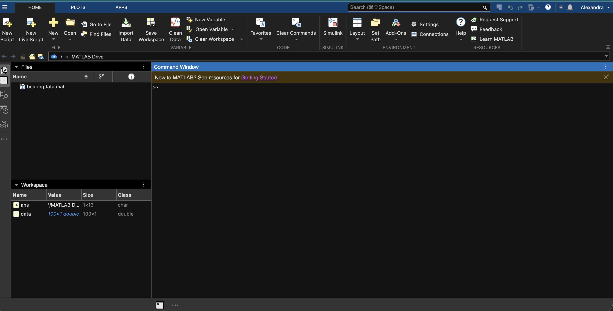

**MATLAB Desktop windows:**

| Window | Purpose |
|---|---|
| **Command Window** | Primary place to interact with MATLAB; the `>>` prompt is where commands are issued (type `quit` or `exit` to close) |
| **Command History** | Running history of prior commands issued in the Command Window |
| **Workspace** | GUI for viewing, loading, and saving MATLAB variables |
| **Launch Pad** | Tree layout for accessing tools, demos, and documentation |
| **Current Directory** | GUI for directory and file manipulation |
| **Help** | GUI for finding and viewing online documentation |
| **Array Editor** | GUI for modifying the contents of MATLAB variables |
| **Editor/Debugger** | Text editor and debugger for MATLAB `.m` files |

### Basics: Basic Operations

| Symbol | Operation | MATLAB form |
|---|---|---|
| `^` | exponentiation: aᵇ | `a^b` |
| `*` | multiplication: ab | `a*b` |
| `/` | right division: a/b | `a/b` |
| `\` | left division: b/a | `a\b` |
| `+` | addition: a + b | `a+b` |
| `-` | subtraction: a − b | `a-b` |

**Examples:**

```matlab
>> 5^2
ans =
    25

>> cos(pi)
ans =
    -1
```

### Basics: Rules of Precedence

| Precedence | Operation |
|---|---|
| First | Parentheses, evaluated starting with the innermost pair |
| Second | Exponentiation, evaluated left to right |
| Third | Multiplication and division (equal precedence), left to right |
| Fourth | Addition and subtraction (equal precedence), left to right |

**Precedence examples:**

```
8 + 3 * 5 = 23            -> (8 + (3 * 5))
4 ^ 2 – 12 – 8 / 4 * 2 = 0 -> ((4^2) – 12 – ((8/4) * 2))
3 * 4 ^ 2 + 5 = 53         -> ((3 * (4^2)) + 5)
27 ^ 1 / 3 + 32 ^ 0.2 = 11 -> (((27^1) / 3) + (32^0.2))
```

*Text reference: page 10*

---

## Week 1 — Lab 1

*Source: Lab1-1 assignment notes*

Your first exercise using MATLAB begins with calculations.

**What is MATLAB?** A numerical computation computer application that basically performs symbolic algebra — computations done in terms of symbols and variables instead of pure numbers.

As shown in the slides, typing into the Command Window:

```matlab
>> 5^2
```

should return `25`.

Once comfortable with the basic operations from the slides, the lab moves on to computations and symbolic algebra in MATLAB (or Octave, if MATLAB isn't installed).

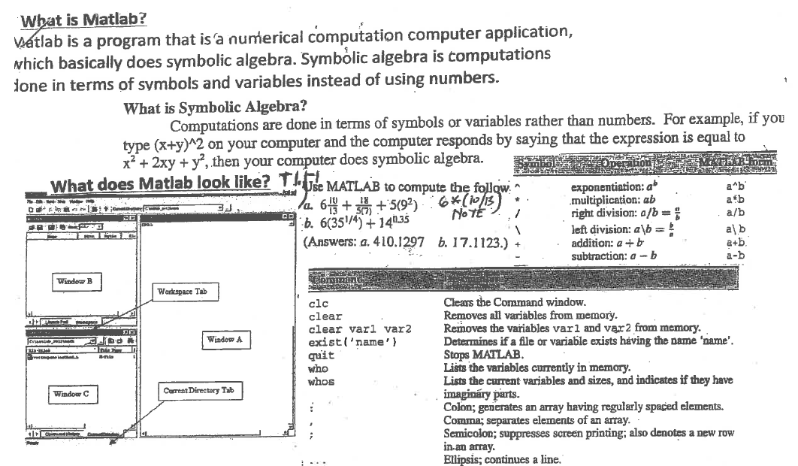

Useful commands to memorize (used frequently throughout the course):

| Command | Action |
|---|---|
| `clc` | Clears the Command Window |
| `clear` | Removes all variables from memory |
| `clear var1 var2` | Removes the variables `var1` and `var2` from memory |
| `exist('name')` | Determines if a file or variable named `'name'` exists |
| `quit` | Stops MATLAB |
| `who` | Lists variables currently in memory |
| `whos` | Lists variables, sizes, and whether they have imaginary parts |
| `:` | Colon — generates an array of regularly spaced elements |
| `,` | Comma — separates elements of an array |
| `;` | Semicolon — suppresses screen printing; also denotes a new row in an array |
| `...` | Ellipsis — continues a line |

### T1-1 — Use MATLAB to compute the following

**a.** $6\left(\frac{10}{13}\right) + \frac{18}{5 \cdot 7} + 5\left(9^2\right)$

```matlab
>> 6*(10/13) + 18/(5*7) + 5*(9^2)
ans =
   410.1297
```

**b.** 6(35^(1/4)) + 14^0.35

```matlab
>> 6*(35^(1/4)) + 14^0.35
ans =
   17.1123
```

---
## SDC Chapter 1 — Intro MATLAB

### Objectives

1. Identify parts of the MATLAB screen.
2. Enter a math expression.
3. Clear the Workspace and Command Window.
4. Work with variables.
5. Use the Help command.
6. Save and load Workspace variables.
7. Show the command history.
8. Use a built in function.

### Summary of functions used in this chapter

| Function / keyword | What it does | Example |
|---|---|---|
| `>>` | command prompt; type here, press **Enter** | `126 + 328` |
| `ans` | auto-made variable for an unassigned result | `ans = 454` |
| `+ - * / ^` | add, subtract, multiply, divide, power | `532 - 33.9123456` |
| `format style` | set display digits (`short`, `long`, `shortE`, `longG`, `bank`, `rat`, ...) | `format long` |
| `format compact` / `loose` | line spacing in the Command Window | `format compact` |
| `help name` | help text in the Command Window | `help format` |
| `clc` | clear the Command Window | `clc` |
| `clear` | clear all Workspace variables | `clear` |
| `load('file.mat')` | load variables from a `.mat` file | `load('bearingdata.mat')` |
| `save('file', 'var')` | save a variable to `file.mat` | `save('bearingdata_grams', 'data_grams')` |
| `min` / `max` | smallest / largest element | `min(data_grams)` |
| `bounds` | smallest and largest, two outputs | `[s, l] = bounds(data_grams)` |
| `mean` / `median` / `mode` | average / middle / most frequent value | `mean(data_grams)` |
| `std` / `var` | standard deviation / variance | `std(data_grams)` |
| `corrcoef` / `cov` | correlation coefficients / covariance | `cov(x, y)` |
| `edit name` | open or create `name.m` in the Editor | `edit terminal_velocity` |
| `%` | comment; not executed | `% Vt = terminal velocity` |
| `;` | suppress display of a line's result | `dia = 2.5;` |
| `pi`, `sqrt` | built-in constant and square root | `sqrt(2*mass*gravity)` |
| `disp(x)` | print a value or text | `disp('cm/s units')` |

### 1.1 The MATLAB Screen

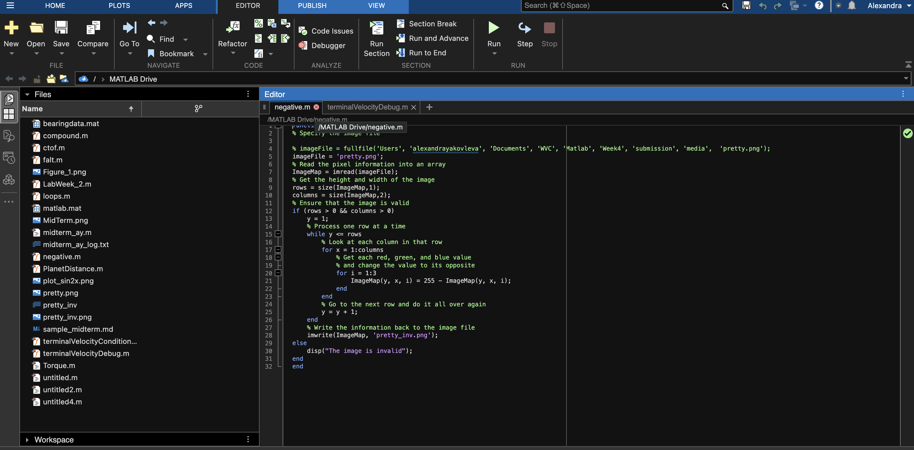

| Part | Where | Does |
|---|---|---|
| Title bar | very top | window controls (close, minimize, maximize) at upper right |
| Quick-access toolbar | below title bar | help icons + search box |
| Ribbon | below that | tabs **HOME**, **PLOTS**, **APPS**; HOME shown by default |
| Command Window | center | type commands at the `>>` prompt |
| Workspace | right (default) | variables and functions in use |
| Current Folder | left | current folder, access files |

> **Tip:** screen looks different $\rightarrow$ your settings aren't the defaults.
> **Tip:** resize/rearrange panels by dragging their borders.

### 1.2 Entering Commands

- Type at the `>>` prompt, press **Enter** to see the result.

```matlab
126 + 328

ans =

   454
```
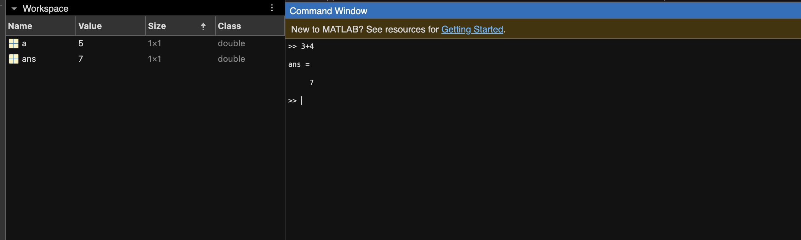

- No variable named $\rightarrow$ MATLAB makes **`ans`** and shows it in the Workspace.

```matlab
532 - 33.9123456

ans =

  498.0877
```

- Real value `498.0876544` is stored with 16 digits. **short** format only *shows* 4 decimals.
- More digits $\rightarrow$ change the display format (prompt or Preferences). Storing more accuracy can slow big calculations.

**Arithmetic operators:**

| Operator | Meaning |
|---|---|
| `+` | addition (plus) |
| `-` | subtraction (minus) |
| `*` | multiplication (times) |
| `/` | division (divide) |
| `^` | power |

> **Tip:** order of math operations: exponentiate, multiply, divide, add, subtract. Use parentheses to group.

#### Key Terms

`>>`, `ans`, arithmetic operators, command prompt, Command Window, variable, Workspace

### 1.3 Preferences & Number Format

**Preferences** dialog $\rightarrow$ default behaviors.

1. **HOME** tab $\rightarrow$ **Preferences**.
2. Left list $\rightarrow$ **Command Window** (Figure 1.3).
3. **Numeric format** drop-down $\rightarrow$ **long**.
4. **Apply** $\rightarrow$ **OK**.

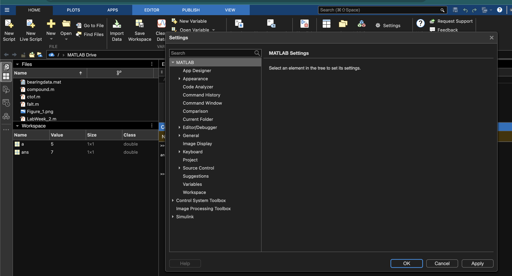

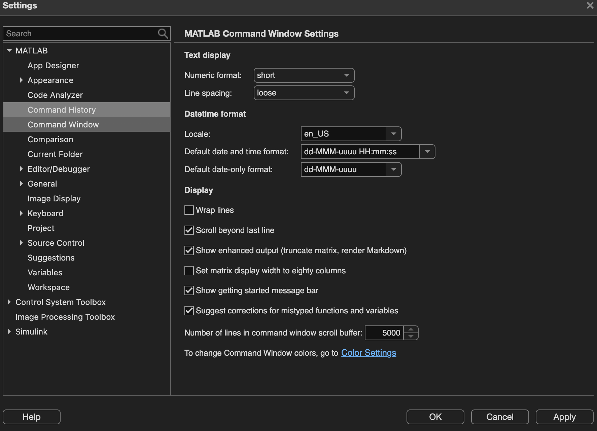

```matlab11/3

ans =

   0.333333333333333
```

- Then set **Numeric format** back to **short** before continuing.

**Same thing from the prompt:**

```matlab
format long
```

- Options: `short`, `long`, `shortE`, `longE`, `shortG`, `longG`, `shortEng`, `longEng`, `+`, `bank`, `hex`, `rat`.
- **Numeric display** `compact` / `loose` $\rightarrow$ line spacing in the Command Window. Compact often useful.

#### Key Commands

`format style`

### 1.4 Using Help

- Commands must be typed **exactly**. Help = invaluable for looking up formats.
- **Help** menu (Figure 1.4): Documentation, Examples, Support Web Site, Community, Request Support, Learn MATLAB, Licensing...

1. Click the **Help** icon (`?`) $\rightarrow$ Help window. Search box upper right.
2. Type `format` into the search box (Figure 1.5).
3. Click **fx format - Set Command Window output display format**.
4. Scroll down for the full list of options (Figure 1.6).
5. Click **X** to close.


**Help from the prompt:**

```matlab
help
```

- Prints a list of topics in the Command Window. Scroll up to see the top (Figure 1.7).
- Click **matlab\general - General purpose commands** $\rightarrow$ look over the list.

#### Key Commands

`help`

### 1.5 Clearing the Command Window & Workspace

```matlab
clc
```

- Command Window now blank. Workspace variables stay.

```matlab
clear
```

- Workspace now blank.
- Both also on the ribbon: **Clear Commands** and **Clear Workspace** (down triangle $\rightarrow$ more options).

#### Key Commands

`clc`, `clear`

### 1.6 Unit Conversion Example: Loading a File

- Units matter. Christopher Columbus misjudged Earth's size (European vs Arabic miles). **Mars Climate Orbiter** was lost: US customary data where NASA specified SI.

**Task:** chromium steel ball, nominal diameter 25 mm. Sample weights stored in **ounces** in `bearingdata.mat`. Convert to grams and check the average.

| Information | |
|---|---|
| Ball bearing diameter | 25 mm |
| Material | AISI 52100 chromium steel |
| Desired weight (each) | 66.9500 g $\pm$ 0.12 |

> **Book typo:** the book calls the file `ballbearing_data.mat` in this paragraph. The file used everywhere else is `bearingdata.mat`.

**Loading a file:**

1. Current Folder toolbar $\rightarrow$ click the small **sideways arrow** (turns downward) to expand the folders list.
2. Select **datafiles-matlab** $\rightarrow$ current folder, or use **Browse for folder**.
3. Double-click **bearingdata.mat**.

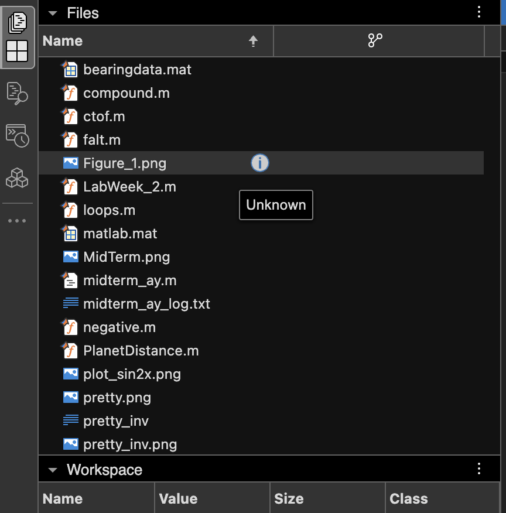

- Double-click runs `load` for you (Figure 1.5). Same as typing:

```matlab
load('bearingdata.mat')
```

- General form: `load('filename.ext')`. Extension `.mat` for data, `.m` for scripts.
- Variable **`data`** now in the Workspace (100×1 double).

> **Tip:** the file name goes in **single quotes** inside the parentheses.

> **Book typo:** the book says "the variable named *Data* is now loaded". MATLAB is case-sensitive; the variable is `data` (lower case), as the Workspace in Figure 1.5 shows.

### 1.7 A First Look at Variables

- **Variable** = named storage location for a value.
- Names: start with a letter; letters, numbers, `_` allowed. Pick descriptive names.
- **Case-sensitive:** `Kwh2` $\neq$ `kwh2`. `kwh2` OK; `2kwh` not allowed.
- Can't use keywords as names. Avoid built-in function names too (allowed, but causes trouble).

**MATLAB keywords:**

`break`, `case`, `catch`, `classdef`, `continue`, `else`, `elseif`, `end`, `for`, `function`, `global`, `if`, `otherwise`, `parfor`, `persistent`, `return`, `spmd`, `switch`, `try`, `while`

- `data` is an **array** of 100 elements in one column. All MATLAB variables are arrays/matrices.
- **Matrix** = rectangular grid of elements. Single value = matrix with one row, one column.
- MATLAB = **MAT**rix **LAB**oratory.

**Viewing the data:**

```matlab
data
```

- Prints 100 numbers in ounces, last ones `2.3633`, `2.3637`, `2.3629`.
- 1 oz (weight at standard gravity, $9.81\ \text{m/s}^2$) has a mass of 28.35 g.

```matlab
data_grams = data * 28.35
```

- 100 values, now ending `66.9987`, `67.0122`, `66.9887`.

> **Note:** 1 ounce $\approx$ 0.278 N. Gram = mass; newton and ounce = weight (force). Mass is the same on the Moon, weight isn't.

> **Note:** `bearingdata.mat` isn't in the photos, so these outputs are the book's, not re-run.

#### Key Terms

array, matrix (matrices), variable

### 1.8 Saving a Variable & Command History

- Not saved $\rightarrow$ gone when you clear the Workspace.

```matlab
save('bearingdata_grams', 'data_grams')
```

- General form: `save('filename.ext', 'variable')`. `.mat` added automatically.
- New file appears in Current Folder (Figure 1.5).


> **Tip:** simpler command form (no parentheses or quotes) works only at the `>>` prompt, not inside scripts/functions:
> ```matlab
> save bearingdata_grams data_grams
> ```

> **Tip:** can't save? You may not have write access to `datafiles-matlab` (network, read-only). Use **Browse for folder** $\rightarrow$ pick `MyWork` or another folder you can write to, then repeat the save.

**Command history:**

- Press the **Up Arrow** key $\rightarrow$ list of earlier commands above the prompt (Figure 1.6).
- Up/down to pick one $\rightarrow$ it appears at the prompt $\rightarrow$ edit $\rightarrow$ **Enter**. Great for fixing typos.

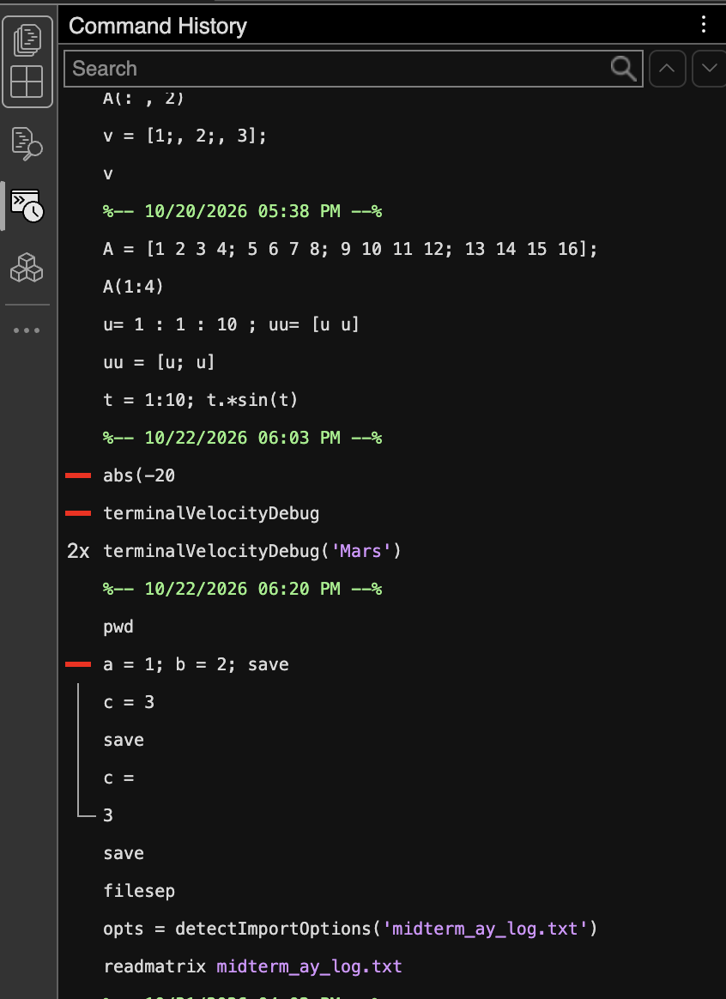

> **Tip:** MATLAB Online: Up Arrow still scrolls previous commands, but no history window.

#### Key Commands

`load`, `save`

### 1.9 Built-in Statistical Functions

| Function | Returns |
|---|---|
| `min` | smallest element |
| `max` | largest element |
| `bounds` | smallest and largest elements |
| `mean` | average |
| `median` | middle value |
| `mode` | most frequent value |
| `std` | standard deviation |
| `var` | variance |
| `corrcoef` | correlation coefficients |
| `cov` | covariance |

```matlab
min(data_grams)

ans =

   66.9075
```

- Up Arrow $\rightarrow$ edit `min` to `max` $\rightarrow$ Enter.

```matlab
max(data_grams)
mean(data_grams)
median(data_grams)

ans =

   67.0477


ans =

   66.9709


ans =

   66.9721
```

```matlab
[smallest, largest] = bounds(data_grams)

smallest =

   66.9075


largest =

   67.0477
```

- `bounds` returns two outputs: first $\rightarrow$ first name left of `=`, second $\rightarrow$ second. Both appear in the Workspace.

- Mean = total / count. Median = middle of the sorted values; even count $\rightarrow$ average of the two middle values.
- Mean 66.9709 g vs target 66.95 $\pm$ 0.12 g $\rightarrow$ within spec. Range 66.9075 to 67.0477 also inside 66.83 to 67.07.

**On your own:** `clear` and `clc`.

#### Key Commands

`min`, `max`, `bounds`, `mean`, `median`

### 1.10 Terminal Velocity Example: Creating a Script

- Drop a steel ball from a plane. Air resistance (drag) grows with speed. **Terminal velocity** = highest speed reached, when drag balances gravity.

$$V_t = \sqrt{\frac{2mg}{\rho C A}} \tag{1}$$

| Symbol | Meaning |
|---|---|
| $V_t$ | terminal velocity |
| $m$ | mass of the falling object |
| $g$ | gravity, about $9.81\ \text{m/s}^2$ |
| $\rho$ | density of the medium (air $\approx 1.225\ \text{kg/m}^3$) |
| $A$ | cross-sectional area, perpendicular to motion (circle for a sphere) |
| $C$ | drag coefficient, about 0.47 for a sphere |

> **Note:** air density changes with altitude and temperature. ISA at sea level, 15 °C: about 0.001225 g/cm³.

**Scripts** = stored commands to run again. Two kinds: scripts and Live Scripts. This chapter uses a plain script.

1. Set **MyWork** as the current folder.
2. Create the file:

```matlab
edit terminal_velocity
```

3. Prompt: file doesn't exist, create it? $\rightarrow$ **Yes**. File made in the current folder, `.m` extension.

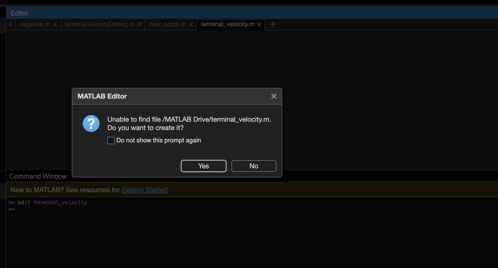

> **Tip:** also **HOME** $\rightarrow$ **New** $\rightarrow$ **Script**. Then save it with a name.
> **Note:** `edit` with an existing file name opens that file, so it's easy to overwrite one by accident.

4. Editor opens
5. Enter:

**terminal_velocity.m:**

```matlab
% program to calculate terminal velocity
% Vt = terminal velocity
% dia = diameter of sphere (in cm)
% mass = mass of the falling object (65.4710 grams)
% gravity = acceleration due to gravity (about 981 cm/s^2)
% airDensity = density of the medium (0.001225 g/cm^3.)
% area = cross-sectional area of the object (in cm^2),
%        which for a sphere is pi*radius^2
% C = drag coefficient (about 0.47 for a sphere)

dia = 2.5;
area = pi*((dia/2)^2);
mass = 65.4710;
gravity = 981;
airDensity = 0.001225;
C = 0.47;
Vt = sqrt((2*mass*gravity)/(airDensity*C*area))
disp 'cm/s units'
```

> **Tip:** `%` = comment, not executed. `;` = hide that line's result. `pi`, `sqrt` = built-in functions.

- Colors help: comments green, etc. Change in **Preferences** (Figure 1.3). Close Preferences when done.

> **Note:** color blind? Choose your own colors instead of default green (comments) and red (warnings).

6. Click **Save**.

**Code Analyzer:** context menu at the upper right of the Editor $\rightarrow$ **Show Code Analyzer Report** #### Key Terms

comment, script, suppress display

#### Key Commands

`edit`, `%`, `;`, `disp`

### 1.6 Running a Script, Saving & Closing
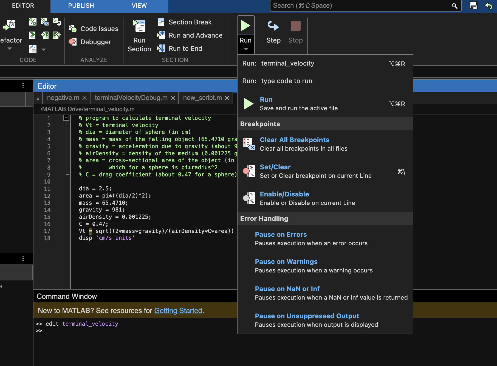

- Run: **Editor** tab $\rightarrow$ **Run**, or type the name:

```matlab
terminal_velocity

Vt =

   6.7417e+03

cm/s units
```
---

#### Key Terms (book list)

`>>`, `%`, `;`, `ans`, array, arithmetic operators, command prompt, Command Window, comment, matrix (matrices), script, suppress display, variable, Workspace

#### Key Commands (book list)

`clear`, `clc`, `format style`, `help`

---

## SDC Chapter 1 — Exercises

**Exercise 1.1** — A climbing carabiner is rated to have a closed gate strength of 20 kN (kiloNewton) and open gate strength of 6 kN. Use MATLAB to calculate the rating for the carabiner in lbf (pounds force). 1 kN = 224.809 lbf.

<details><summary>Solution</summary>

```matlab
closedGate = 20 * 224.809
openGate = 6 * 224.809

closedGate =

   4.4962e+03


openGate =

   1.3489e+03
```

Closed gate **4496.18 lbf**, open gate **1348.85 lbf**. (`format short` switches to e-notation for non-integers this size; `format shortG` shows `4496.2` and `1348.9`.)

</details>

**Exercise 1.2** — Use the data file **bearingdata.mat** to convert the values stored in the file from ounces to kilograms. One ounce equals 0.0283495 kg. Show the values to 16 significant digits.

<details><summary>Solution</summary>

```matlab
load('bearingdata.mat')
format long
data_kg = data * 0.0283495
format short
```

- `format long` $\rightarrow$ 16 significant digits for values like these (about 0.067 kg).
- File not in the photos, so no output shown. Check: last value $2.3629 \times 0.0283495 \approx 0.06699$ kg, matching the gram values ($\approx 66.99$ g).

</details>

**Exercise 1.3** — Use MATLAB to calculate the following:
a. 654.23 + 345.73
b. 597.64533 - 0.83455
c. 3984566 / 5.5
d. 343490999 / 2 * 34.6540

<details><summary>Solution</summary>

```matlab
654.23 + 345.73
597.64533 - 0.83455
3984566 / 5.5
343490999 / 2 * 34.6540

ans =

  999.9600


ans =

  596.8108


ans =

   7.2447e+05


ans =

   5.9517e+09
```

- c = 724466.5455; d = 5951668539.673. (d: `/` and `*` same precedence, left to right $\rightarrow$ $(343490999/2) \times 34.654$.)

</details>

**Exercise 1.4** — Modify the terminal_velocity script you created previously to calculate the terminal velocity if the 25 mm spherical object of mass 65.4710 was falling towards Mars and not Earth. The gravity of Mars is 3.711 m/s². The atmospheric density at the surface of Mars is estimated to be .020 kg/m³. Notice that these units for the density and gravity of Mars are in m (meters) units not mm (millimeters).

<details><summary>Solution</summary>

Script works in cm and g, so convert:

- gravity: $3.711\ \text{m/s}^2 \times 100 = 371.1\ \text{cm/s}^2$
- density: $0.020\ \text{kg/m}^3 \times \frac{1000\ \text{g}}{10^6\ \text{cm}^3} = 0.000020\ \text{g/cm}^3$

**terminal_velocity_mars.m:**

```matlab
% terminal velocity of the 2.5 cm steel ball on Mars (cgs units)
dia = 2.5;
area = pi*((dia/2)^2);
mass = 65.4710;
gravity = 371.1;          % 3.711 m/s^2 -> cm/s^2
airDensity = 0.000020;    % 0.020 kg/m^3 -> g/cm^3
C = 0.47;
Vt = sqrt((2*mass*gravity)/(airDensity*C*area))
disp 'cm/s units'
```

```matlab
terminal_velocity_mars

Vt =

   3.2452e+04

cm/s units
```

**32,452 cm/s** (324.5 m/s), about 4.8× Earth's. Thin air beats weak gravity.

</details>

---
## Week 2 — Lab 2

### T1-1 (repeated, parts c & d)

**c.** $6\left(\frac{10}{13}\right) + \frac{18}{5 \cdot 7} + 5\left(9^2\right)$

```matlab
>> 6*(10/13) + 18/(5*7) + 5*(9^2)
ans =
   410.1297
```

**d.** 6(35^(1/4)) + 14^0.35

```matlab
>> 6*(35^(1/4)) + 14^0.35
ans =
   17.1123
```

### Cylinder Problem

The volume of a circular cylinder of height *h* and radius *r* is V = πr²h. A cylindrical tank is 15 m tall with a radius of 8 m. Construct another tank with 20% greater volume but the same height — how large must its radius be?

**Solution:** r = √(V / πh)

```matlab
>> r = 8;
>> h = 15;
>> V = pi*(r^2)*h;
>> V = V + 0.2*V;
>> r = sqrt(V/(pi*h))
r =
    8.7636
```

**Answer:** The new cylinder must have a radius of **8.7636 m**.

### T1-2: Test Your Understanding

Given x = -5 + 9i and y = 6 - 2i, show that x+y = 1 + 7i, xy = -12 + 64i, and x/y = -1.2 + 1.1i.

```matlab
>> x = -5 + 9*i;
>> y = 6 - 2*i;
>> x + y
ans =
   1.0000 + 7.0000i

>> x*y
ans =
  -12.0000 +64.0000i

>> x/y
ans =
  -1.2000 + 1.1000i
```

### Arrays (Chapter 2)

```matlab
>> u = [0:0.1:10];
>> w = 5*sin(u);
>> u(7)
ans =
    0.6000

>> w(7)
ans =
    2.8232

>> m = length(w)
m =
   101
```

### T3-1: 25th Element

Determine how many elements are in the array `[cos(0):0.02:log10(100)]`, and find the 25th element.

```matlab
>> a = [cos(0):0.02:log10(100)];
>> m = length(a)
m =
    51

>> a(25)
ans =
    1.4800
```

**Answer:** There are 51 elements in the array, and the 25th element is 1.48.

### Polynomial Roots

**Example)** Find the roots of x³ − 7x² + 40x − 34 = 0.

```matlab
>> a = [1, -7, 40, -34];
>> roots(a)
ans =
   3.0000 + 5.0000i
   3.0000 - 5.0000i
   1.0000 + 0.0000i
```

**Answer:** The roots are x = 1 and x = 3 ± 5i.

### T3-2: Polynomial 290 − 11x + 6x² + x³

```matlab
>> a = [1, 6, -11, 290];
>> roots(a)
ans =
  -10.0000 + 0.0000i
    2.0000 + 5.0000i
    2.0000 - 5.0000i
```

**Answer:** The roots are x = -10 and x = 2 ± 5i.

### Plotting with MATLAB (Chapter 5)

**Example)** Plot $y = sin(2x)$ for $0 \le x \le 10$.

```matlab
>> x = 0:0.01:10;
>> y = sin(2*x);
>> plot(x, y, linewidth=2)
>> xlabel('x')
>> ylabel('y')
>> legend('y = sin2x')
>> grid on
>> title('Function y = sin2x')
```

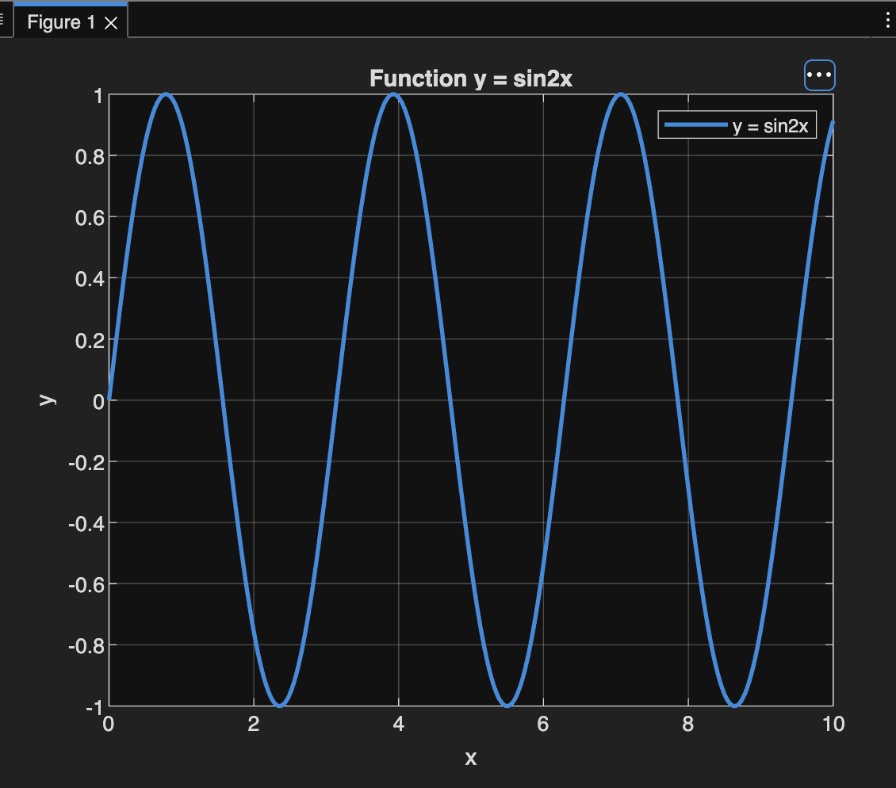

### T3-3: Plot $s = 2sin(3t+2) + \sqrt {(5t+1)}$ for $0 \le t \le 5$

```matlab
>> t = 0:0.01:5;
>> s = 2*sin(3*t + 2) + sqrt(5*t + 1);
>> plot(t,s, linewidth=2, LineStyle="--", Color= 'r')
>> xlabel('t: time (seconds)')
>> ylabel('s: speed (feet per second)')
>> title('The function of s = 2sin(3t+2)+sqrt(5t+1)')
>> legend('y = s = 2sin(3t+2)+sqrt(5t+1)')
>> grid on
```

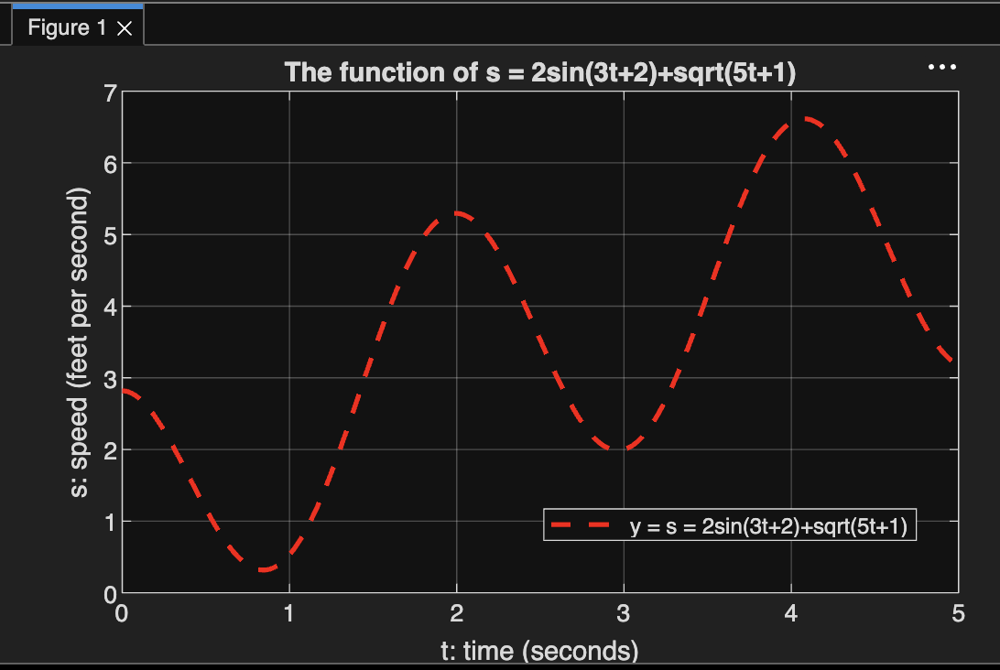

### T3-4: $y = 4* \sqrt {6x+1}$ and $z = 5e^{0.3x} − 2x$ for $0 \le x \le 1.5$

```matlab
>> x = 0:0.01:1.5;
>> y = 4*sqrt(6*x+1);
>> z = 5*exp(0.3*x) - 2*x;
>> plot(x,y, linestyle='-.')
>> xlabel('x: distance (meters)')
>> ylabel('y: force (newtons)'), ...
>> title('The function of y = 4sqrt(6x+1)')
>> grid on;
>> legend('y = 4sqrt(6x+1)')
```

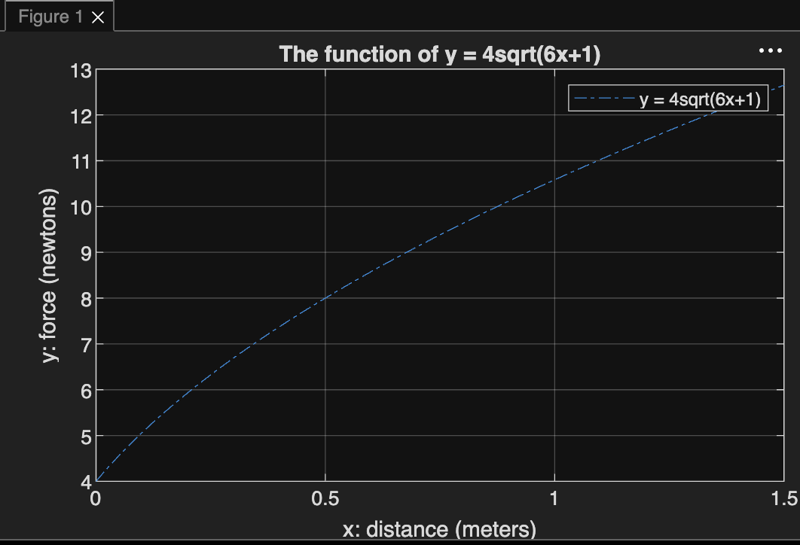

```matlab
>> plot(x,z, '--*', 'MarkerSize', 3, 'MarkerEdgeColor', 'y')
>> xlabel('x: distance (meters)'), ylabel('z: force (newtons)'), ...
>> title('The function of $z = 5e^{(0.3x)}-2x$', 'Interpreter', 'latex')
>> legend('$z = 5e^{(0.3x)}-2x$', 'Interpreter', 'latex')
>> grid on
```

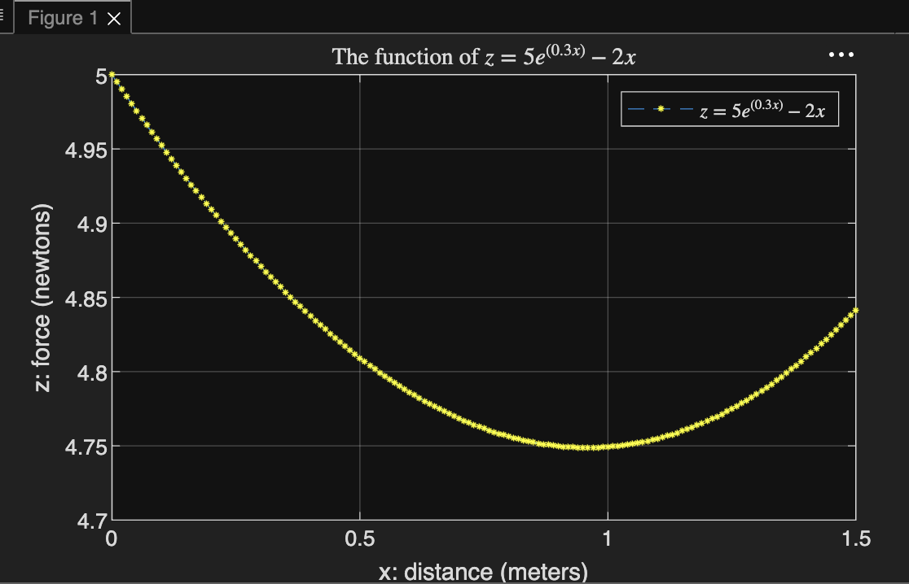

**Example) Plot of rocket height**

```matlab
>> x = 0:0.1:52;
>> y = 0.4*sqrt(1.8*x);
>> x = 0:0.1:52;
>> plot(x,y, 'vr')
>> xlabel('Distance (miles)')
>> ylabel('Height (miles)')
>> title('Rocket Height as a Function of Downrange Distance')
>> legend('Rocket!', 'Box', 'off', 'fontsize', 20, 'FontAngle', 'italic')
```

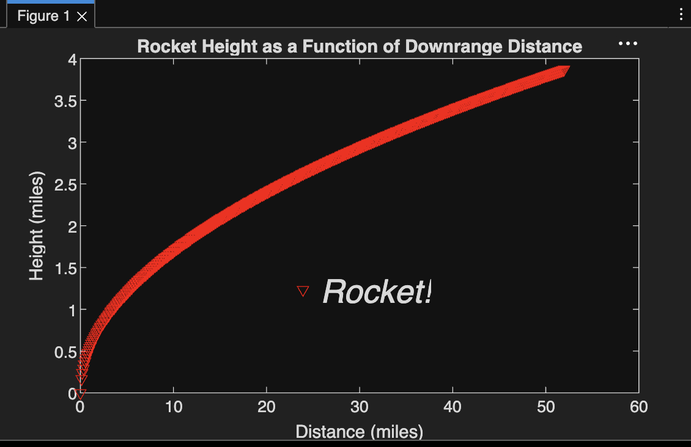

### Script Files

**Sample SQRT)** Example #1 of a script file (`Sample_SQRT.m`):

```matlab
% Example of a script file
% This program calculates the square root of the numbers 1 through 10.
% It displays a vector x with the numbers 1 through 10
% and the vector y with the square root.
x = 1:10
y = sqrt(x)
```

```matlab
>> Sample_SQRT
x =
    1   2   3   4   5   6   7   8   9   10
y =
   1.0000  1.4142  1.7321  2.0000  2.2361  2.4495  2.6458  2.8284  3.0000  3.1623
```

**Population Table)** Example #2 of a script file (`PopTable.m`):

```matlab
% Example of a script file (PopTable.m)
% This program will display the population along with years.
yr = [1984 1986 1988 1990 1992 1994 1996];
pop = [127 130 136 145 158 178 211];
tableYP(:,1) = yr';
tableYP(:,2) = pop';
disp('        YEAR      POPULATION')
disp('                  (MILLIONS)')
disp('')
disp(tableYP)
```

```matlab
>> PopTable
    YEAR   POPULATION
           (MILLIONS)
    1984      127
    1986      130
    1988      136
    1990      145
    1992      158
    1994      178
    1996      211
```

**Power of 3 by User Input)** Example #3 of a script file (`Power3input.m`):

```matlab
% Example of a script file (Power3input.m)
% This program will display "the power (cube or exponent) of 3" of the
% number entered by user.
n = 1:10;
c = n.^3;
number1 = input('Enter the points scored in the first game: ');
if number1 < 0
    display('Warning! Input invalid')
else
    number2 = number1^3
    disp(number2)
end
```

```matlab
>> Power3input
Enter the points scored in the first game: 3
number2 =
   27
   27

>> Power3input
Enter the points scored in the first game: 6
number2 =
   216
   216

>> Power3input
Enter the points scored in the first game: -5
Warning! Input invalid
```

**Average points per game)** Example #4 of a script file (`sampleAVG.m`):

```matlab
% Example of a script file (sampleAVG.m)
% This program will display the values of the points from 3 games.
game1 = 75;
game2 = 93;
game3 = 68;
ave_points = (game1 + game2 + game3) / 3
```

```matlab
>> sampleAVG
ave_points =
   78.6667
```

**Average points by User Input)** Example #5 of a script file (`sampleGameInput.m`):

```matlab
% Example of a script file (sampleGameInput.m)
% This script file calculates the average of points scored in 3 games.
% The points from each game are assigned to the variables by using the
% input command.
game1 = input('Enter the points scored in the first game: ');
game2 = input('Enter the points scored in the second game: ');
game3 = input('Enter the points scored in the third game: ');
ave_points = (game1 + game2 + game3) / 3
disp('')
disp('The average of points scored in a game is: ')
disp('')
disp(ave_points)
```

```matlab
>> sampleGameInput
Enter the points scored in the first game: 61
Enter the points scored in the second game: 74
Enter the points scored in the third game: 101
ave_points =
   78.6667
The average of points scored in a game is:
   78.6667
```

### Narrative — Projectile Motion

**Predict landing distance of an object in projectile motion.** The object is launched at 45 degrees from ground level at 50 meters per second. Ignore air drag and wind.

**Variables:**

- Angle: 45° (= 45° × π/180° rad = π/4 rad = 0.7854 rad)
- Speed: 50 (m/s)
- Starting height: 0 (m)
- Gravity: -9.81 (m/s²)

**MATLAB coding (`ProjectileMotion.m`):**

```matlab
% Example of a script file (ProjectileMotion.m)
% This script file calculates the horizontal velocity, vertical velocity,
% time in flight, horizontal distance of an object in projectile motion.
angle = pi/4;
speed = 50;
startingHeight = 0;
gravity = -9.81;
HorizontalVelocity = speed*cos(angle)
VerticalVelocity = speed*sin(angle)
TimeInFlight = VerticalVelocity/(abs(gravity/2))
HorizontalDistance = TimeInFlight*HorizontalVelocity
```

```matlab
>> ProjectileMotion
HorizontalVelocity =
   35.3553
VerticalVelocity =
   35.3553
TimeInFlight =
   7.2080
HorizontalDistance =
   254.8420
```

**Answer:**

- Horizontal starting velocity = 35.3553 m/s
- Vertical starting velocity = 35.3553 m/s
- Time in flight: 7.2080 s
- Horizontal distance from start: 254.8420 m

*(EOF)*

---

## SDC Chapter 2 — Operators, Variables & Data Types

### Chapter 2 Objectives

1. Understand and apply operator precedence.
2. Assign a value to a variable.
3. Understand the minimum and maximum value of various numeric variable types.
4. Understand the difference between string and character arrays.
5. Work with data from an imported file.

### 2.1 Operators

**Arithmetic Operators (p.15)**

| Operator | Meaning |
|---|---|
| `+` | Addition (3+2) |
| `-` | Subtraction (3-2) |
| `*` | Multiplication (3*2) |
| `/` | Division (3/2) |
| `^` | Raise to a power (3^2) |

**Relational Operators (p.15)**

| Operator | Meaning |
|---|---|
| `<` | Less than |
| `<=` | Less than or equal to |
| `>` | Greater than |
| `>=` | Greater than or equal to |
| `==` | Equals |
| `~=` | Does not equal |

> (p.16) Using a single equals sign, `=`, assigns the value on the right side to the variable on the left side. Using two, `==`, asks whether the two sides are mathematically/logically equal (1 for True, 0 for False).

**Logical Operators (p.16)**

| Operator | Meaning |
|---|---|
| `&&` | and |
| `\|\|` | or |
| `~` | not |

> (p.17) The `~` operator reverses the logical value it's applied to — true (1) becomes false (0) and vice versa.
> ```matlab
> >> ~(x==3)
> ans =
>   logical
>    0
> ```
> Since x was previously set to 3, `x==3` evaluates to true, and `~` reverses it to false (0).

**The `&` operator (and)** — true only when both compared values are true:

| X | Y | X & Y | Explanation |
|---|---|---|---|
| True (1) | True (1) | True (1) | X & Y is true if X is true and Y is true |
| True (1) | False (0) | False (0) | X & Y is false if X is true and Y is false |
| False (0) | True (1) | False (0) | X & Y is false if X is false and Y is true |
| False (0) | False (0) | False (0) | X & Y is false if X is false and Y is false |

**The `|` operator (or)** — true when either or both compared values are true:

| X | Y | X \| Y | Explanation |
|---|---|---|---|
| True (1) | True (1) | True (1) | X \| Y is true if X is true and Y is true |
| True (1) | False (0) | True (1) | X \| Y is true if X is true and Y is false |
| False (0) | True (1) | True (1) | X \| Y is true if X is false and Y is true |
| False (0) | False (0) | False (0) | X \| Y is false if X is false and Y is false |

### 2.2 Variables & Precedence

(p.18) Type into the Command Window:

```matlab
>> x=3
x =
    3
>> y=2
y =
    2
>> z=2
z =
    2
>> x==y
ans =
  logical
   0
>> y==z
ans =
  logical
   1
>> x==y & y==z
ans =
  logical
   0
>> x==y | y==z
ans =
  logical
   1
>> ~(x==y) & y==z
ans =
  logical
   1
```

**Logical type / `class()` / `islogical()`:**

```matlab
>> x=1;
>> y=logical(1);      % assigned y to be logical 1
>> class(x)            % asks the class of the variable x
ans =
    'double'
>> class(y)             % asks the class of the variable y
ans =
    'logical'
>> islogical(x)          % returned false(0) because not assigned logical
ans =
  logical
   0
>> islogical(y)           % returned true(1) because assigned logical
ans =
  logical
   1
```

`double` is the default numeric data type in MATLAB and stores values between ±1.79×10³⁰⁸. Use `islogical()` to check whether a value is of type `logical`.

**Operator precedence (p.18-19)**

```matlab
>> 3+2*6
ans =
    15
>> (3+2)*6
ans =
    30
```

The `==` relational operator has higher precedence than `&&`/`||` — this is why `x == y` and `y == z` were evaluated *before* the `&`/`|` operators above.

**Order of Operations (p.19)**

1. Parentheses
2. Logical negation (`~`), unary minus (`-`)
3. Multiplication, division
4. Addition, subtraction
5. Relational operators (`<`, `<=`, `>`, `>=`, `==`, `~=`)
6. Logical AND (`&`)
7. Logical OR (`|`)

A variable holds a value; it has a name (e.g. `x` or `city`) assigned a value (e.g. `3` or `'Paris'`).

**Variable Naming Rules (p.19)**

- Can include letters, numbers, and underscores
- MUST begin with a letter, cannot begin with a number. Underscore ok.
- Names with capital and lowercase letters are **not** interchangeable (`abc` and `Abc` are different variables)

### 2.3 Variable Naming & Classes

(p.19-20) Type into the Command Window:

```matlab
>> a=5
a =
    5
>> A=15
A =
   15
>> a+3
ans =
    8
>> A+3
ans =
   18
>> A+a
ans =
   20
>> win_win=3
win_win =
    3
>> 2win=3
2win=3
   ^
Error: Unexpected 'win'.
Check for missing multiplication operator.
>> win-win=3
win-win=3
   ^
Incorrect use of '=' operator. Assign a value to
a variable using '=' and compare values for equality
using '=='.
>> win.win=3
win =
  struct with fields:
    win: 3
```

**Invalid variable names:**

| Invalid name | Result | Reason |
|---|---|---|
| `2win` | Error: Unexpected MATLAB expression | Variable begins with a number |
| `win-win` | Error: The expression to the left of the equals sign is not a valid target for an assignment | MATLAB thinks you're subtracting a variable called `win` from itself |
| `win.win` | A new structure `win` is created with a member `win` | The name contains an invalid character but is a valid way to refer to a member of a structure (an advanced data type covered later); MATLAB creates it instead of erroring |

> (p.20) It's best to write code that's easily understood by others, since other programmers will review and later maintain it — use descriptive variable names (e.g. `altitude_in_meters`). You can also click and drag variable names from the Workspace and Editor into the Command Window to avoid retyping them.

**Classes / types (p.21):**

```matlab
>> x=666
x =
   666
>> class(x)
ans =
    'double'
```

Even though an integer was entered, MATLAB creates a `double` by default unless the type is explicitly specified.

```matlab
>> x=int8(666);
>> class(x)
ans =
    'int8'
```

`int8` stores the number as an 8-bit integer. The `class` function reports the class/type. The number of bits determines how many binary digits the value can store; if one bit is reserved for the sign, the storable range shrinks accordingly.

| 2⁷ | 2⁶ | 2⁵ | 2⁴ | 2³ | 2² | 2¹ | 2⁰ | Sum |
|---|---|---|---|---|---|---|---|---|
| 1 | 1 | 1 | 1 | 1 | 1 | 1 | 1 | |
| 128 | 64 | 32 | 16 | 8 | 4 | 2 | 1 | = 255 |

### 2.4 Integer & Floating-Point Types

**Integer Types (p.21)**

| Type | Bits | Signed/Unsigned | Range |
|---|---|---|---|
| `int8` | 8 | signed | -128 to 127 |
| `uint8` | 8 | unsigned | 0 to 255 |
| `int16` | 16 | signed | -32,768 to 32,767 |
| `uint16` | 16 | unsigned | 0 to 65,535 |
| `int32` | 32 | signed | -2,147,483,648 to 2,147,483,647 |
| `uint32` | 32 | unsigned | 0 to 4,294,967,295 |
| `int64` | 64 | signed | -9,223,372,036,854,775,808 to 9,223,372,036,854,775,807 |
| `uint64` | 64 | unsigned | 0 to 18,446,744,073,709,551,615 |

Supplying a type to `intmin()` / `intmax()` tells you the minimum/maximum value that type can hold.

**Floating Point Types (p.22)**

| Type | Bits | Signed/Unsigned | Range |
|---|---|---|---|
| `single` | 32 | signed | -3.4×10³⁸ to 3.4×10³⁸ |
| `double` | 64 | signed | -1.79×10³⁰⁸ to 1.79×10³⁰⁸ |

**Constants — `Inf` and `NaN` (p.22)**

A constant is a value that, once assigned, cannot be changed. Two special floating-point values result from certain operations:

```matlab
>> 3/0
ans =
    Inf
>> inf-inf
ans =
    NaN
```

Instead of an error, MATLAB returns `Inf` (or `-Inf`) for results that are enormously large/small, and `NaN` ("not a number") for operations that are not mathematically defined. `pi` is another built-in constant:

```matlab
>> format long
>> pi
ans =
   3.141592653589793
>> pi+7
ans =
   10.141592653589793
```

**Overflow behavior (p.22-23)**

```matlab
>> x=128 +2
x =
   130
>> y=int8(128)+2
y =
  int8
   127
>> z=int8(128)
z =
  int8
   127
```

If a number is larger or smaller than a type can handle, MATLAB returns the largest/smallest value that type can hold, with no error (127 is as high as an `int8` can go).

### 2.5 Numerical Functions & Rounding

| Function | Action |
|---|---|
| `ceil` | Rounds toward positive infinity |
| `floor` | Rounds toward negative infinity |
| `fix` | Rounds toward zero |
| `round` | Rounds toward the nearest whole number |
| `mod(a, b)` | Modulus of a divided by b; retains the sign of the divisor (e.g. `mod(10, -7)` returns -4) |
| `rem(a, b)` | Remainder of a division; retains the sign of the dividend (e.g. `rem(10, -7)` returns 3) |

```matlab
>> ceil(3.4)
ans =
    4
>> ceil(-3.4)
ans =
   -3
>> floor(3.4)
ans =
    3
>> floor(-3.4)
ans =
   -4
>> fix(3.4)
ans =
    3
>> fix(-3.4)
ans =
   -3
>> round(3.4)
ans =
    3
>> round(-3.4)
ans =
   -3
>> mod(5, 2)
ans =
    1
>> rem(5, 2)
ans =
    1
>> mod(5, -2)
ans =
   -1
>> rem(5, -2)
ans =
    1
>> mod(-5, 2)
ans =
    1
>> rem(-5, 2)
ans =
   -1
```

**Precision loss on conversion (p.24)**

```matlab
>> x=uint8(255)
x =
  uint8
   255
>> y=int8(x)
y =
  int8
   127
```

`int16(43)` converts the double `43` into a 16-bit integer. Converting unsigned types to signed types can easily lose precision or exceed the range. (Search MATLAB help for "trigonometry" to see the full list of available trig functions.)

### 2.6 Strings & Character Arrays

(p.24) A **string** holds text and can contain any valid character (`"123456"`, `"< <= > >="`, etc.). An **array** is a collection of data all of the same type, each item accessible by index. Consider the phrase "Carpe diem." stored as a character array:

| Index | 1 | 2 | 3 | 4 | 5 | 6 | 7 | 8 | 9 | 10 | 11 |
|---|---|---|---|---|---|---|---|---|---|---|---|
| Character | C | a | r | p | e | (space) | d | i | e | m | . |

This is a 1×11 one-dimensional array of characters.

```matlab
>> st='Carpe diem.'
st =
    'Carpe diem.'
>> size(st)
ans =
    1   11
>> length(st)
ans =
   11
>> st(4)
ans =
    'p'
>> st(4)='9'
st =
    'Car9e diem.'
>> st(4)=33
st =
    'Car!e diem.'
```

`size()` reports the array's dimensions (1×11); `length()` reports the number of elements (11). `st(4)` accesses a specific element. Setting `st(4) = 33` overwrites that element with the character whose ASCII code is 33 (`!`) — all elements of a character-array variable must share the same type, so numeric values are interpreted as ASCII codes.

**Character arrays vs. string arrays (p.26)**

Character arrays use single quotes (`'the'`); string arrays use double quotes (`"the"`), producing a 1×1 array containing one string. A character array is a 1×length array of individual characters; a string array is a 1×1 array containing a single string.

```matlab
>> clc
>> sc='This is a character array'
sc =
    'This is a character array'
>> st="This is a string array"
st =
    "This is a string array"
>> class(sc)
ans =
    'char'
>> class(st)
ans =
    'string'
>> size(sc)
ans =
    1   25
>> length(sc)
ans =
   25
>> size(st)
ans =
    1    1
>> length(st)
ans =
    1
>> sc(1)
ans =
    'T'
>> st(1)
ans =
    "This is a string array"
>> sc(2)='H';
>> sc
sc =
    'THis is a character array'
>> st(2)="And this is the second dtring in the array";
>> st
st =
  1x2 string array
    Column 1
      "This is a string array"
    Column 2
      "And this is the second dtr..."
```

**Character/string test functions (p.27-28)**

```matlab
>> charArray='This is a character array.'
>> stringArray="This is a string array."
>> ischar(charArray)
ans =
  logical
   1
>> ischar(stringArray)
ans =
  logical
   0
>> isstring(stringArray)
ans =
  logical
   1
>> isletter(charArray)
ans =
  1x26 logical array
  Columns 1 through 14
   1 1 1 1 0 1 0 1 0 1 1 1 1 1
  Columns 15 through 26
   1 1 1 1 0 1 1 1 1 0
>> isspace(charArray)
ans =
  1x26 logical array
  Columns 1 through 14
   0 0 0 0 1 0 0 1 0 0 0 0 0 0
  Columns 15 through 26
   0 0 0 0 1 0 0 0 0 0
>> upper(stringArray)
ans =
    "THIS IS A STRING ARRAY."
>> stringArray=upper(stringArray)
stringArray =
    "THIS IS A STRING ARRAY."
```

Search "Characters and Strings" in MATLAB help for the full function list.

**Comparing strings — `strcmp` (p.28)**

Whenever you want to compare two strings, use `strcmp(a, b)`.

```matlab
>> text1='Four score an seven years ago'
>> text2='87 years ago'
>> text3='Four score and seven years ago'
>> strcmp(text1, text2)
ans =
  logical
   0
>> strcmp(text1, text3)
ans =
  logical
   1
>> text1==text3
ans =
  1x30 logical array
  Columns 1 through 14
   1 1 1 1 1 1 1 1 1 1 1 1 1 1
  Columns 15 through 28
   1 1 1 1 1 1 1 1 1 1 1 1 1 1
  Columns 29 through 30
   1 1
```

**Finding & modifying substrings (p.28-29)**

```matlab
>> contains(text1, 'seven')
ans =
  logical
   1
>> strfind(text1, 'seven')
ans =
   16
>> insertBefore(text1, strfind(text1, 'seven'), 'fifty-')
ans =
    'Four score and fifty-seven years ago'
```

`contains` tells you the substring `'seven'` is present; `strfind` reports where (the `'s'` of "seven" is at index 16). `insertBefore` shows a function used as a value within another function — when parentheses are nested, MATLAB highlights the matching open parenthesis to help track them.

**Type coercion (p.29-30)**

```matlab
>> x=3
>> class(x)
ans =
    'double'
>> x='I am some text'
>> class(x)
ans =
    'char'
```

A variable becomes the type of whatever is assigned to it, regardless of its previous type.

```matlab
>> x=3
>> y=single(5)
>> z=x+y
>> class(z)
ans =
    'single'
>> x=int16(5)+int8(3)
Error using  +
Integers can only be combined with
integers of the same class, or scalar
doubles.
```

Integer types can't be freely mixed with each other — only with same-class integers or scalar doubles; this restriction doesn't apply to floating-point types.

```matlab
>> x=3
>> y='I am a string'
>> z=x+y
z =
  Columns 1 through 7
   76  35  100  112  35  100  35
  Columns 8 through 13
   118  119  117  108  113  106
>> class(z)
ans =
    'double'
>> char(z)
ans =
    'L#dp#d#vwulqj'
```

MATLAB treated the string as a character array, added 3 to each character's ASCII value, and returned a numeric array of those values. `char(z)` casts the array back to a character-array string based on the (shifted) ASCII values.

### 2.7 Importing Data (VCF Files)

(p.31) A **Variant Call Format (VCF)** file contains information about positions in the genome and genotype information for each sample. It's a text file with a header section followed by this required data per line:

| Field | Description |
|---|---|
| `CHROM` | Chromosome number. (Course dataset only has chromosome 22 data.) |
| `POS` | Position — location of the gene on the chromosome (range ~1 to 1.2 million; no decimal portion) |
| `ID` | dbSNP identifier(s); `.` if none available (string, no whitespace/semicolons) |
| `REF` | Reference base(s) — one of A, C, G, T, or N (not case-sensitive; more than one letter allowed; string) |
| `ALT` | Alternate base(s) — A, C, G, T, N, or `*` (missing due to upstream deletion) |
| `QUAL` | Quality score (Phred-scale); course dataset uses 100 throughout |
| `FILTER` | Filter status; `"PASS"` indicates a passing quality score |
| `INFO` | Additional info keys, e.g. AA (ancestral allele), AC (allele count), AF (allele frequency) |

**Steps to Import Data (p.32-34)**

1. Use the **Import Data** tool from the Home tab of the ribbon.
2. Change the file filter to **All Files (\*.\*)** to show the `.vcf` file.
3. Set **Text Type** to **String Array**. *(Note: this setting wasn't found in the Import Data window during this exercise.)*
4. Leave the **Output Type** as **Table**.
5. Data has delimiters (tabs), so leave the option set to **Tab delimited**. *(Note: this setting also wasn't located.)*
6. Choose a row for the **Variable Names** (or double-click the header to set names after importing), and select the data **Range** from the same menu.
7. Click **Import Selection** to add the data to the Workspace; double-click it there to open.

**Sorting imported data (p.34)**

To sort the data by `'ID'` (or any column):

```matlab
>> tblIDs=sortrows(ChromeExport2, 'ID')
tblIDs =
  36x9 table
  CHROM     POS         ID          REF   ALT   QUAL   FILTER
  -----   --------   -------------   ---   ---   ----   ------
    22    16050678   "rs139377059"    C     T     100    PASS
    22    16050984   "rs188945759"    C     G     100    PASS
    22    16050922   "rs367963583"    T     G     100    PASS
    22    16050627   "rs587593704"    G     T     100    PASS
    22    16050840   "rs587616822"    C     G     100    PASS
```

The new variable `tblIDs` appears in the Workspace alongside `ChromeExport2`. The sorted data was saved to the `datafiles-matlab` folder as `Chrome22data.mat`.

---

## SDC Chapter 2 — Exercises

*(p.36-38) Exercises 2.1 – 2.8*

### 2.1

Based on operator precedence, predict the result without using MATLAB:

**5 + 2 \* 8 / 2 − (3 \* 2 + 10) / -1**

Work the parentheses first (multiplication before addition inside): `3*2+10 = 16`. Then left-to-right multiplication/division: `5 + 8 − (-16)`. Finally addition/subtraction left to right: **29**.

```matlab
>> 5+2*8/2-(3*2+10)/-1
ans =
   29
```

Yes, the answers agree.

### 2.2

Predict the value of `z`:

```matlab
>> x=1
>> y=5
>> z=~(x<y||~(y<x)&&islogical(x))
```

The `&&` operation happens before `||` (order of operations). To evaluate `&&`, first compute `~(y<x)`, which is `1`. `islogical(x)` is `0`, so `1 && 0 = 0`. Then `1 || 0 = 1`, and `~(1) = 0`. Expected: **0**.

```matlab
>> x=1
x =
    1
>> y=5
y =
    5
>> z=~(x<y||~(y<x)&&islogical(x))
z =
  logical
   0
```

Yes, the answers agree.

### 2.3

Predict both the value and data type of `x`:

**x = 55 + uint32(-22) + pi**

`uint32` is unsigned and starts at 0, so the closest value it can represent for -22 is 0. Then `55 + 0 + pi = 58.14159...`, and the result should take on type `uint32`.

```matlab
>> x=55+uint32(-22)+pi
x =
  uint32
   58
```

The answers are slightly different — MATLAB displays just the whole number (`58`) rather than `58.14159...`. This demonstrates that variable types follow strict rules, and misunderstanding them can silently produce unexpected results (the integer type truncates/rounds the floating-point result).

### 2.4

Predict the value of each:

```matlab
>> int8(ceil(127.1))
>> int8(floor(127.9))
>> int8(fix(127.5))
>> int8(round(127.7))
>> int8(ceil(rem(-528.6,200)))
```

Predicted, in order: **127, 127, 127, 127, -128**

```matlab
>> int8(ceil(127.1))
ans =
  int8
   127
>> int8(floor(127.9))
ans =
  int8
   127
>> int8(fix(127.5))
ans =
  int8
   127
>> int8(round(127.7))
ans =
  int8
   127
>> int8(ceil(rem(-528.6,200)))
ans =
  int8
   -128
```

Yes, the numbers match.

### 2.5

Predict what you'd expect to see (generally, not precisely) from the last two lines:

```matlab
>> x='small kittens'
>> y="small kittens"
>> 3+x
>> 3+y
```

For `3+x`: a bunch of numbers — the ASCII codes of each letter, each shifted by 3. For `3+y`: it might just prepend the `3` to the string.

```matlab
>> x='small kittens'
x =
    'small kittens'
>> y="small kittens"
y =
    "small kittens"
>> 3+x
ans =
  Columns 1 through 8
   118  112  100  111  111   35  110  108
  Columns 9 through 13
   119  119  104  113  118
>> 3+y
ans =
    "3small kittens"
```

### 2.6

Data type likely used to store each kind of information, with brief reasoning:

| Item | Likely data type | Reasoning |
|---|---|---|
| a. Data table | **Table** | Makes it easier to sort through |
| b. Numeric measurements | **Numeric** | So calculations can be performed on the data |
| c. Seating chart (rows & seats per row) | **Character array** | Because of both rows and number of seats in each row |
| d. Non-numeric categories | **Categorical array** | Because the data is non-numeric |
| e. Sentences | **String array** | To hold every word in a string |
| f. List of separate entries | **String array** | So each entry will be its own string |
| g. True/false data | **Numeric** (logical) | True and false can be represented by 1 and 0 |
| h. Non-numeric categories | **Categorical array** | Because it's non-numeric data |

### 2.7

Carpet costs $1.69/ft², sold on a roll 12 ft wide. For each room, calculate the cost and percentage of wasted carpet:

```matlab
>> (((12*8)-(8*11))/(12*8))*100
ans =
    8.3333
>> 12*8*1.69
ans =
   162.2400

>> (((12*12)-(14*9))/(12*12))*100
ans =
   12.5000
>> 12*12*1.69
ans =
   243.3600

>> 144*102
ans =
   14688
>> 14688/144
ans =
   102
>> 102*1.69
ans =
   172.3800

>> (((12*20)-(18*13))/(12*20))*100
ans =
    2.5000
>> 12*20*1.69
ans =
   405.6000
```

| Room | Dimensions | Cost | Waste |
|---|---|---|---|
| a. | 8' × 11' | **$162.24** | **8.3%** |
| b. | 14' × 9' | **$243.36** | **12.5%** |
| c. | 12' × 8'-6" | **$172.38** | **0%** |
| d. | 18' × 13' | **$405.60** | **2.5%** |

### 2.8

The Great Pacific Garbage Patch (GPGP) — a zone of plastic debris between California and Hawaii — is estimated at 79,000 tons of plastic across 1.6 million km². 75% of the mass is from pieces larger than 5 cm; microplastics account for 8% of the mass but 94% of the estimated 1.8 trillion pieces. Estimate:

**a. Average weight of a piece of plastic debris:**

```matlab
>> m_grams=79000*1000000
m_grams =
   7.9000e+10
>> avg_m_grams=(m_grams)/(1.8*10^12)
avg_m_grams =
    0.0439
```

**b. Average number of pieces per square mile:**

```matlab
>> (0.621371)^2
ans =
    0.3861
>> A_sqmi=(1.6*10^6)*(0.3861)
A_sqmi =
   617760
>> piece_sqmi=(1.8*10^12)/(A_sqmi)
piece_sqmi =
   2.9138e+06
```

**c. Volume in cubic yards if condensed into one solid mass (density 1.20 g/cm³):**

```matlab
>> m_grams=79000*1000000
m_grams =
   7.9000e+10
>> V_cm3=(m_grams)/(1.20)
V_cm3 =
   6.5833e+10
>> (91.44)^3
ans =
   7.6455e+05
>> V_yd3=(V_cm3)/(ans)
V_yd3 =
   8.6107e+04
```

**Answers:**

- a. **0.0439 grams**
- b. **2.9138 × 10⁶ pieces per square mile**
- c. **8.6107 × 10⁴ cubic yards**

---

## Home Loan Assignment

This week you will do some Engineering Economic Analysis and see how computers iterate their formulas to derive answers.  This starts with understanding the time value of money.  You will choose and compare a home with a 30 and 15-year loan to observe the difference in the exercise Home Loan.  I've done a sample, but you will choose your own price and interest and write over my results to get the results for your home.  Answer the questions in the boxes provided and place into your notebook.

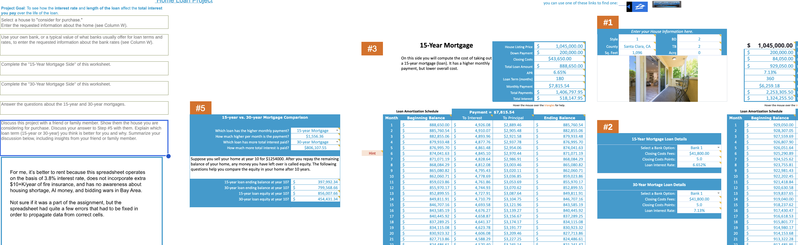

---

## SDC Chapter 3 — Programming Basics: Arrays, Structures & Tables

### Objectives

1. Understand what constitutes an array.
2. Access array elements using indexes.
3. Explain the difference between an array, matrix, vector, and scalar.
4. Define a series of numbers using the colon (`:`) operator.
5. Access selected array elements in multiple dimensions using the colon (`:`) operator and the `end` keyword.
6. Explain the difference between an array and a cell array.
7. Use the MATLAB Variables window to examine and modify array and structure elements.
8. Create a structure and add and modify its fields.
9. Work with an array of structures.
10. Create a table from various data sources.
11. Extract a sub-table.
12. Convert a table to a structure and back again.

### Summary of functions used in this chapter

#### Type & Shape Checks

| Function | Purpose | Example |
|---|---|---|
| `class` | Returns a variable's data type | `class(aVector)` $\rightarrow$ `double` |
| `size` | Returns the dimensions (rows, then columns) | `size(string1)` $\rightarrow$ `1 18` |
| `length` | Returns the size of the largest dimension | `length(1:5)` $\rightarrow$ `5` |
| `ndims` | Returns the number of dimensions | `ndims(randi(15,4,5,2))` $\rightarrow$ `3` |
| `numel` | Returns the total number of elements | `numel(magic(4))` $\rightarrow$ `16` |
| `isscalar` | Is it 1×1? | `isscalar(57)` $\rightarrow$ `1` |
| `isvector` | Is it 1×n or n×1? | `isvector(1:5)` $\rightarrow$ `1` |
| `ismatrix` | Is it 2-D? | `ismatrix(57)` $\rightarrow$ `1` |
| `isrow` | Is it a row vector? | `isrow(1:5)` $\rightarrow$ `1` |
| `iscolumn` | Is it a column vector? | `iscolumn((1:5)')` $\rightarrow$ `1` |
| `isempty` | Does it have no elements? | `isempty([])` $\rightarrow$ `1` |

#### Array Creation

| Function | Purpose | Example |
|---|---|---|
| `zeros` | Array of all 0s | `zeros(3)` |
| `ones` | Array of all 1s | `ones(10, 4)` |
| `rand` | Random floats between 0 and 1 | `rand(3)` |
| `randi` | Random integers from 1 to imax | `randi(10, 4)` |
| `true` / `false` | Logical 1s / 0s | `true(2, 3)` |
| `diag` | Diagonal matrix | `diag([1 2 3])` |
| `magic` | n×n matrix with equal row and column sums | `magic(5)` |
| `int16` | Converts to a 16-bit integer | `int16(345)` |

#### Concatenation

| Function | Purpose | Example |
|---|---|---|
| `cat` | Joins arrays along a chosen dimension | `cat(1, A, B)` |
| `horzcat` | Joins side by side (needs the same number of rows) | `horzcat(A, B)` |
| `vertcat` | Stacks top to bottom (needs the same number of columns) | `vertcat(A, B)` |

#### Strings & Math

| Function | Purpose | Example |
|---|---|---|
| `strcmp` | Is the whole text equal? Returns a single 1/0 | `strcmp(string1, 'b')` $\rightarrow$ `0` |
| `sum` | Adds up elements (column-wise for a matrix) | `sum(M(:))` |
| `cos` | Cosine (input in radians) | `cos(45)` |

#### Cell Arrays

| Function | Purpose | Example |
|---|---|---|
| `cell` | Creates a cell array of empty `[]` cells | `cell(4, 5)` |
| `iscell` | Is it a cell array? | `iscell(b)` $\rightarrow$ `1` |
| `cell2mat` | Cell array $\rightarrow$ matrix (all cells must be the same type) | `cell2mat({1, 2; 3, 4})` |
| `cell2struct` | Cell array $\rightarrow$ structure | `cell2struct(c, fields, 2)` |
| `cell2table` | Cell array $\rightarrow$ table | `cell2table(c)` |

#### Structures

| Function | Purpose | Example |
|---|---|---|
| `struct` | Creates a structure (empty, or from name/value pairs) | `struct('name', "Ludwig", 'age', 20)` |
| `fieldnames` | Cell array of the field names | `fieldnames(rocket)` |
| `rmfield` | Removes a field (from every element of a struct array) | `rocket = rmfield(rocket, 'stages')` |
| `struct2cell` | Structure $\rightarrow$ cell array | `struct2cell(person)` |
| `struct2table` | Structure $\rightarrow$ table | `struct2table(s, 'RowNames', rowNames)` |

#### Tables

| Function | Purpose | Example |
|---|---|---|
| `table` | Creates a table from variables | `table(diameter, rings, 'RowNames', planets)` |
| `summary` | Shows the metadata plus min/median/max of each variable | `summary(planetary_data)` |
| `table2array` | Table $\rightarrow$ array (data must be all one type) | `table2array(T(:, 1:3))` |
| `table2cell` | Table $\rightarrow$ cell array | `table2cell(T)` |
| `table2struct` | Table $\rightarrow$ structure | `table2struct(planetary_data)` |
| `table2timetable` | Table $\rightarrow$ timetable | `table2timetable(T)` |
| `array2table` | Array $\rightarrow$ table | `array2table(magic(3))` |
| `timetable2table` | Timetable $\rightarrow$ table | `timetable2table(TT)` |

#### Workspace & Display (commands)

| Command | Purpose | Example |
|---|---|---|
| `clear` | Removes all variables from the workspace | `clear` |
| `format` | Sets how many digits are displayed | `format long`, `format short` |

### 3.1 Arrays, Matrices, Vectors & Scalars

A **complex data type** holds a collection of values rather than a single one. In MATLAB the core one is the **array**: a collection of one data type, where each value is an **element** reached by an **index** in parentheses — `(row, column, page, ...)`.

| Term | Shape | Example |
|---|---|---|
| Array | any number of dimensions | `randi(15,4,5,2)` |
| Matrix | 2-D (rows × columns) | `magic(4)` |
| Vector | 1 × n (row) or n × 1 (column) | `1:5`, a char array |
| Scalar | 1 × 1 | `57`, an `int32` value |

These nest: every scalar is also a vector, a matrix, and an array.

```matlab
isscalar(57)
isvector(57)
ismatrix(57)

ans =

  logical

   1


ans =

  logical

   1


ans =

  logical

   1
```

**Key idea:** to MATLAB, almost everything is a matrix.

Because of this hierarchy, any array can be passed to a function written for its own type or for any broader type. For example, `57` works in functions that expect scalars, vectors, matrices, or arrays.

Arrays can have any number of dimensions.

**Indexing is 1-based.** The first element is `(1)` or `(1,1)`, not `(0,0)` as in C++, Java, or Python.

### 3.2 Growing Arrays & the Empty Array

If you assign to an index beyond the current size, the array expands. Arrays must stay rectangular, so every new filler element is set to `0`.

**Example: array growth**

```matlab
A = randi(10, 2)
A(4,3) = 54

A =

    10     9
     5     2


A =

    10     9     0
     5     2     0
     0     0     0
     0     0    54
```

**Example:** assigning a value to an element in a non-existent array creates that array with the new value in the lower right corner.

```matlab
clear
A(3,4) = 16

A =

     0     0     0     0
     0     0     0     0
     0     0     0    16
```

`[]` is an array with no elements. Operations return it when there's no answer, and it is also a common way to initialize an array. Test for it using the `isempty` function.

```matlab
A = []
size(A)
isempty(A)

A =

     []


ans =

     0     0


ans =

  logical

   1
```

### 3.3 Matrix Basics & Size

A matrix is a two-dimensional grid of values, indexed in rows and columns.

**In MATLAB, array indexes are 1-based**, which means that the first item is (1), (1,1), (1,1,1), etc.

Example: tic-tac-toe game:

```text
        (1,1) (1,2) (1,3)
(1,1)     X  |  X  |  O
        -----+-----+-----
(2,1)     O  |  O  |  X
        -----+-----+-----
(3,1)     X  |  O  |  X
```

**Note:** Single quotes produce a character array, while double quotes produce a string array.

```matlab
aScalar = int16(345);
string1 = 'To be or not to be';
string2 = "that is the question";
aVector = 1:5;
class(aScalar)
class(string1)
class(string2)
class(aVector)

ans =

    'int16'


ans =

    'char'


ans =

    'string'


ans =

    'double'
```

The variable *aScalar*, a single number of type int16, is considered by MATLAB as a matrix with one row and one column (ans = 1 1), which is to say a scalar. The vector *aVector* (ans = 1 5) is a matrix of one row and five columns, each of which contains a single number.
Note how *string1* is an array of characters and *string2* is interpreted as a single string.

```matlab
size(aScalar)
size(string1)
size(string2)
size(aVector)

ans =

     1     1


ans =

     1    18


ans =

     1     1


ans =

     1     5
```

### 3.4 Strings as Matrices

The character array string is a matrix of one row and many columns, each of which contains a single letter.
The string array is a matrix of one row and one column: a single element that contains the entire string.

Example:

```matlab
string2 == 'b'
strcmp(string2, 'b')
string1 == 'b'
strcmp(string1, 'b')

ans =

  logical

   0


ans =

  logical

   0


ans =

  1×18 logical array

   0   0   0   1   0   0   0   0   0   0   0   0   0   0   0   0   1   0


ans =

  logical

   0
```

The `==` operator and the `strcmp()` function give the same result for string array *string2*. They give very different results for the character array *string1*: `==` compares element-wise and `strcmp()` compares the whole value.

| | `==` | `strcmp()` |
|---|---|---|
| **Char array** `'...'` | Compares character by character and gives a logical array the same length as the text. Both sides must be the same length, or one side a single character. | Compares the whole text and gives a single `1` or `0` |
| `string1 == 'b'` / `strcmp(string1,'b')` | 1×18 logical, with `1` at positions 4 and 17 | `0` |
| `'abc' == 'abd'` / `strcmp('abc','abd')` | `[1 1 0]` | `0` |
| `'abc' == 'ab'` / `strcmp('abc','ab')` | **Error**, because the lengths don't match | `0` |
| **String array** `"..."` | Compares the whole text and gives a single `1` or `0` | Compares the whole text and gives a single `1` or `0` |
| `string2 == 'b'` / `strcmp(string2,'b')` | `0` | `0` |
| `"abc" == "abc"` / `strcmp("abc","abc")` | `1` | `1` |

### 3.5 The Colon Operator

The colon operator is used to specify an evenly spaced series of numbers in a conveniently terse manner.

```text
first number : step amount : limit
```

The *first number* is the starting number in the series.

The *step amount* is the numerical distance between each number in the series. It can be negative if *limit <= first number*.
The step amount is optional; the default step amount is 1.

The *limit* is the maximum number that can be found in the series (or the minimum if the step amount is negative). The step amount can cause this number to be exceeded but not hit precisely, so it might not be included in the resulting series.

```matlab
1:5
1:2:5
1:2:6

ans =

     1     2     3     4     5


ans =

     1     3     5


ans =

     1     3     5
```

### 3.6 Indexing with Colon & End

The colon operator has four main uses:

| Use | Example |
|---|---|
| Build a vector | `v = 1:2.5:100` |
| Select an index range | `M(1:3)`, `M(1:3, 2:4)` |
| Mean "all of this dimension" | `M(:, 4)` |
| Flatten into one column | `M(:)` |

```matlab
rng('default')
V = 1:5
M = randi(10, 4)
A = randi(15, 4, 5, 2)

V =

     1     2     3     4     5


M =

     9     7    10    10
    10     1    10     5
     2     3     2     9
    10     6    10     2


A(:,:,1) =

     7    10    11    10     5
    14     1    12     3     1
    12    13    12    11     2
    15    15     6     1    13


A(:,:,2) =

    11     7     3    11    10
     5     6     8    12     3
    15    12     7     5     2
     1    12    10    11     8
```

**Example: slicing**

```matlab
sub = V(3:5)

sub =

     3     4     5
```

This command asks for the element in row 2, column 4 of matrix M and returns a floating-point number:

```matlab
M(2, 4)

ans =

     5
```

This command asks for columns 1 and 2 from row 1 and row 2 of M and returns a 2 x 2 matrix. The row is specified first and the column second, as in *M(row, column)*.

```matlab
M(1:2, 1:2)

ans =

     9     7
    10     1
```

This command selects all elements in column 1. Putting a colon in place of any array dimension tells MATLAB to get the full range of that dimension – in this case all rows. It is equivalent to `1:end`.

```matlab
M(1:4, 1)
M(:, 1)

ans =

     9
    10
     2
    10


ans =

     9
    10
     2
    10
```

**Example: every other row and column**

This command creates a new matrix `A2` made up of every other row of every other column in an existing array `A1`.

```matlab
A1 = randi(15, 8, 10)
A2 = A1(1:2:8, 1:2:10)

A1 =

    15    14    13     6     6     9     3     4     2     4
     6    15     4    13     9     8    10    14    15    13
     9     9    14     9     2     1     4     3     1     7
     4     3     6     9     1     6    10    13    12    14
    12     3     3    14     8     3    11     9    13     3
     4     4     4     5    12    12    12    15    14     4
     8    13    10    12    15     5     7     2     2     3
    11     4     8    12     2     8     2     7     6     3


A2 =

    15    13     6     3     2
     9    14     2     4     1
    12     3     8    11    13
     8    10    15     7     2
```

The same selection in two steps:

```matlab
A2 = A1(1:2:8, :)
A3 = A2(:, 1:2:10)

A2 =

    15    14    13     6     6     9     3     4     2     4
     9     9    14     9     2     1     4     3     1     7
    12     3     3    14     8     3    11     9    13     3
     8    13    10    12    15     5     7     2     2     3


A3 =

    15    13     6     3     2
     9    14     2     4     1
    12     3     8    11    13
     8    10    15     7     2
```

**Example: assigning to a selection**

The colon-specified ranges can also be placed on the left side of an equation to allow you to assign a new value to only those selected array elements.

```matlab
A1(1:2:8, 1:2:10) = 0

A1 =

     0    14     0     6     0     9     0     4     0     4
     6    15     4    13     9     8    10    14    15    13
     0     9     0     9     0     1     0     3     0     7
     4     3     6     9     1     6    10    13    12    14
     0     3     0    14     0     3     0     9     0     3
     4     4     4     5    12    12    12    15    14     4
     0    13     0    12     0     5     0     2     0     3
    11     4     8    12     2     8     2     7     6     3
```

You can also replace a block with elements from another array:

```matlab
S = ones(10, 4)
T = randi(100, 2)
S(2:3, 2:3) = T

S =

     1     1     1     1
     1     1     1     1
     1     1     1     1
     1     1     1     1
     1     1     1     1
     1     1     1     1
     1     1     1     1
     1     1     1     1
     1     1     1     1
     1     1     1     1


T =

    87    55
    58    15


S =

     1     1     1     1
     1    87    55     1
     1    58    15     1
     1     1     1     1
     1     1     1     1
     1     1     1     1
     1     1     1     1
     1     1     1     1
     1     1     1     1
     1     1     1     1
```

To replace a block, the array on the right must be the same size as the selection. Here both are 2×2.

**Drills with `end`:**

```matlab
X = ones(3, 7)
X(2, [1 3]) = 2
X(2, 1:3) = 3
X([2 1], 2) = 4
X(end, 2) = 5
X(end, end) = 6
X([1 end], 4) = 7
X(1:end, 5) = 8
X(1, end-1) = 9
X(1:end, 5:6) = 10
X(1:end, 2:3) = [11 11; 12 12; 13 13]
X(:) = X(1, end)

X =

     1     1     1     1     1     1     1
     1     1     1     1     1     1     1
     1     1     1     1     1     1     1


X =

     1     1     1     1     1     1     1
     2     1     2     1     1     1     1
     1     1     1     1     1     1     1


X =

     1     1     1     1     1     1     1
     3     3     3     1     1     1     1
     1     1     1     1     1     1     1


X =

     1     4     1     1     1     1     1
     3     4     3     1     1     1     1
     1     1     1     1     1     1     1


X =

     1     4     1     1     1     1     1
     3     4     3     1     1     1     1
     1     5     1     1     1     1     1


X =

     1     4     1     1     1     1     1
     3     4     3     1     1     1     1
     1     5     1     1     1     1     6


X =

     1     4     1     7     1     1     1
     3     4     3     1     1     1     1
     1     5     1     7     1     1     6


X =

     1     4     1     7     8     1     1
     3     4     3     1     8     1     1
     1     5     1     7     8     1     6


X =

     1     4     1     7     8     9     1
     3     4     3     1     8     1     1
     1     5     1     7     8     1     6


X =

     1     4     1     7    10    10     1
     3     4     3     1    10    10     1
     1     5     1     7    10    10     6


X =

     1    11    11     7    10    10     1
     3    12    12     1    10    10     1
     1    13    13     7    10    10     6


X =

     1     1     1     1     1     1     1
     1     1     1     1     1     1     1
     1     1     1     1     1     1     1
```

The last line sets every element to the value in the top-right corner, which is `1`.

**Flip a matrix top to bottom:**

```matlab
X = magic(5)
X(end:-1:1, 1:end)

X =

    17    24     1     8    15
    23     5     7    14    16
     4     6    13    20    22
    10    12    19    21     3
    11    18    25     2     9


ans =

    11    18    25     2     9
    10    12    19    21     3
     4     6    13    20    22
    23     5     7    14    16
    17    24     1     8    15
```

`magic(n)` makes an n×n matrix whose rows, columns and diagonals all add up to the same total.

### 3.7 Reshaping & Array Functions

`(:)` stacks every column into a single column vector. That's useful for functions like `sum()`.

```matlab
M(:)
V(:)
A(:)

ans =

     9
    10
     2
    10
     7
     1
     3
     6
    10
    10
     2
    10
    10
     5
     9
     2


ans =

     1
     2
     3
     4
     5


ans =

     7
    14
    12
    15
    10
     1
    13
    15
   ...
     3
     2
     8
```

`A(:)` returns 40 rows; only the first 8 and last 3 are shown here.

```matlab
sum(M(:))

ans =

   106
```

> **Tip:** Double-click a variable in the **Workspace** to open it in the spreadsheet-style **Variables** window. There you can edit cells and insert or delete rows and columns.

**Figures 3.3 & 3.4 — Workspace and Variables window** (recreated in MATLAB):

```matlab
clear; clc
rng('default')
V  = 1:5;
A1 = randi(15, 8, 10);
A2 = A1(1:2:8, :);
A3 = A2(:, 1:2:10);
workspace
openvar('A1')
```

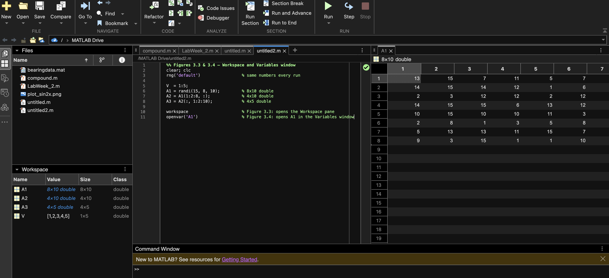

| Function | Action |
|---|---|
| `zeros` | Creates an array of all zeros |
| `ones` | Creates an array of all ones |
| `rand` | Creates an array of random floating-point numbers |
| `randi` | Creates an array of random integers |
| `true` / `false` | Creates an array of logical ones / zeros |
| `diag` | Creates a diagonal array |
| `cat` | Concatenates arrays |
| `horzcat` | Concatenates side by side (needs the same number of rows) |
| `vertcat` | Stacks top to bottom (needs the same number of columns) |
| `length` | Returns the size of the largest dimension |
| `size` | Returns the dimensions |
| `ndims` | Returns the number of dimensions |
| `numel` | Returns the number of elements |
| `isrow` / `iscolumn` | Is it a row / column vector? |

```matlab
length(A)
size(A)
ndims(A)
numel(A)
isrow(V)
iscolumn(V)
diag([1 2 3])
horzcat([1; 2], [3; 4])
vertcat([1 2], [3 4])

ans =

     5


ans =

     4     5     2


ans =

     3


ans =

    40


ans =

  logical

   1


ans =

  logical

   0


ans =

     1     0     0
     0     2     0
     0     0     3


ans =

     1     3
     2     4


ans =

     1     2
     3     4
```

### 3.8 Cell Arrays

A **cell array** can hold a different data type and size in each cell. Create one with `cell()` and index its contents with **curly braces `{}`**.

```matlab
a = cell(4)
b = cell(4, 5)
c = cell(4, 5, 2);
size(c)
A = [4 5 2];
d = cell(A);
size(d)

a =

  4×4 cell array

    {0×0 double}    {0×0 double}    {0×0 double}    {0×0 double}
    {0×0 double}    {0×0 double}    {0×0 double}    {0×0 double}
    {0×0 double}    {0×0 double}    {0×0 double}    {0×0 double}
    {0×0 double}    {0×0 double}    {0×0 double}    {0×0 double}


b =

  4×5 cell array

    {0×0 double}    {0×0 double}    {0×0 double}    {0×0 double}    {0×0 double}
    {0×0 double}    {0×0 double}    {0×0 double}    {0×0 double}    {0×0 double}
    {0×0 double}    {0×0 double}    {0×0 double}    {0×0 double}    {0×0 double}
    {0×0 double}    {0×0 double}    {0×0 double}    {0×0 double}    {0×0 double}


ans =

     4     5     2


ans =

     4     5     2
```

Every cell starts as an empty `[]`, shown as `{0×0 double}`. The `c` and `d` commands end with semicolons here so the two-page display isn't printed.

The four value assignments below also end with semicolons, so `b` is printed once at the end rather than after every line.

```matlab
b{2,2} = 4.2;
b{1,1} = 'Good morning';     % char
b{1,2} = "Bonjour";          % string
b{3,4} = cos(45);            % 45 is in radians
b{4,1} = int16(432);
b
b{3,4}
iscell(b)
cell2mat({1 2; 3 4})

b =

  4×5 cell array

    {'Good morning'}    {["Bonjour"]}    {0×0 double}    {0×0 double}    {0×0 double}
    {0×0 double    }    {[   4.2000]}    {0×0 double}    {0×0 double}    {0×0 double}
    {0×0 double    }    {0×0 double }    {0×0 double}    {[  0.5253]}    {0×0 double}
    {[         432]}    {0×0 double }    {0×0 double}    {0×0 double}    {0×0 double}


ans =

    0.5253


ans =

  logical

   1


ans =

     1     2
     3     4
```

The char array shows in single quotes and the string array in double quotes.

| Function | Action |
|---|---|
| `cell` | Creates a cell array |
| `iscell` | Is the variable a cell array? |
| `cell2mat` | Converts a cell array to a matrix (all cells must be the same type) |
| `cell2struct` | Converts a cell array to a structure |
| `struct2cell` | Converts a structure to a cell array |

> **Tip:** `format long` shows 16 digits; `format short` shows fewer.

### 3.9 Structures

A **struct** groups named **fields**, and each field can hold any data type. Assigning to a field creates the field, and the struct too if it doesn't exist yet.

```matlab
rocket = struct
rocket.manufacturer = "SpaceX"
rocket.model = "Falcon9";
rocket.height = 70;
rocket.diameter = 3.7;
rocket.stages = 2

rocket =

  struct with no fields.


rocket =

  struct with fields:

    manufacturer: "SpaceX"


rocket =

  struct with fields:

    manufacturer: "SpaceX"
           model: "Falcon9"
          height: 70
        diameter: 3.7000
          stages: 2
```

**All at once, with name/value pairs:**

```matlab
person = struct('name', "Ludwig", 'age', 20, 'height', 6.1)

person =

  struct with fields:

      name: "Ludwig"
       age: 20
    height: 6.1000
```

**A struct inside a struct:**

```matlab
enginesStage1.quantity = 9;
enginesStage1.burnTime = 162;
enginesStage1.totalThrustAtSeaLevel = 7600;
enginesStage1.totalThrustInVacuum = 8227;
rocket.engines = enginesStage1
time = rocket.engines.burnTime
rocket.engines.totalThrustAtSeaLevel = 7607;
rocket.engines

rocket =

  struct with fields:

    manufacturer: "SpaceX"
           model: "Falcon9"
          height: 70
        diameter: 3.7000
          stages: 2
         engines: [1×1 struct]


time =

   162


ans =

  struct with fields:

                 quantity: 9
                 burnTime: 162
    totalThrustAtSeaLevel: 7607
      totalThrustInVacuum: 8227
```

### 3.10 Structure Arrays

Every struct is really a 1×1 struct array, so you can add elements to it by index.

```matlab
enginesStage2.quantity = 1;
enginesStage2.burnTime = 397;
enginesStage2.totalThrustAtSeaLevel = "N/A";
enginesStage2.totalThrustInVacuum = 934;
rocket.engines(2) = enginesStage2;
rocket.engines
rocket.engines(2)
time = rocket.engines(1).burnTime

ans =

  1×2 struct array with fields:

    quantity
    burnTime
    totalThrustAtSeaLevel
    totalThrustInVacuum


ans =

  struct with fields:

                 quantity: 1
                 burnTime: 397
    totalThrustAtSeaLevel: "N/A"
      totalThrustInVacuum: 934


time =

   162
```

The field types can differ between elements: `totalThrustAtSeaLevel` is a number in `engines(1)` and a string in `engines(2)`.

**Rule:** every element of a struct array must have the **same fields**.

```matlab
engine3 = struct;
engine3.burnTime = 250;
rocket.engines(3) = engine3

Subscripted assignment between dissimilar structures.
```

MATLAB keeps the fields consistent for you. Fields that haven't been given a value are filled with `[]`.

```matlab
rocket(2).model = "Gemini"
rocket(2)
rocket(1).engines(2).type = "Merlin";
rocket(1).engines(1)
fieldnames(person)
person = rmfield(person, 'height')

rocket =

  1×2 struct array with fields:

    manufacturer
    model
    height
    diameter
    stages
    engines


ans =

  struct with fields:

    manufacturer: []
           model: "Gemini"
          height: []
        diameter: []
          stages: []
         engines: []


ans =

  struct with fields:

                 quantity: 9
                 burnTime: 162
    totalThrustAtSeaLevel: 7607
      totalThrustInVacuum: 8227
                     type: []


ans =

  3×1 cell array

    {'name'  }
    {'age'   }
    {'height'}


person =

  struct with fields:

    name: "Ludwig"
     age: 20
```

| Function | Action |
|---|---|
| `struct` | Creates a structure as a 1×1 structure array |
| `fieldnames` | Returns a cell array of all the field names |
| `rmfield` | Removes a field from a structure, or from every structure in an array |
| `struct2cell` | Converts a structure to a cell array |
| `cell2struct` | Converts a cell array to a structure |

### 3.11 Creating Tables

A **table** stores data of mixed types in a labeled grid, together with **metadata**. Each column, or group of columns, is a **variable**. A variable holds one type, but different variables can have different types.

**Rule:** every variable in a table must have the **same number of rows**.

| Function | Action |
|---|---|
| `table` | Creates an empty 0×0 table |
| `table(var1, ..., varX)` | Creates a table from existing variables |
| `table('Size', sz, 'VariableTypes', varTypes)` | Preallocates a table filled with default values |

```matlab
table([1;2;3], [4;5;6], [7;8;9])
Var1 = [1;2;3];
Var2 = [4 7; 5 8; 6 9];
table(Var1, Var2)

ans =

  3×3 table

    Var1    Var2    Var3
    ____    ____    ____

     1       4       7
     2       5       8
     3       6       9


ans =

  3×2 table

    Var1     Var2
    ____    ______

     1      4    7
     2      5    8
     3      6    9
```

`Var2` is one variable that spans two columns.

**The planetary data table:**

```matlab
diameter = [4879.40; 12103.60; 12742; 6779; 139822; 116464; 50724; 49244];
rotational_period = [1407.50; 5832.43; 23.93; 24.62; 9.92; 10.66; 17.23; 16.10];
orbital_period = [0.24; 0.62; 1.00; 1.88; 11.86; 29.45; 84.02; 164.79];
rings = {'No'; 'No'; 'No'; 'No'; 'Yes'; 'Yes'; 'Yes'};
atmosphere = {'None'; 'Carbon Dioxide, Nitrogen'; 'Nitrogen, Oxygen'; ...
       'Carbon Dioxide, Nitrogen, Argon'; 'Hydrogen, Helium'; ...
       'Hydrogen, Helium'; 'Hydrogen, Helium, Methane'; ...
       'Hydrogen, Helium, Methane'};
planetary_data = table(diameter, rotational_period, orbital_period, rings, atmosphere);

Error using tabular/verifyCountVars
All variables must have the same number of rows.
```

`rings` only has 7 entries, so add the missing 8th one and try again:

```matlab
rings(8) = {'Yes'};
planetary_data = table(diameter, rotational_period, orbital_period, rings, atmosphere)

planetary_data =

  8×5 table

     diameter     rotational_period    orbital_period    rings                atmosphere
    __________    _________________    ______________    _______    ___________________________________

        4879.4         1407.5                0.24        {'No' }    {'None'                           }
         12104         5832.4                0.62        {'No' }    {'Carbon Dioxide, Nitrogen'       }
         12742          23.93                   1        {'No' }    {'Nitrogen, Oxygen'               }
          6779          24.62                1.88        {'No' }    {'Carbon Dioxide, Nitrogen, Argon'}
    1.3982e+05           9.92               11.86        {'Yes'}    {'Hydrogen, Helium'               }
    1.1646e+05          10.66               29.45        {'Yes'}    {'Hydrogen, Helium'               }
         50724          17.23               84.02        {'Yes'}    {'Hydrogen, Helium, Methane'      }
         49244           16.1              164.79        {'Yes'}    {'Hydrogen, Helium, Methane'      }
```

**Naming things when you create the table:**

```matlab
varNames = {'Key', 'Name', 'Age'};
rowNames = {'Tunisia', 'France', 'Japan'};

table(var1, var2, var3, 'VariableNames', varNames);
table(var1, var2, var3, 'RowNames', rowNames);
table(var1, var2, var3, 'VariableNames', varNames, 'RowNames', rowNames);
table(var1, var2, var3, 'RowNames', rowNames, 'VariableNames', {'Key', 'Name', 'Age'});
```

These syntax examples assume `var1`, `var2` and `var3` already exist, so there is no output to show.

### 3.12 Table Properties

```matlab
planetary_data.Properties

ans =

  TableProperties with properties:

             Description: ''
                UserData: []
          DimensionNames: {'Row'  'Variables'}
           VariableNames: {'diameter'  'rotational_period'  'orbital_period'  'rings'  'atmosphere'}
    VariableDescriptions: {}
           VariableUnits: {}
      VariableContinuity: []
                RowNames: {}
        CustomProperties: No custom properties are set.
```

`Properties` is case-sensitive.

| Property | Data Type | Use |
|---|---|---|
| `Description` | String | Free-text explanation of the table |
| `UserData` | Array | Any extra information |
| `DimensionNames` | Cell array | Names of the dimensions (`Row`, `Variables` by default) |
| `VariableNames` | Cell array | Column headings |
| `VariableDescriptions` | Cell array | Longer description of each variable |
| `VariableUnits` | Cell array | Unit for each variable |
| `VariableContinuity` | Array | Used only with timetables |
| `RowNames` | Cell array | Heading for each row |

```matlab
planets = {'Mercury'; 'Venus'; 'Earth'; 'Mars'; 'Jupiter'; 'Saturn'; 'Uranus'; 'Neptune'};
planetary_data.Properties.RowNames = planets;
planetary_data.Properties.VariableNames(1) = {'Diameter'};
planetary_data.Properties.VariableNames(2) = {'Rotational_Period'};
planetary_data.Properties.VariableNames(3) = {'Orbital_Period'};
planetary_data.Properties.VariableNames(4) = {'Rings'};
planetary_data.Properties.VariableNames(5) = {'Atmosphere'}

planetary_data =

  8×5 table

                Diameter     Rotational_Period    Orbital_Period    Rings                Atmosphere
               __________    _________________    ______________    _______    ___________________________________

    Mercury        4879.4         1407.5                0.24        {'No' }    {'None'                           }
    Venus           12104         5832.4                0.62        {'No' }    {'Carbon Dioxide, Nitrogen'       }
    Earth           12742          23.93                   1        {'No' }    {'Nitrogen, Oxygen'               }
    Mars             6779          24.62                1.88        {'No' }    {'Carbon Dioxide, Nitrogen, Argon'}
    Jupiter    1.3982e+05           9.92               11.86        {'Yes'}    {'Hydrogen, Helium'               }
    Saturn     1.1646e+05          10.66               29.45        {'Yes'}    {'Hydrogen, Helium'               }
    Uranus          50724          17.23               84.02        {'Yes'}    {'Hydrogen, Helium, Methane'      }
    Neptune         49244           16.1              164.79        {'Yes'}    {'Hydrogen, Helium, Methane'      }
```

The book uses the next command to show an error, because older MATLAB only allows valid variable names (no spaces) as column names.

```matlab
planetary_data.Properties.VariableNames(2) = {'Rotational Period'}
```

- **Before R2019b:** the command errors because `'Rotational Period'` is not a valid variable name.
- **R2019b and later:** the command works, and you access the column with `planetary_data.('Rotational Period')`.

If the rename worked in your version, set the name back so the commands later in this chapter still run:

```matlab
planetary_data.Properties.VariableNames(2) = {'Rotational_Period'};
```

**Units and dimension names:**

```matlab
planetary_data.Properties.VariableUnits = {'km', 'hours', 'Earth years', '', ''};
planetary_data.Properties.DimensionNames = {'Planet', 'Data'};
planetary_data.Properties.VariableUnits

ans =

  1×5 cell array

    {'km'}    {'hours'}    {'Earth years'}    {0×0 char}    {0×0 char}
```

- Row names can be any string.
- A table **copies** your data. Changing `diameter` afterwards doesn't update the table.

```matlab
planetary_data.Properties.Description = 'Planets of the solar system';
summary(planetary_data)

Description:  Planets of the solar system
Variables:
    Diameter: 8×1 double
        Properties:
            Units:  km
        Values:
            Min          4879.4
            Median        30993
            Max      1.3982e+05
    Rotational_Period: 8×1 double
        Properties:
            Units:  hours
        Values:
            Min          9.92
            Median      20.58
            Max        5832.4
    Orbital_Period: 8×1 double
        Properties:
            Units:  Earth years
        Values:
            Min          0.24
            Median       6.87
            Max        164.79
    Rings: 8×1 cell array of character vectors
    Atmosphere: 8×1 cell array of character vectors
```

`summary` shows the metadata and gives the min, median and max for each numeric variable.

### 3.13 Accessing & Adding Table Data

```matlab
mars = planetary_data(4, :)
mars = planetary_data('Mars', :);
mars_rotation = planetary_data('Mars', 'Rotational_Period')

mars =

  1×5 table

            Diameter    Rotational_Period    Orbital_Period    Rings     Atmosphere
            ________    _________________    ______________    ______    _________________________________

    Mars      6779            24.62               1.88         {'No'}    {'Carbon Dioxide, Nitrogen, Argon'}


mars_rotation =

  table

            Rotational_Period
            _________________

    Mars          24.62
```

`planetary_data('Mars', :)` gives the same result as `planetary_data(4, :)`, but uses the row name.

```matlab
planets = {'Mercury', 'Jupiter', 'Neptune'};
facts = {'Diameter', 'Rotational_Period'};
planetary_data(planets, facts)
planetary_data{planets, facts}

ans =

  3×2 table

                Diameter     Rotational_Period
               __________    _________________

    Mercury        4879.4         1407.5
    Jupiter    1.3982e+05           9.92
    Neptune         49244           16.1


ans =

   1.0e+05 *

    0.0488    0.0141
    1.3982    0.0001
    0.4924    0.0002
```

Parentheses `()` return a **table**. Curly braces `{}` return a plain **array**, which only works when the types are compatible. The `1.0e+05 *` line means every value in the array is multiplied by 100,000.

| Command | Return Type | Retrieved Data |
|---|---|---|
| `planetary_data(planets, facts)` | table | The chosen rows from the chosen columns |
| `planetary_data{planets, facts}` | array | The same, if all the data is of compatible types |
| `planetary_data.Rings` / `planetary_data.(4)` | array | Every column of that variable |
| `planetary_data.Rotational_Period('Saturn')` / `planetary_data.Rotational_Period(6)` / `planetary_data.(2)(6)` | value or array | One value, or several if the variable spans more than one column |
| `planetary_data.Variables` | array | All rows, if the data is of compatible types |

```matlab
planetary_data.Rotational_Period('Saturn')
planetary_data.(2)(6)

ans =

   10.6600


ans =

   10.6600
```

**Filtering with a logical test:**

```matlab
small_planets = planetary_data.Diameter < planetary_data.Diameter('Earth')
small_planet_table = planetary_data(small_planets, :)

small_planets =

  8×1 logical array

   1
   1
   0
   1
   0
   0
   0
   0


small_planet_table =

  3×5 table

               Diameter    Rotational_Period    Orbital_Period    Rings                Atmosphere
               ________    _________________    ______________    ______    ___________________________________

    Mercury     4879.4          1407.5               0.24         {'No'}    {'None'                           }
    Venus        12104          5832.4               0.62         {'No'}    {'Carbon Dioxide, Nitrogen'       }
    Mars          6779           24.62               1.88         {'No'}    {'Carbon Dioxide, Nitrogen, Argon'}
```

**Adding a column:**

```matlab
planetary_data.Known_Life = {'No'; 'No'; 'Yes'; 'No'; 'No'; 'No'; 'No'; 'No'};
planetary_data(:, {'Diameter', 'Known_Life'})

ans =

  8×2 table

                Diameter     Known_Life
               __________    __________

    Mercury        4879.4     {'No' }
    Venus           12104     {'No' }
    Earth           12742     {'Yes'}
    Mars             6779     {'No' }
    Jupiter    1.3982e+05     {'No' }
    Saturn     1.1646e+05     {'No' }
    Uranus          50724     {'No' }
    Neptune         49244     {'No' }
```

Note: The new column's values go in a column (semicolons between them). The book separates them with commas instead, which makes a 1×8 row, and MATLAB rejects that because the table has 8 rows.

### 3.14 Table Conversion Functions

| Function | Action |
|---|---|
| `table2array` | Converts a table of same-type data to an array |
| `table2cell` | Converts a table to a cell array |
| `table2struct` | Converts a table to a structure |
| `table2timetable` | Converts a table to a timetable |
| `array2table` | Converts an array to a table |
| `cell2table` | Converts a cell array to a table |
| `struct2table` | Converts a structure to a table |
| `timetable2table` | Converts a timetable to a table |

```matlab
planet_struct = table2struct(planetary_data);
size(planet_struct)
planet_struct(4)
planet_table = struct2table(planet_struct);
planet_table.Properties.RowNames

ans =

     8     1


ans =

  struct with fields:

             Diameter: 6779
    Rotational_Period: 24.6200
       Orbital_Period: 1.8800
                Rings: 'No'
           Atmosphere: 'Carbon Dioxide, Nitrogen, Argon'
           Known_Life: 'No'


ans =

  0×0 empty cell array
```

The struct array has one element per planet, and each table variable became a field. The row names and units were lost in the conversion, so `planet_table` has no row names.

```matlab
rowNames = {'Mercury', 'Venus', 'Earth', 'Mars', 'Jupiter', 'Saturn', 'Uranus', 'Neptune'}
planet_table = struct2table(planet_struct, 'RowNames', rowNames);
planet_table('Mars', {'Diameter', 'Known_Life'})

rowNames =

  1×8 cell array

    {'Mercury'}    {'Venus'}    {'Earth'}    {'Mars'}    {'Jupiter'}    {'Saturn'}    {'Uranus'}    {'Neptune'}


ans =

  1×2 table

            Diameter    Known_Life
            ________    __________

    Mars      6779        {'No'}
```

After converting back, reassign the other metadata (description, units and so on) through `.Properties`.

---

## SDC Chapter 3 — Exercises

Each worked solution is collapsed, so you can try the exercise yourself before opening it. The `randi` exercises call `rng('default')` first, so your output should match.

**Exercise 3.1** — Using the colon operator, create a 1 × 10 array whose first five numbers are the odd numbers from 1 to 9 and whose last five are the even numbers from 2 to 10. *Hint: a comma is involved.*

<details><summary>Solution</summary>

```matlab
[1:2:9, 2:2:10]

ans =

     1     3     5     7     9     2     4     6     8    10
```

</details>

**Exercise 3.2** — Create a 6 × 6 array with `randi()`. Using the colon operator, write an equation that retrieves the upper-left 3 × 3 corner of the array.

<details><summary>Solution</summary>

```matlab
rng('default')
R = randi(10, 6)
corner = R(1:3, 1:3)

R =

     9     3    10     8     7     8
    10     6     5    10     8     1
     2    10     9     7     8     3
    10    10     2     1     4     1
     7     2     5     9     7     1
     1    10    10    10     2     9


corner =

     9     3    10
    10     6     5
     2    10     9
```

</details>

**Exercise 3.3** — Create an 8 × 8 array with `randi()`. Using the colon operator, write an equation that builds a new array from every other row and column of the original.

<details><summary>Solution</summary>

```matlab
rng('default')
R = randi(10, 8)
everyOther = R(1:2:end, 1:2:end)

R =

     9    10     5     7     3     5     8    10
    10    10    10     8     1     4     8     4
     2     2     8     8     1     8     3     6
    10    10    10     4     9     8     7     3
     7    10     7     7     7     2     7     8
     1     5     1     2     4     5     2     3
     3     9     9     8    10     5     2     6
     6     2    10     1     1     7     5     7


everyOther =

     9     5     3     8
     2     8     1     3
     7     7     7     7
     3     9    10     2
```

</details>

**Exercise 3.4** — Create a structure called `student` with four fields: a character array `name`, an `int8` `age`, a floating-point `GPA` and a string array `major`. Give each field a suitable value. Convert the structure to a cell array and multiply each age entry by three.

<details><summary>Solution</summary>

```matlab
student = struct('name', 'Ada', 'age', int8(20), 'GPA', 3.85, 'major', "Physics")
c = struct2cell(student)
c{2} = c{2} * 3
class(c{2})

student =

  struct with fields:

     name: 'Ada'
      age: 20
      GPA: 3.8500
    major: "Physics"


c =

  4×1 cell array

    {'Ada'      }
    {[       20]}
    {[   3.8500]}
    {["Physics"]}


c =

  4×1 cell array

    {'Ada'      }
    {[       60]}
    {[   3.8500]}
    {["Physics"]}


ans =

    'int8'
```

Multiplying an `int8` by 3 keeps the `int8` type. `int8` values stop at 127, so any age above 42 would be capped at 127 after multiplying by 3.

</details>

**Exercise 3.5** — Using a combination of structure arrays and cell arrays, build a MATLAB structure called `house` with this content:

```text
house
  address
  year_built
  rooms
    bedroom          200 sq_ft;  furniture: bed, dresser, nightstand
    kitchen          100 sq_ft;  appliances: stove, refrigerator, dishwasher
    man/woman_cave   300 sq_ft;  gaming_systems: Xbox, Playstation
    garage           1000 sq_ft
  cars
    car1   make, model, year
    car2   make, model, year
```

*Hint: build from the smallest part to the largest.*

<details><summary>Solution</summary>

`man/woman_cave` isn't a valid field name because of the `/`, so this solution uses `man_woman_cave`.

```matlab
bedroom.sq_ft = 200;
bedroom.furniture = {'bed', 'dresser', 'nightstand'};
kitchen.sq_ft = 100;
kitchen.appliances = {'stove', 'refrigerator', 'dishwasher'};
cave.sq_ft = 300;
cave.gaming_systems = {'Xbox', 'Playstation'};
garage.sq_ft = 1000;
rooms.bedroom = bedroom;
rooms.kitchen = kitchen;
rooms.man_woman_cave = cave;
rooms.garage = garage;
cars(1).make = "Toyota";
cars(1).model = "Camry";
cars(1).year = 2020;
cars(2).make = "Tesla";
cars(2).model = "Model 3";
cars(2).year = 2023;
house.address = "123 Main St";
house.year_built = 1998;
house.rooms = rooms;
house.cars = cars
house.rooms
house.rooms.kitchen
house.cars(2)

house =

  struct with fields:

       address: "123 Main St"
    year_built: 1998
         rooms: [1×1 struct]
          cars: [1×2 struct]


ans =

  struct with fields:

           bedroom: [1×1 struct]
           kitchen: [1×1 struct]
    man_woman_cave: [1×1 struct]
            garage: [1×1 struct]


ans =

  struct with fields:

         sq_ft: 100
    appliances: {'stove'  'refrigerator'  'dishwasher'}


ans =

  struct with fields:

     make: "Tesla"
    model: "Model 3"
     year: 2023
```

</details>

**Exercise 3.6** — Use the information from Exercise 3.5 to create a table.

<details><summary>Solution</summary>

```matlab
roomNames = {'bedroom'; 'kitchen'; 'man_woman_cave'; 'garage'};
sq_ft = [200; 100; 300; 1000];
contents = {{'bed', 'dresser', 'nightstand'}; ...
               {'stove', 'refrigerator', 'dishwasher'}; ...
               {'Xbox', 'Playstation'}; {}};
rooms_table = table(sq_ft, contents, 'RowNames', roomNames)
cars_table = struct2table(house.cars)

rooms_table =

  4×2 table

                      sq_ft     contents
                      _____    __________

    bedroom            200     {1×3 cell}
    kitchen            100     {1×3 cell}
    man_woman_cave     300     {1×2 cell}
    garage            1000     {0×0 cell}


cars_table =

  2×3 table

     make        model      year
    ________    _________    ____

    "Toyota"    "Camry"      2020
    "Tesla"     "Model 3"    2023
```

This solution makes two tables, because rooms and cars have different fields. `struct2table` turns the `cars` struct array straight into a table.

</details>

## SDC Chapter 4 — Looping & Conditionals

### Objectives

1. Define the most basic of functions and save it in a .m file.
2. Declare and use the two loop styles found in MATLAB: while and for.
3. Declare and use the two conditional styles found in MATLAB: if(-elseif-else) and switch.
4. Understand the flow of execution in a function that contains looping and conditional statements.
5. Exit a function at the line of your choosing.

### Summary of functions used in this chapter

| Function / keyword | What it does | Example |
|---|---|---|
| `edit name` | open/create `name.m` in Editor | `edit loops` |
| `function ... end` | define function; name = file name | `function loops()` |
| `while cond ... end` | repeat while cond true; check at start | `while x < 6` |
| `for i = a:s:b ... end` | repeat once per array element | `for i = 1:3` |
| `if / elseif / else / end` | run first block whose cond true | `if strcmp(p,'Mars')` |
| `switch / case / otherwise / end` | pick block by value | `switch planet` |
| `strcmp(a,b)` | text equal? $\rightarrow$ 1/0 | `strcmp(planet,'Mars')` |
| `fprintf(fmt, vals)` | formatted print; `%d` int, `\n` newline, `\t` tab | `fprintf('x = %d\n', x)` |
| `disp(x)` | plain print, simpler than fprintf | `disp("Gravity = " + g)` |
| `ceil(x)` | round toward +∞ | `ceil(-2.4)` $\rightarrow$ `-2` |
| `size(A, dim)` | length along one dim (1 = rows, 2 = cols) | `size(ImageMap, 1)` |
| `imread(file)` | image $\rightarrow$ array (rows × cols × 3 for RGB) | `imread('pretty.png')` |
| `imwrite(A, file)` | array $\rightarrow$ image file | `imwrite(ImageMap, f)` |
| `break` | quit loop, go past its `end` | `if x == 6, break; end` |
| `continue` | skip rest of this iteration | `if x == 6, continue; end` |
| `return` | quit whole function | `return` |
| `factorial(n)` | n! (built-in, for checking Ex 4.4) | `factorial(150)` |

### 4.1 Using the MATLAB Editor

- **Script** = list of commands saved in `.m` file. Basic program type.
- **Function** = package of code, called from Command Window or other function. Takes inputs, (usually) returns outputs. More in next chapter.
- Both stored in `.m` files.

**Ways to open a new function:**

- Home ribbon $\rightarrow$ **New** $\rightarrow$ **Function** (Figure 4.1). Opens unnamed file with skeleton + helpful text.
- `edit` $\rightarrow$ new blank unnamed file; ribbon switches to Editor tab.
- `edit filename` $\rightarrow$ new blank file saved as `filename.m` in current folder.

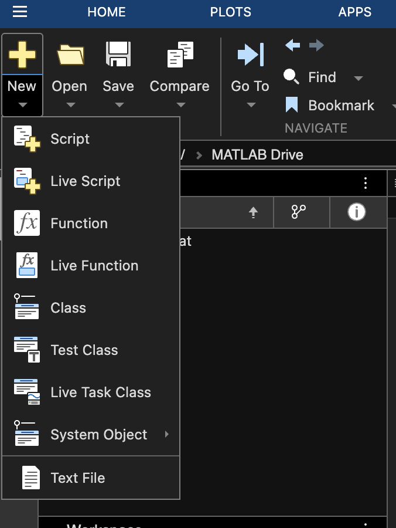

```matlab
edit loops
```

Select **Yes** if asked to create the file. Editor opens above the Command Window (Figure 4.2).Don't need `.m` — MATLAB adds it. `edit loops.m` also works.


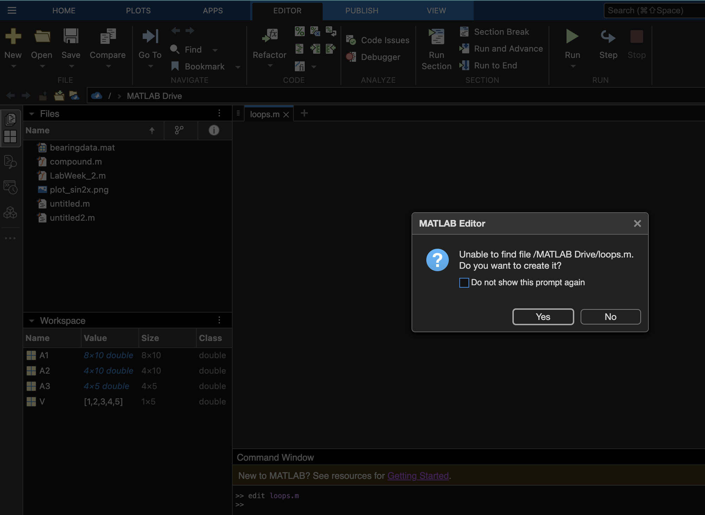


Enter skeleton, blank line before `end` (Figure 4.3):

```matlab
function loops()

end
```
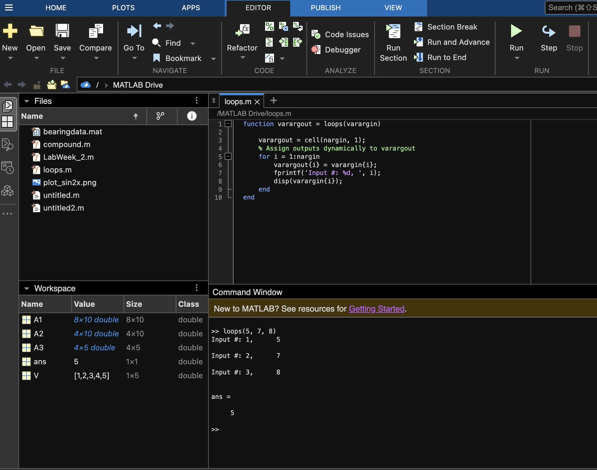


> **Tip:** Can also type code in any editor (Notepad etc.) and paste into the MATLAB Editor later.

### 4.2 Loops & Algorithms

**Loop** = run same block over and over, usually w/ different data each time. Uses:

- same operation on each member of a set
- walk through info looking for a match
- operation a given number of times

**Algorithm** = sequence of steps in plain language before code. Adding first 5 even numbers:

1. Start with the first even number: 2
2. Get the second even number: 4
3. Add 2 + 4
4. Get the third even number: 6
5. Add (2 + 4) + 6
6. Get the fourth even number: 8
7. Add ((2 + 4) + 6) + 8
8. Get the fifth even number: 10
9. Add (((2 + 4) + 6) + 8) + 10

From step 4, just repeating steps 2 & 3. Generalized:

1. Get a number
2. Get the next number
3. Add those numbers and call the sum X
4. Get the next number
5. X = X + the new number
6. Repeat steps 4 & 5 until you're done
7. Get on with your life

**End condition** = how you know you're done ("retrieved a million numbers yet?"). Evaluates true/false.

**Infinite loop** = condition can never be met (e.g. "Does X = 3?" when adding even numbers). Sometimes on purpose, usually a bug. Function churning, no output $\rightarrow$ suspect infinite loop.

### 4.3 while Loops

```text
while condition
    block of code
end
```

- Block runs as long as condition true.
- Condition checked at **start** $\rightarrow$ block may never run.
- Condition = simple logical, complex logical, or function call, as long as result true/false.
- Parentheses around condition optional.

MATLAB does not have a **do-while** loop.
**Formatting:** indent code between opening statement and `end` (loops, branches, functions). Nested blocks $\rightarrow$ another level. MATLAB auto-indents. 2 or 4 spaces most common. Set in Preferences $\rightarrow$ Editor/Debugger $\rightarrow$ Tab.

**Example loops.m**

```matlab
function loops()
    x = 0;
    while x < 6
        x = x + 1;
        fprintf('x = %d\n',x);
    end
end
```

- `x = 0` $\rightarrow$ enter loop $\rightarrow$ `0 < 6` true $\rightarrow$ body (loop body) runs: x + 1, print.
- Back to `while`, re-check. When x = 6 $\rightarrow$ false $\rightarrow$ jump past loop `end` $\rightarrow$ function `end` $\rightarrow$ exit.

Run by typing function name in Command Window:

```matlab
loops

x = 1
x = 2
x = 3
x = 4
x = 5
x = 6
```

> **Tip:** `%d` = print as signed integer, `\n` = new line.

**Semicolons:** optional in MATLAB (unlike C++/Java), but suppress output.


**Sum of first million even numbers** — add before the last `end` :

```matlab
function loops()
    x = 0;
    while x < 6
        x = x + 1;
        fprintf('x = %d\n',x);
    end

    count = 0;
    runningSum = 0;
    evenNum = 0;
    while count < 1000000
        evenNum = evenNum + 2;
        runningSum = runningSum + evenNum;
        count = count + 1;
    end
    fprintf('The sum is %d\n', runningSum);
end
```

```matlab
loops

x = 1
x = 2
x = 3
x = 4
x = 5
x = 6
The sum is 1000001000000
```

Loop ran 1,000,000 times in a blink. (Check: $2 + 4 + \dots + 2n = n(n+1)$, so the sum is $10^6 \cdot (10^6 + 1)$.)
### 4.4 for Loops

Loop **index** controls how many times the block runs; often also used as a variable inside.

```text
for loopIndex = firstValue : lastValue
    block of code
end
```

- `loopIndex` $\rightarrow$ any legal name. Tradition = `i`, but easy to confuse with `1` / `l`.
- `firstValue` / `lastValue` $\rightarrow$ integers or floats; numbers, variables, calculations, function calls, any mix.
- The `:` part is just the colon operator $\rightarrow$ makes an array of index values.
- The `for` condition can be **any** array, even 3-D.

```matlab
index = 1:4

index =

     1     2     3     4
```

```matlab
num = 12;
firstValue = 2;
lastValue = 8;
index = firstValue : lastValue
index = ceil(-2.4) : 5
index = 3/8 + num : 2*7.5

index =

     2     3     4     5     6     7     8


index =

    -2    -1     0     1     2     3     4     5


index =

   12.3750   13.3750   14.3750
```

**forloops.m** — `edit forloops`, select **Yes**:

```matlab
function forloops()
    x = 10;
    loopCounter = 1;
    for i = 1:3
        fprintf("Entering loop #" + loopCounter);

        loopCounter = loopCounter + 1;

        fprintf("\n\ti (loop index) = " + i);
        fprintf("\n\tx (on entry) = " + x);

        x = x + i;

        fprintf("\n\tx (on exit) = " + x);
        fprintf("\n");
    end
end
```

> **Important:** Function name **must** match the file name.

> **Warning:** Don't use `i` or `j` as loop variables if your code uses imaginary numbers — `i`/`j` = √-1 in MATLAB and get overwritten.

```matlab
>> i

ans =

   0.0000 + 1.0000i

>> j

ans =

   0.0000 + 1.0000i

>>
```

```matlab
forloops

Entering loop #1
	i (loop index) = 1
	x (on entry) = 10
	x (on exit) = 11
Entering loop #2
	i (loop index) = 2
	x (on entry) = 11
	x (on exit) = 13
Entering loop #3
	i (loop index) = 3
	x (on entry) = 13
	x (on exit) = 16
```

Loop # matches loop index $\rightarrow$ default step = 1.

### 4.5 Step Values & Index Arrays

Add a step between first and last, like any colon array:

```text
for loopIndex = firstValue : stepAmount : lastValue
    block of code
end
```

Change line 4 of `forloops.m` from `for i = 1:3` to:

```matlab
for i = 1 : 0.3 : 3
```

```matlab
forloops

Entering loop #1
	i (loop index) = 1
	x (on entry) = 10
	x (on exit) = 11
Entering loop #2
	i (loop index) = 1.3
	x (on entry) = 11
	x (on exit) = 12.3
Entering loop #3
	i (loop index) = 1.6
	x (on entry) = 12.3
	x (on exit) = 13.9
Entering loop #4
	i (loop index) = 1.9
	x (on entry) = 13.9
	x (on exit) = 15.8
Entering loop #5
	i (loop index) = 2.2
	x (on entry) = 15.8
	x (on exit) = 18
Entering loop #6
	i (loop index) = 2.5
	x (on entry) = 18
	x (on exit) = 20.5
Entering loop #7
	i (loop index) = 2.8
	x (on entry) = 20.5
	x (on exit) = 23.3
```

`lastValue` 3 not in the array: 2.8 + 0.3 = 3.1 > 3 $\rightarrow$ stop.

```matlab
i = 1 : 0.3 : 3

i =

    1.0000    1.3000    1.6000    1.9000    2.2000    2.5000    2.8000
```


**Negative step** $\rightarrow$ count down. `firstValue` must be > `lastValue`, else body never runs.

```matlab
x = 10
for i = 2 : -0.4 : 1
    x = x + 1;
end
x

x =

    10


x =

    13
```

`i` = 2, 1.6, 1.2 $\rightarrow$ 3 passes. (Last line `x` added here to show the result.)
Step can be number, variable, or calculation; int or float.

**Any array works** as the loop condition. Change the line to:

```matlab
for i = [1, 1.3, 1.6, 1.9, 2.2, 2.5, 2.8]
```

`forloops` $\rightarrow$ same output as the `1 : 0.3 : 3` run. Colon form is more practical for long arrays.

Array in a variable:

```matlab
indexArray = 1:200;
for i = indexArray
```

### 4.6 if & if-else Statements

**Conditional statements** $\rightarrow$ decide whether to run a block, or pick between mutually exclusive blocks. Two flavors: **if** (+ sub-flavors) and **switch**.

**if:**

```text
if condition
    block of code
end
```

- Condition $\rightarrow$ any logical expression (like `while`).
- True $\rightarrow$ run block. False $\rightarrow$ skip to the line after `end`.

> **Tip:** Parentheses around condition optional.

Terminal velocity example, as a function, set values from a String `planet`:

```matlab
if (strcmp(planet, 'Mars'))
    gravity = 3.711;
    atmosphericDensity = 0.020;
end
```

**if-else** $\rightarrow$ exactly one of two blocks runs:

```text
if condition
    block of code 1
else
    block of code 2
end
```

Only one `else` per `if`.

```matlab
edit branches
```

**branches.m — Figure 4.8:**

```matlab
function branches()
    planet = 'Earth';
    if strcmp(planet, 'Mars')
        gravity = 3.711;
        atmosphericDensity = 0.020;
    else
        gravity = 9.798;
        atmosphericDensity = 1.2170;
    end
    disp("Gravity = " + gravity);
end
```

> **Note:** `disp` = output command like `fprintf`, but simpler, doesn't format, just outputs the value.

```matlab
branches

Gravity = 9.798
```

Condition false $\rightarrow$ `else` block $\rightarrow$ Earth values. Change `planet` to `'Mars'` and re-run:

```matlab
branches

Gravity = 3.711
```

### 4.7 if-elseif-else & switch Statements

**if-elseif-else** $\rightarrow$ add one or more `elseif` blocks, each with own condition:

```text
if condition 1
    block of code 1
elseif condition 2
    block of code 2
elseif condition 3
    block of code 3
...
else
    block of code 4
end
```

- Only first block whose condition is true runs.
- `else` = optional fallback. Omit $\rightarrow$ possible that no block runs.
- Too many `elseif`s $\rightarrow$ look for a more elegant design.

**Figure 4.9 — flow chart:** Condition 1 $\rightarrow$ true $\rightarrow$ Block 1 $\rightarrow$ End; false $\rightarrow$ Condition 2 $\rightarrow$ true $\rightarrow$ Block 2 $\rightarrow$ End; false $\rightarrow$ Condition 3 $\rightarrow$ true $\rightarrow$ Block 3 $\rightarrow$ End; false $\rightarrow$ Block 4 $\rightarrow$ End.

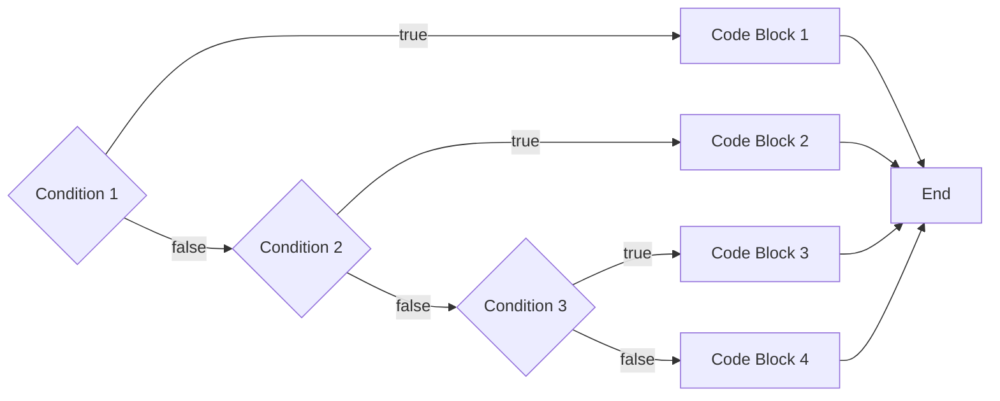

> **Tip:** **Elegant** code = brevity, clarity, efficiency. Clever, but not so clever others can't read or change it.

**switch** $\rightarrow$ same variable tested against many values (**cases**). Cleaner than a long `elseif` chain.

```text
switch variable
    case value 1
        block of code 1
    case value 2
        block of code 2
    case value 3
        block of code 3
    ...
    otherwise
        block of code 4
end
```

**Same result, two ways** (default = Earth):

| switch | if-elseif-else |
|---|---|
| <pre>switch planet<br>  case 'Mars'<br>    gravity = 3.71;<br>    atmosphericDensity = 0.020;<br>  case 'Saturn'<br>    gravity = 10.44;<br>    atmosphericDensity = 0.19;<br>  case 'Neptune'<br>    gravity = 11.15;<br>    atmosphericDensity = 0.45;<br>  otherwise<br>    gravity = 9.798;<br>    atmosphericDensity = 1.217;<br>end</pre> | <pre>if strcmp(planet, 'Mars')<br>  gravity = 3.71;<br>  atmosphericDensity = 0.020;<br>elseif strcmp(planet, 'Saturn')<br>  gravity = 10.44;<br>  atmosphericDensity = 0.19;<br>elseif strcmp(planet, 'Neptune')<br>  gravity = 11.15;<br>  atmosphericDensity = 0.45;<br>else<br>  gravity = 9.798;<br>  atmosphericDensity = 1.217;<br>end</pre> |

### 4.8 Terminal Velocity with Conditionals

Terminal velocity of a 25 mm ball bearing, script version.

1. Clear the Command Window and Workspace (`clc`, `clear`).
2. **Open** button $\rightarrow$ `terminalVelocityConditionals.m` from the data files (Figure 4.10).

**terminalVelocityConditionals.m** 

```matlab
function terminalVelocityConditionals(planet)

% program to calculate terminal velocity
% Vt = terminal velocity
% dia = diameter of sphere (in cm)
% mass = mass of the falling object(65.4710 grams)
% gravity = acceleration due to gravity (in cm/sec^2)
% atmosphericDensity = density of the medium through which the object is
% falling (in g/cm^3)
% area = cross-sectional area of the object,
%        for a sphere it is pi*radius^2
% C = drag coefficient (sphere is approx 0.47)
%
% Set planet in the Command Window before running, e.g.
%   planet = 'Neptune'
% planet = 'Mars'

    if ~nargin
        planet  = 'Neptune';
    end

    switch planet
        case 'Mars'
            gravity = 371;
            atmosphericDensity = 0.000020;
        case 'Saturn'
            gravity = 1044;
            atmosphericDensity = 0.00019;
        case 'Neptune'
            gravity = 1115;
            atmosphericDensity = 0.00045;
        otherwise   % Earth
            gravity = 981;
            atmosphericDensity = 0.001217;
    end % end switch
    dia = 2.5;
    area = pi*((dia/2)^2);
    mass = 65.4710;
    C = 0.47;
    Vt = sqrt((2*mass*gravity)/(atmosphericDensity*area*C));
    fprintf('For %s, terminal velocity is %.4f cm/s units \n', planet, Vt);
end % end of function
```

```matlab
>> terminalVelocityConditionals
For Neptune, terminal velocity is 11858.6918 cm/s units 
```


**Save As** `terminalVelocityCond2.m` and replace the `switch` with `if-elseif`:

```matlab
if strcmp (planet, 'Mars')
    gravity = 371;
    atmosphericDensity = 0.000020;
elseif strcmp (planet, 'Saturn')
    gravity = 1044;
    atmosphericDensity = 0.00019;
elseif strcmp (planet, 'Neptune')
    gravity = 1115;
    atmosphericDensity = 0.00045;
else
    gravity = 981;
    atmosphericDensity = 0.001217;
end
```


$\rightarrow$ same results. Parallel methods; `otherwise`/`else` both optional. `switch` reads cleaner; `if`/`elseif` works fine. Pick per situation (or preference).


**Idea:** use `otherwise`/`else` as a data check $\rightarrow$ print "Pluto, the Moon, Krypton, or Tatooine aren't real planets, try again."

### 4.9 Loops & Conditionals: Make a Negative


```matlab
edit negative
```

- Pixel = small colored dot = mix of red, green, blue.
- Full pixel = (x, y) position + 3 color values.
- `imread` $\rightarrow$ 3-D array, pixel-by-pixel: (row, col, color). Color index 1 = red, 2 = green, 3 = blue.
- Each value 0–255 (uint8) $\rightarrow$ negative = `255 - value`.

**negative.m:**

```matlab
  function negative()
      % Specify the image file
  
      imageFile = fullfile('Users', 'alexandrayakovleva', 'Documents', 'WVC', 'Matlab', 'Week4', 'submission', 'media',  'pretty.png');
      % Read the pixel information into an array
      ImageMap = imread(imageFile);
      % Get the height and width of the image
      rows = size(ImageMap,1);
      columns = size(ImageMap,2);
      % Ensure that the image is valid
      if (rows > 0 && columns > 0)
          y = 1;
          % Process one row at a time
          while y <= rows
              % Look at each column in that row
              for x = 1:columns
                  % Get each red, green, and blue value
                  % and change the value to its opposite
                  for i = 1:3
                      ImageMap(y, x, i) = 255 - ImageMap(y, x, i);
                  end
              end
              % Go to the next row and do it all over again
              y = y + 1;
          end
          % Write the information back to the image file
          imwrite(ImageMap, imageFile);
      else
          disp("The image is invalid");
      end
  end
```

> **Tip:** Well-commented code = sign of a fine programmer. Don't comment every line, but do comment key points.

1. Save `negative.m`.
2. View `pretty.png` (Figure 4.4).
3. Run `negative` (Command Window or **Run** on Editor ribbon).
4. View `pretty_inv.png` again $\rightarrow$ negative, opposite colors (Figure 4.5).
5. Run again $\rightarrow$ back to normal (negative of a negative = positive).

| Before | After |
|---|---|
| 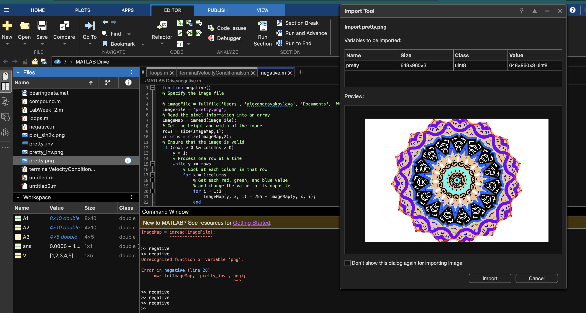 | 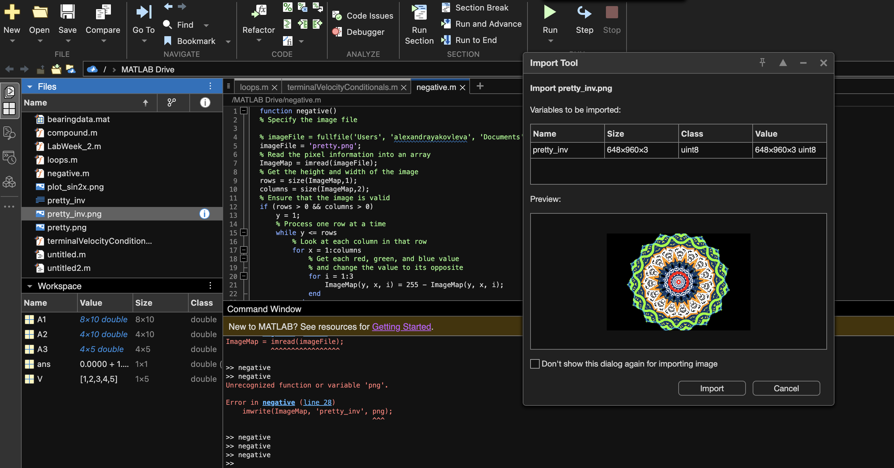 |

```matlab
negative
```

No Command Window output (only the image file changes).

- Usually written with nested `for` loops; done with `for` inside `while` to show any of these can contain any other. `switch` inside `for` inside `while` inside `if` $\rightarrow$ fine if it suits the problem.

### 4.10 Exiting a Loop

No point looping once you've found what you need. Three ways out:

| Command | Effect |
|---|---|
| `break` | stop the loop, go to the statement after the loop's `end` |
| `continue` | stop this iteration, go to the next one |
| `return` | exit the whole function (works anywhere, not just loops); more in a later chapter |

```matlab
edit loops2
```

**loops2.m — basic:**

```matlab
function loops2()
    for x=1:10
        disp(x);
    end
end
```

```matlab
loops2

     1

     2

     3

     4

     5

     6

     7

     8

     9

    10
```

(In loose format `disp` puts a blank line after each value; with `format compact` they print on consecutive lines.)

**With `break`:**

```matlab
function loops2()
    for x=1:10
        if x == 6
            break;
        end
        disp(x);
    end
end
```

```matlab
loops2

     1

     2

     3

     4

     5
```

x = 6 $\rightarrow$ `if` true $\rightarrow$ `break` $\rightarrow$ loop exits, never reaches 10.

**With `continue`:**

```matlab
function loops2()
    for x=1:10
        if x == 6
            continue;
        end
        disp(x);
    end
end
```

```matlab
loops2

     1

     2

     3

     4

     5

     7

     8

     9

    10
```

6 missing: at x = 6 `continue` skips `disp(x)` for that pass, x becomes 7, loop finishes.

### 4.11 Stopping an Infinite Loop

Stuck in an infinite loop $\rightarrow$ halt the function before fixing it.

- Editor ribbon $\rightarrow$ **Run** section. Lets you run the function directly instead of typing it in the Command Window.
- While a function runs, the Run section shows **Pause** 
- **Pause** $\rightarrow$ Run section becomes **Debug** $\rightarrow$ **Quit Debugging** exits

**loops3.m:**

```matlab
function loops3()
    while 1
        disp("All work and no play makes Jack a dull boy");
    end
end
```

Condition always true (`logical(1)`) $\rightarrow$ runs forever.

1. **Run** (Editor ribbon) $\rightarrow$ launch `loops3`.
2. **Pause**.
3. **Quit Debugging** $\rightarrow$ leaves loop and function.


```matlab
loops3

All work and no play makes Jack a dull boy
All work and no play makes Jack a dull boy
All work and no play makes Jack a dull boy
...
```

Also useful outside infinite loops. Plan a graceful exit; if code keeps going on and on, be ready with **Pause**. (Keyboard alternative: **Ctrl+C** in the Command Window.)

#### Key Terms

branching, condition, conditionals, firstValue, function, infinite loop, lastValue, loop body, loop index, loops, pause

#### Key Commands

`for`, `if`, `imread`, `imwrite`, `otherwise`, `switch`, `while`

---

## SDC Chapter 4 — Exercises

**Exercise 4.1** — Explain why this loop will never execute, in terms of an array declaration and the resulting array.

```matlab
for x = 1 : -2 : 10
    disp(x);
end
```

<details><summary>Solution</summary>

Step is negative (-2) but 10 > 1, so counting down from 1 can never reach 10 $\rightarrow$ colon makes an **empty** array $\rightarrow$ zero passes.

```matlab
1 : -2 : 10

ans =

  1×0 empty double row vector
```

</details>

**Exercise 4.2** — Rewrite this while loop as a for loop.

```matlab
x = 1;
while x <= 10
    disp(x);
    x = x + 1;
end
```

<details><summary>Solution</summary>

```matlab
for x = 1:10
    disp(x);
end
```

Same output: 1 through 10. The `for` handles the start, the +1 step and the stop condition for you.

</details>

**Exercise 4.3** — Rewrite this if statement as a switch statement. Assume that the String variable *hero* has been defined earlier in the function.

```matlab
if strcmp(hero, 'Superman')
    villain = 'Bizarro';
elseif strcmp(hero, 'The Thing')
    villain = 'Fin Fang Foom';
elseif strcmp(hero, 'Hellboy')
    villain = 'Baba Yaga';
else
    villain = 'Dracula';
end
```

<details><summary>Solution</summary>

```matlab
switch hero
    case 'Superman'
        villain = 'Bizarro';
    case 'The Thing'
        villain = 'Fin Fang Foom';
    case 'Hellboy'
        villain = 'Baba Yaga';
    otherwise
        villain = 'Dracula';
end
```

```matlab
hero = 'Hellboy';
switch hero
    case 'Superman'
        villain = 'Bizarro';
    case 'The Thing'
        villain = 'Fin Fang Foom';
    case 'Hellboy'
        villain = 'Baba Yaga';
    otherwise
        villain = 'Dracula';
end
villain

villain =

    'Baba Yaga'
```

</details>

**Exercise 4.4** — The factorial of a number is the product of all of the positive integers less than or equal to the number. An exclamation point (!) after a number is used to designate the factorial of that number, for example 150!. Create a script to calculate the factorial of 150 using loops and conditionals. MATLAB has a built-in function to compute factorials, but do not use it in your code. Look in Help for the factorial function, and use it to check your results.

<details><summary>Solution</summary>

```matlab
% factorial150.m
n = 150;
if n < 0
    disp("Factorial is undefined for negative numbers");
else
    result = 1;
    for k = 2:n
        result = result * k;
    end
    result
    factorial(n)
end
```

```matlab
factorial150

result =

  5.7134e+262


ans =

  5.7134e+262
```

Match. (`n = 0` $\rightarrow$ loop runs zero times $\rightarrow$ `result = 1` = 0!, correct.)

</details>

**Exercise 4.5** — Create your own code example that will result in an infinite loop. Modify the code to provide a conditional that will exit the loop.

<details><summary>Solution</summary>

Infinite (x never equals 3 when adding 2 from 0):

```matlab
x = 0;
while x ~= 3
    x = x + 2;
end
```

Fixed with a conditional exit:

```matlab
x = 0;
while x ~= 3
    x = x + 2;
    if x > 100
        disp("x skipped past 3 — stopping");
        break;
    end
end
x

x skipped past 3 — stopping

x =

   102
```

</details>

## SDC Chapter 5 — Matrices

### Objectives

1. Explain the difference between an array, a matrix, a vector, and a scalar.
2. Specify an array in MATLAB using brackets and semi-colons.
3. Understand the concepts of a diagonal, identity, and magic matrix.
4. Add, subtract, multiply, and divide a matrix by a scalar or vector.
5. Raise the values in a matrix to a scalar power or a vector of powers.
6. Use MATLAB functions to create test matrices.
7. Seed a sequence of random numbers so that the sequence can be replicated.
8. Recognize when two matrices meet the requirements for matrix multiplication.
9. Perform a matrix multiplication manually.
10. Have a rudimentary understanding of an inverse matrix and a matrix determinant.

### Summary of functions used in this chapter

| Function / operator | What it does | Example |
|---|---|---|
| `[a b; c d]` | build matrix; space/comma = next col, `;` = next row | `[1 2 3; 4 5 6]` |
| `size(A)` | rows, cols | `size(A)` $\rightarrow$ `2 3` |
| `diag(v)` | vector $\rightarrow$ diagonal matrix | `diag(1:4)` |
| `diag(A)` | matrix $\rightarrow$ its diagonal as column | `diag(A)` |
| `eye(n)` | n×n identity | `eye(4)` |
| `magic(n)` | n×n, 1..n², equal row/col sums | `magic(5)` |
| `rand(n)` / `rand(n,m)` | uniform floats 0–1 | `rand(3,5)` |
| `randn(n)` / `randn(n,m)` | normal floats, mean 0 (±) | `randn(3,5)` |
| `randi(max,n)` / `randi(max,n,m)` | ints 1..max | `randi(10,3,5)` |
| `ones(n)` / `ones(n,m)` | all 1s | `ones(5)` |
| `zeros(n)` / `zeros(n,m)` | all 0s | `zeros(2,3)` |
| `rng(seed)` | seed RNG $\rightarrow$ repeatable "random" | `rng(0)` |
| `+` `-` | element-wise add/sub (same size or scalar) | `A + B` |
| `.*` `./` `.^` | element-wise mult/div/power | `A .* B` |
| `*` | matrix multiplication (inner dims match) | `A * B` |
| `/` | matrix "division" (`x = B/A` solves `x*A = B`) | `B / A` |
| `'` | transpose + complex conjugate | `A'` |
| `.'` | transpose only | `A.'` |
| `transpose(A)` | same as `.'` | `transpose(A)` |
| `<` `<=` `>` `>=` `==` `~=` | element-wise compare $\rightarrow$ logical matrix | `A <= 5` |
| `det(A)` | determinant | `det(A)` |
| `inv(A)` | inverse matrix | `inv(A)` |
| `sqrt(-2)` | gives imaginary result | `sqrt(-2)` $\rightarrow$ `0 + 1.4142i` |
| `format short` | 4 decimals display | `format short` |
| `sum(A,dim)` | sum (1 = down cols, 2 = across rows) — exercises | `sum(D,2)` |

### 5.1 What Is a Matrix?

- MATLAB's big strength = matrices. **Linear algebra** = interaction/manipulation of matrices to solve problems. Used in engineering (circuits, robotics, signal processing), physics (QM), graphics (reflections, 3D$\rightarrow$2D), photography (color correction).
- **Matrix** = 2-D rectangular array, rows × columns.
- **Vector** = 1 × N (row) or N × 1 (column).
- **Scalar** = single value = 1 × 1 to MATLAB.

$$\begin{bmatrix}1 & 2 & 3\\4 & 5 & 6\end{bmatrix}$$

```matlab
[1 2 3; 4 5 6]
```

- `;` = **row separator**. Every row must have the same number of elements.
- **Square brackets $\rightarrow$ define** matrices. **Parentheses $\rightarrow$ use/index** them.
- Always **row first, then column**.
- Values in a row can be separated by commas or spaces: `[1,2,3; 4,5,6]` = `[1 2 3; 4 5 6]`.

```matlab
A = [1 2 3; 4 5 6]
size(A)

A =

     1     2     3
     4     5     6


ans =

     2     3
```

2 rows, 3 cols $\rightarrow$ A is 2 × 3.

### 5.2 Special Matrices: Diagonal, Identity, Magic

**Diagonal matrix** $\rightarrow$ square; values on the diagonal (upper-left $\rightarrow$ lower-right), 0 everywhere else.

```matlab
V = [1:4];
A = diag(V)

A =

     1     0     0     0
     0     2     0     0
     0     0     3     0
     0     0     0     4
```

`diag` on a matrix $\rightarrow$ pulls the diagonal out as a vector:

```matlab
X = diag(A)

X =

     1
     2
     3
     4
```

**Identity matrix** $\rightarrow$ diagonal of 1s, rest 0. Matrix version of the number 1: `A * I = A`.

```matlab
eye(4)

ans =

     1     0     0     0
     0     1     0     0
     0     0     1     0
     0     0     0     1
```

**Magic matrix** $\rightarrow$ N × N, integers 1 to N², every row and column sums to the same value.

```matlab
magic(5)

ans =

    17    24     1     8    15
    23     5     7    14    16
     4     6    13    20    22
    10    12    19    21     3
    11    18    25     2     9
```

One number N to a matrix-generation function $\rightarrow$ square N × N matrix.

**Matrix math** = any math with at least one matrix:

- add/subtract a scalar to each element
- multiply/divide each element by a scalar
- raise each element to a power
- add/subtract same-size matrices
- multiply/divide matrices $\rightarrow$ **two very different kinds** (array vs matrix)

### 5.3 Creating Test Matrices & Random Numbers

| Function | Creates |
|---|---|
| `magic(n)` | n × n, numbers 1 to n², equal row/col sums |
| `eye(n)` | n × n zeros with diagonal of 1s |
| `rand(n)` / `rand(n,m)` | random floats between 0 and 1 |
| `randn(n)` / `randn(n,m)` | small random floats, mean 0 (neg + pos) |
| `randi(max,n)` / `randi(max,n,m)` | random integers 1 to max |
| `ones(n)` / `ones(n,m)` | all ones |
| `zeros(n)` / `zeros(n,m)` | all zeros |

**Random numbers** $\rightarrow$ no such thing as truly random on a computer. **Pseudo-random**: each number based on the one before; first one based on a **seed**. Same seed $\rightarrow$ same sequence.

```matlab
randi(10,1,10)
randi(10,1,10)
ans =

     8     8     3     7     7     2     2     5    10     4


ans =

     6     3     8     3     6     7     9    10     6     2
```

(Press the **Up Arrow** key to repeat a command.) Two different outputs. Now seed it:

```matlab
rng(0)
randi(10,1,10)
rng(0)
randi(10,1,10)

ans =

     9    10     2    10     7     1     3     6    10    10


ans =

     9    10     2    10     7     1     3     6    10    10
```

`rng(0)` resets the **random number generator** $\rightarrow$ same seed $\rightarrow$ same sequence. Useful for consistent test data. (`rng(0)` = `rng('default')`, the setting used in these notes.)

### 5.4 Array Math: Addition & Subtraction

**Array math** $\rightarrow$ element by element. Arrays must be **same dimensions** (or one is a scalar). Works on 3-D+ arrays too.

**Matrix addition** $\rightarrow$ A(1,1) + B(1,1), A(1,2) + B(1,2), ...

$$\begin{bmatrix}a&b&c\\d&e&f\end{bmatrix}+\begin{bmatrix}h&i&j\\k&l&m\end{bmatrix}=\begin{bmatrix}a+h&b+i&c+j\\d+k&e+l&f+m\end{bmatrix}$$

**Matrix subtraction** $\rightarrow$ same, but order counts: A − B $
eq$ B − A (not **commutative**).

$$\begin{bmatrix}a&b&c\\d&e&f\end{bmatrix}-\begin{bmatrix}h&i&j\\k&l&m\end{bmatrix}=\begin{bmatrix}a-h&b-i&c-j\\d-k&e-l&f-m\end{bmatrix}$$

```matlab
rng('default')
A = randi(10,3,5)
B = randn(3,5);
C = rand(3,5);
D = [1 2 3; 4 5 6; 7 8 9]
E = A + B + C;
F = A - C;

A =

     9    10     3    10    10
    10     7     6     2     5
     2     1    10    10     9


D =

     1     2     3
     4     5     6
     7     8     9
```

`B`, `C`, `E`, `F` hold random decimals, so they're suppressed here. Now the size mismatch:

```matlab
G = A - D

Arrays have incompatible sizes for this operation.
```

A is 3 × 5, D is 3 × 3.


### 5.5 Element-wise (Dot) Operators

As long as at least one dimension agrees, **array multiplication/division** works element by element. Three new operators:

| Operator | Name |
|---|---|
| `.*` | element-wise multiplication |
| `./` | element-wise division |
| `.^` | element-wise power |

- The `.` makes them element-wise, not matrix operators.
- Same precedence as `*` `/` `^`.

$$\begin{bmatrix}a&b&c\\d&e&f\end{bmatrix}.*\begin{bmatrix}h&i&j\\k&l&m\end{bmatrix}=\begin{bmatrix}a h&b i&c j\\d k&e l&f m\end{bmatrix}$$

$$\begin{bmatrix}a&b&c\\d&e&f\end{bmatrix}./\begin{bmatrix}h&i&j\\k&l&m\end{bmatrix}=\begin{bmatrix}a/h&b/i&c/j\\d/k&e/l&f/m\end{bmatrix}$$

Agree in only one dimension (2 × 3 `.*` 1 × 3) $\rightarrow$ the row is applied to every row:

$$\begin{bmatrix}a&b&c\\d&e&f\end{bmatrix}.*\begin{bmatrix}g&h&i\end{bmatrix}=\begin{bmatrix}a g&b h&c i\\d g&e h&f i\end{bmatrix}$$

### 5.6 Scalar Math Operations

Scalar in an array equation $\rightarrow$ applied to **every element**.

$$n+\begin{bmatrix}a&b&c\\d&e&f\end{bmatrix}=\begin{bmatrix}n+a&n+b&n+c\\n+d&n+e&n+f\end{bmatrix}$$

```matlab
A = ones(5)
A + 6

A =

     1     1     1     1     1
     1     1     1     1     1
     1     1     1     1     1
     1     1     1     1     1
     1     1     1     1     1


ans =

     7     7     7     7     7
     7     7     7     7     7
     7     7     7     7     7
     7     7     7     7     7
     7     7     7     7     7
```

```matlab
B = rand(1,3)
x = 1
B + x

B =

    0.4898    0.4456    0.6463


x =

     1


ans =

    1.4898    1.4456    1.6463
```

**Subtraction** $\rightarrow$ same, order counts:

$$n-\begin{bmatrix}a&b&c\\d&e&f\end{bmatrix}=\begin{bmatrix}n-a&n-b&n-c\\n-d&n-e&n-f\end{bmatrix}\qquad\begin{bmatrix}a&b&c\\d&e&f\end{bmatrix}-n=\begin{bmatrix}a-n&b-n&c-n\\d-n&e-n&f-n\end{bmatrix}$$

**Mult/div by scalar** $\rightarrow$ same result with or without the dot. Use the one that matches your intent.

$$\begin{bmatrix}a&b&c\\d&e&f\end{bmatrix}.*n=\begin{bmatrix}a n&b n&c n\\d n&e n&f n\end{bmatrix}\qquad\begin{bmatrix}a&b&c\\d&e&f\end{bmatrix}./n=\begin{bmatrix}a/n&b/n&c/n\\d/n&e/n&f/n\end{bmatrix}$$

```matlab
A = magic(3)
n = 5
A / n
A ./ n
n ./ A

A =

     8     1     6
     3     5     7
     4     9     2


n =

     5


ans =

    1.6000    0.2000    1.2000
    0.6000    1.0000    1.4000
    0.8000    1.8000    0.4000


ans =

    1.6000    0.2000    1.2000
    0.6000    1.0000    1.4000
    0.8000    1.8000    0.4000


ans =

    0.6250    5.0000    0.8333
    1.6667    1.0000    0.7143
    1.2500    0.5556    2.5000
```

```matlab
n / A

Error using  / 
Matrix dimensions must agree.
```

(Newer MATLAB versions may word this error differently.)
Array and matrix forms give the same result here, but don't assume it. Use the operator that says what you mean.

**Under the hood:** MATLAB expands the scalar into an array of the same size, then does a normal array operation. That's why scalar `./` array works.

$$\begin{bmatrix}a&b&c\\d&e&f\end{bmatrix}./n=\begin{bmatrix}a&b&c\\d&e&f\end{bmatrix}./\begin{bmatrix}n&n&n\\n&n&n\end{bmatrix}=\begin{bmatrix}a/n&b/n&c/n\\d/n&e/n&f/n\end{bmatrix}$$

### 5.7 Transposition

**Transpose**: rows become columns and columns become rows. A row vector becomes a column vector, and vice versa.

| Operator | Effect |
|---|---|
| `.'` | transpose; precedence just below parentheses |
| `'` | transpose **+ complex conjugate** (flips sign of imaginary part) |
| `transpose(A)` | same as `.'`, easier to see |

No complex numbers $\rightarrow$ `'` and `.'` give the same result.

$$A=\begin{bmatrix}a&b&c\\d&e&f\end{bmatrix}\qquad A'=\begin{bmatrix}a&d\\b&e\\c&f\end{bmatrix}$$

```matlab
A = [1:2:6; 3:5:15; 10:10:30]
A'
A.'

A =

     1     3     5
     3     8    13
    10    20    30


ans =

     1     3    10
     3     8    20
     5    13    30


ans =

     1     3    10
     3     8    20
     5    13    30
```

Colon-built rows must all be the same length, or you get "Dimensions of arrays being concatenated are not consistent." Matrix doesn't have to be square.

**With an imaginary number** (`sqrt(-2)` $\rightarrow$ `1.4142i`; `i` = imaginary unit):

```matlab
format short
A = [1 3 10; 3 sqrt(-2) 20; 5 13 30]
A'
A.'

A =

   1.0000 + 0.0000i   3.0000 + 0.0000i  10.0000 + 0.0000i
   3.0000 + 0.0000i   0.0000 + 1.4142i  20.0000 + 0.0000i
   5.0000 + 0.0000i  13.0000 + 0.0000i  30.0000 + 0.0000i


ans =

   1.0000 + 0.0000i   3.0000 + 0.0000i   5.0000 + 0.0000i
   3.0000 + 0.0000i   0.0000 - 1.4142i  13.0000 + 0.0000i
  10.0000 + 0.0000i  20.0000 + 0.0000i  30.0000 + 0.0000i


ans =

   1.0000 + 0.0000i   3.0000 + 0.0000i   5.0000 + 0.0000i
   3.0000 + 0.0000i   0.0000 + 1.4142i  13.0000 + 0.0000i
  10.0000 + 0.0000i  20.0000 + 0.0000i  30.0000 + 0.0000i
```

`'` $\rightarrow$ `-1.4142i`; `.'` $\rightarrow$ `+1.4142i`. Not the same operator!

**Transpose in array multiplication:**

```matlab
A = [1:6; 3:8; 4:9]
B = [2 4 6]

A =

     1     2     3     4     5     6
     3     4     5     6     7     8
     4     5     6     7     8     9


B =

     2     4     6
```

```matlab
B .* A

Arrays have incompatible sizes for this operation.
```

1 × 3 `.*` 3 × 6 $\rightarrow$ no match. Flip A $\rightarrow$ 6 × 3:

```matlab
B .* A'

ans =

     2    12    24
     4    16    30
     6    20    36
     8    24    42
    10    28    48
    12    32    54
```

Each row of A' multiplied by matching element of B.

### 5.8 Powers & Logical Operations

**Power** $\rightarrow$ `.^`, same pattern as other element-wise ops:

$$\begin{bmatrix}a&b&c\\d&e&f\end{bmatrix}.\hat{}\,2=\begin{bmatrix}a^2&b^2&c^2\\d^2&e^2&f^2\end{bmatrix}$$

$$\begin{bmatrix}a&b&c\\d&e&f\end{bmatrix}.\hat{}\begin{bmatrix}r&s&t\end{bmatrix}=\begin{bmatrix}a^r&b^s&c^t\\d^r&e^s&f^t\end{bmatrix}\qquad\begin{bmatrix}a&b&c\\d&e&f\end{bmatrix}.\hat{}\begin{bmatrix}r\\s\end{bmatrix}=\begin{bmatrix}a^r&b^r&c^r\\d^s&e^s&f^s\end{bmatrix}$$

$$\begin{bmatrix}a&b&c\\d&e&f\end{bmatrix}.\hat{}\begin{bmatrix}g&h&i\\j&k&l\end{bmatrix}=\begin{bmatrix}a^g&b^h&c^i\\d^j&e^k&f^l\end{bmatrix}$$

Scalar raised to an n × m matrix $\rightarrow$ n × m matrix:

$$2\,.\hat{}\begin{bmatrix}a&b&c\\d&e&f\end{bmatrix}=\begin{bmatrix}2^a&2^b&2^c\\2^d&2^e&2^f\end{bmatrix}$$

In MATLAB these are `.^` — plain `^` is the matrix power (eigenvalue stuff, not covered).

**Logical operations** (`<` `<=` `>` `>=` `==` `~=`) $\rightarrow$ element by element; n × m matrix in $\rightarrow$ n × m logical out.

```matlab
A = [1 2 3 4 5 6; 3 4 5 6 7 8; 4 5 6 7 8 9]
B = A <= 5

A =

     1     2     3     4     5     6
     3     4     5     6     7     8
     4     5     6     7     8     9


B =

  3×6 logical array

   1   1   1   1   1   0
   1   1   1   0   0   0
   1   1   0   0   0   0
```

Can compare:

- two matrices of the same size
- a matrix and a vector sharing one dimension
- a matrix and a scalar

The list also names `&&` and `||`. Those only work on scalars; element-wise AND/OR on matrices = `&` and `|`.

### 5.9 Matrix Multiplication

- No separate matrix versions of `+` / `-`.
- Matrix `^` exists $\rightarrow$ linear algebra (eigenvalues/eigenvectors), not covered.
- **Matrix `*` and `/` are very different from `.*` and `./`.**

**Rule:** # columns in first = # rows in second. Result = combination of multiplication **and** addition. Real power of matrices $\rightarrow$ solve parallel equations simultaneously, model huge data sets.

```text
A * B   ->   (3,5) (5,2)
```

- **Inner** dims match (5) $\rightarrow$ valid. Result size = **outer** dims $\rightarrow$ (3,2).
- Not commutative: `B * A` $\rightarrow$ (5,2)(3,5), inner 2 $
eq$ 3 $\rightarrow$ error.

For A (r,s) and B (t,u):

- multiply only if **s = t**
- result is **(r,u)**

**General formula:**

$$R(r,c)=\sum_x A(r,x)\,B(x,c)$$

Element (r,c) of R = sum over x of A(row r, x) × B(x, col c) $\rightarrow$ row of A "dotted" with column of B.

**Example:**

$$A=\begin{bmatrix}a&b\\c&d\\e&f\end{bmatrix}\qquad B=\begin{bmatrix}g&h\\i&j\end{bmatrix}$$

A cols (2) = B rows (2) $\rightarrow$ valid; R is (3,2). Picture B above, A to the left, R at the intersection:

```text
            B
        [ g  h ]
        [ i  j ]

  A                 R
[ a  b ]        [ R11  R12 ]
[ c  d ]        [ R21  R22 ]
[ e  f ]        [ R31  R32 ]
```

| Element | Value | Index form |
|---|---|---|
| R(1,1) | $ag + bi$ | $A_{11} B_{11} + A_{12} B_{21}$ |
| R(1,2) | $ah + bj$ | $A_{11} B_{12} + A_{12} B_{22}$ |
| R(2,1) | $cg + di$ | $A_{21} B_{11} + A_{22} B_{21}$ |
| R(2,2) | $ch + dj$ | $A_{21} B_{12} + A_{22} B_{22}$ |
| R(3,1) | $eg + fi$ | $A_{31} B_{11} + A_{32} B_{21}$ |
| R(3,2) | $eh + fj$ | $A_{31} B_{12} + A_{32} B_{22}$ |

$$R=\begin{bmatrix}A_{11}B_{11}+A_{12}B_{21} & A_{11}B_{12}+A_{12}B_{22}\\A_{21}B_{11}+A_{22}B_{21} & A_{21}B_{12}+A_{22}B_{22}\\A_{31}B_{11}+A_{32}B_{21} & A_{31}B_{12}+A_{32}B_{22}\end{bmatrix}$$

MATLAB does it in a few keystrokes — but know what it's doing. Very different from scalar × matrix, or element × matching element (that's `.*`).

**Quick check with numbers:**

```matlab
A = [1 2; 3 4; 5 6];
B = [7 8; 9 10];
A * B

ans =

    25    28
    57    64
    89   100
```

$R_{11} = 1 \cdot 7 + 2 \cdot 9 = 25$, which matches.

### 5.10 Matrix Division & Inverse Matrices

Technically no "matrix division". For `x = B/A`, MATLAB help says:

- A scalar $\rightarrow$ `B/A` = `B./A`.
- A square n × n, B has n columns $\rightarrow$ `x = B/A` solves `x*A = B` (if a solution exists).
- A rectangular m × n (m $
eq$ n), B has n columns $\rightarrow$ least-squares solution of `x*A = B` (beyond scope).

Middle case = the useful one $\rightarrow$ needs **inverse matrices**.

$$A \cdot B = C \quad\Rightarrow\quad B = A^{-1} \cdot C$$

Know A and C, want B $\rightarrow$ multiply by inverse of A (like 3 ÷ 4 = 3 × ¼, but order matters).

- **A⁻¹** = inverse; must be **n × n square**.
- Definition: $AA^{-1} = A^{-1}A = I$ (identity). Shorthand: "cancels out", like 1.
- Built from the **determinant** and the **adjugate**.

**2 × 2 case:**

$$A=\begin{bmatrix}a&b\\c&d\end{bmatrix}$$

- **Determinant** (scalar) = $ad - cb$
- **Adjugate** = swap a and d, negate b and c:

$$\operatorname{adj}(A)=\begin{bmatrix}d&-b\\-c&a\end{bmatrix}\qquad A^{-1}=\frac{1}{\det(A)}\,.\!*\,\operatorname{adj}(A)$$

Larger than 2 × 2 $\rightarrow$ many more steps, beyond scope. MATLAB does it with `inv`.

| Function | Result |
|---|---|
| `det(A)` | Determinant of a matrix |
| `inv(A)` | Inverse of a matrix |

### 5.11 Examples: Solving Linear Systems

**Example 1:**

$$\begin{aligned}3x+3y&=16\\2x-5y&=-4\end{aligned}$$

Coefficients $\rightarrow$ A, right side $\rightarrow$ B, unknowns $\rightarrow$ D.

Single-column variable/solution matrices = column vectors.

```matlab
A = [3 3; 2 -5]
B = [16; -4]

A =

     3     3
     2    -5


B =

    16
    -4
```

```matlab
C = inv(A)
D = C * B

C =

    0.2381    0.1429
    0.0952   -0.1429


D =

    3.2381
    2.0952
```

x = 3.2381, y = 2.0952 $\rightarrow$ the intersection point of the two lines. (No solution / lines never cross $\rightarrow$ MATLAB returns `Inf`. Note: a singular A actually also prints a warning "Matrix is singular to working precision.")

**Check:**

```matlab
3*D(1) + 3*D(2)
2*D(1) - 5*D(2)

ans =

    16


ans =

   -4.0000
```

Later chapter $\rightarrow$ `fplot`. Come back and plot both lines to see the intersection.

**Example 2: Justice League fundraiser (week 1)**

| | Hero | Sidekick | Villain | Total |
|---|---|---|---|---|
| Space Station | 800 | 300 | 200 | 8900 |
| Fortress of Solitude | 700 | 400 | 200 | 9400 |
| Batcave | 300 | 500 | 100 | 7700 |

How many heroes, sidekicks, villains? Coefficients = Hero/Sidekick/Villain cols; answer matrix = Total.

```matlab
A = [800 300 200; 700 400 200; 300 500 100]
C = [8900; 9400; 7700]

A =

   800   300   200
   700   400   200
   300   500   100


C =

        8900
        9400
        7700
```

$AB = C$, with B = [heroes; sidekicks; villains]. Inverse + multiply in one step:

```matlab
B = inv(A)*C

B =

    6.0000
   11.0000
    4.0000
```

**6 heroes, 11 sidekicks, 4 villains.**

`A\C` (backslash) solves the same system without forming the inverse — faster and more accurate. Same answer here.

#### Key Terms

array division, array multiplication, commutative, diagonal matrix, element-by-element, element-by-element logical operation, element-wise division, element-wise multiplication, element-wise power, identity matrix, imaginary number i, magic matrix, matrices, matrix, matrix addition, matrix math, matrix subtraction, pseudo-random, random number, random number generator, row separator, scalar, seed, square matrix, transposition, vector

#### Key Commands

`'`, `.*`, `.^`, `./`, `diag`, `eye`, `magic`, `ones`, `rand`, `randi`, `randn`, `rng`, `size`, `transpose`, `zeros`

---

## SDC Chapter 5 — Exercises

**Exercise 5.1** — A.\*A results in the square of each value in matrix A. A\*A, however, which gives an entirely different answer, can only be performed if what condition is true?

<details><summary>Solution</summary>

A must be **square** (n × n): columns of the first (n) must equal rows of the second, and both are A.

```matlab
A = [1 2; 3 4];
A .* A
A * A

ans =

     1     4
     9    16


ans =

     7    10
    15    22
```

</details>

**Exercise 5.2** — In the second week of the Justice League fundraiser discussed in the lesson, contributions were as follows:

- For the space station: from each hero $500, each sidekick $300, and each villain $200: a total of $7100
- For the Fortress of Solitude: from each hero $1000, each sidekick $100, each villain $300: a total of $8300
- For the Batcave: from each hero $200, each sidekick $200, each villain $0 (really, nobody likes Batman): a total of $3400

Prove that the number of heroes, sidekicks, and villains is the same as found in the lesson (6 heroes, 11 sidekicks, 4 villains).

<details><summary>Solution</summary>

```matlab
A = [500 300 200; 1000 100 300; 200 200 0];
C = [7100; 8300; 3400];
B = inv(A)*C

B =

    6.0000
   11.0000
    4.0000
```

Same as week 1.

</details>

**Exercise 5.3** — Create a 3 × 3 matrix A, with any numerical content. Use MATLAB to determine its inverse, then *manually* perform the matrix multiplication A \* A⁻¹ to prove that the answer is 1.

<details><summary>Solution</summary>

```matlab
A = [2 1 3; 0 1 4; 5 6 0]
Ainv = inv(A)

A =

     2     1     3
     0     1     4
     5     6     0


Ainv =

    0.5581   -0.4186   -0.0233
   -0.4651    0.3488    0.1860
    0.1163    0.1628   -0.0465
```

Exact values are fractions over 43 (`format rat` shows them): `Ainv = (1/43)*[24 -18 -1; -20 15 8; 5 7 -2]`.

Row 1 of $A$ times column 1 of $A^{-1}$:

$$\tfrac{1}{43}\big(2\cdot24 + 1\cdot(-20) + 3\cdot5\big) = \tfrac{43}{43} = 1$$

Row 1 of $A$ times column 2 of $A^{-1}$:

$$\tfrac{1}{43}\big(2\cdot(-18) + 1\cdot15 + 3\cdot7\big) = \tfrac{0}{43} = 0$$

Repeat for all 9 $\rightarrow$ identity matrix ("1" for matrices). MATLAB check:

```matlab
A * Ainv

ans =

    1.0000         0         0
         0    1.0000         0
         0         0    1.0000
```

(Tiny round-off like `-0.0000` may show.)

</details>

**Exercise 5.4** — In Germany, annual professional fees are set by law for engineers, doctors, and lawyers. In Frankfurt, the total fees charged in a single year by 23 doctors, 18 lawyers, and 12 engineers were equivalent to $76,500,000 US. In that same year in Berlin, 25 doctors, 20 lawyers, and 16 engineers charged $85,500,000. In Munich, 18 doctors, 9 lawyers, and 20 engineers charged $55,000,000.

In MATLAB, use the formula B = A⁻¹\*C to determine the annual fee charged by each doctor, each lawyer, and each engineer. Tip: Use 76.5 rather than 76,500,000 (etc.) in constructing that matrix.

<details><summary>Solution</summary>

Rows = cities (Frankfurt, Berlin, Munich); cols = doctors, lawyers, engineers. Values in $ millions.

```matlab
A = [23 18 12; 25 20 16; 18 9 20];
C = [76.5; 85.5; 55];
B = inv(A)*C

B =

    1.5000
    2.0000
    0.5000
```

Doctor **$1.5M**, lawyer **$2.0M**, engineer **$0.5M** per year.

</details>

**Exercise 5.5** — Using the matrices A and B from Exercise 5.4, in a single MATLAB command, calculate a new 3 × 3 matrix D that contains the specific amounts charged by each profession in each city. For example, (1,1) will be the total fees charged by doctors in Frankfurt, (2,2) the total fees charged by doctors in Berlin, and so on.

<details><summary>Solution</summary>

Multiply each column of A by that profession's fee $\rightarrow$ `.*` with B transposed to a row.

```matlab
D = A .* B'

D =

   34.5000   36.0000    6.0000
   37.5000   40.0000    8.0000
   27.0000   18.0000   10.0000
```

Rows = cities, cols = professions ($M). (1,1) = doctors in Frankfurt.

Book typo: doctors in Berlin are at **(2,1)**, not (2,2). (2,2) = lawyers in Berlin.

</details>

**Exercise 5.6** — To the matrix D created in Exercise 5.5, add a 4th column that is a sum of each row. Do this with a single MATLAB command. Hint: the sum function, the colon operator, and MATLAB help are your friends.

<details><summary>Solution</summary>

```matlab
D(:,4) = sum(D,2)

D =

   34.5000   36.0000    6.0000   76.5000
   37.5000   40.0000    8.0000   85.5000
   27.0000   18.0000   10.0000   55.0000
```

Column 4 = city totals $\rightarrow$ matches the C totals.

</details>

**Exercise 5.7** — To the matrix D from Exercise 5.6, add a 4th row that is a sum of each column. Do this with a single MATLAB command.

<details><summary>Solution</summary>

```matlab
D(4,:) = sum(D,1)

D =

   34.5000   36.0000    6.0000   76.5000
   37.5000   40.0000    8.0000   85.5000
   27.0000   18.0000   10.0000   55.0000
   99.0000   94.0000   24.0000  217.0000
```

Row 4 = profession totals; D(4,4) = grand total $217M.

</details>

**Exercise 5.8** — Using a single MATLAB command applied to matrix D from Exercise 5.8, calculate a matrix E where each element is reduced by half to account for the local and national taxes paid by each profession.

<details><summary>Solution</summary>

Book typo: "from Exercise 5.8" — means 5.7.

```matlab
E = D ./ 2

E =

   17.2500   18.0000    3.0000   38.2500
   18.7500   20.0000    4.0000   42.7500
   13.5000    9.0000    5.0000   27.5000
   49.5000   47.0000   12.0000  108.5000
```

</details>

**Exercise 5.9** — Based on matrix E from Exercise 5.8, and once again using a single MATLAB command, calculate a new 1 × 3 matrix F that specifies the average annual after-tax income of a doctor, a lawyer, and an engineer in this year. Are you still happy with your career choice?

<details><summary>Solution</summary>

Total after-tax per profession (row 4) ÷ total people per profession (column sums of A):

```matlab
F = E(4,1:3) ./ sum(A)

F =

    0.7500    1.0000    0.2500
```

After tax: doctor **$750K**, lawyer **$1.0M**, engineer **$250K**. (= B'/2, as expected.)

</details>

**Exercise 5.10** — On Monday, a farmer sells 8 pounds of potatoes, 3 pounds of beets, and 6 pounds of asparagus. He receives a total of $44. On Tuesday, he receives $48 dollars for 5 pounds of beets, 3 pounds of potatoes and 7 pounds of asparagus. On Wednesday, he receives a total of $31 for 9 pounds of potatoes, 1 pound of beets, and 4 pounds of asparagus.

Using MATLAB, determine the inverse of the coefficient matrix. Manually perform the matrix multiplication to determine what price per pound the farmer charges for each of the produce types. Verify your answer using MATLAB.

<details><summary>Solution</summary>

Cols = potatoes, beets, asparagus (watch Tuesday's order — beets listed first).

```matlab
A = [8 3 6; 3 5 7; 9 1 4];
C = [44; 48; 31];
Ainv = inv(A)

Ainv =

    2.6000   -1.2000   -1.8000
   10.2000   -4.4000   -7.6000
   -8.4000    3.8000    6.2000
```

Manual $A^{-1}C$ (each row of $A^{-1}$ times $C$):

- potatoes: $2.6 \cdot 44 - 1.2 \cdot 48 - 1.8 \cdot 31 = 114.4 - 57.6 - 55.8 = 1$
- beets: $10.2 \cdot 44 - 4.4 \cdot 48 - 7.6 \cdot 31 = 448.8 - 211.2 - 235.6 = 2$
- asparagus: $-8.4 \cdot 44 + 3.8 \cdot 48 + 6.2 \cdot 31 = -369.6 + 182.4 + 192.2 = 5$

```matlab
B = Ainv * C

B =

    1.0000
    2.0000
    5.0000
```

Potatoes **$1/lb**, beets **$2/lb**, asparagus **$5/lb**. Check Monday: 8 + 6 + 30 = 44, correct.

</details>
---
## SDC Chapter 6 — Functions & Scripts

### Objectives

1. Understand the importance of commenting your code.
2. Create a script from Command Window statements.
3. Prompt for values from the user.
4. Understand the difference between a script and a function.
5. Know the advantages of building a complex program from single-task functions.
6. Write an algorithm as a first step to writing code.
7. Understand how to return and accept multiple values from a function.
8. Know the difference between a main function and a local function.
9. Understand variable scope.
10. Use global and persistent variables.
11. Write a recursive function.

### Summary of functions used in this chapter

| Function / keyword | What it does | Example |
|---|---|---|
| `%` | comment; MATLAB skips it | `% Variables` |
| `edit name` | open/create `name.m` | `edit matrixMax` |
| `function ... end` | define function; 1st function name = file name | `function biggie = matrixMax(A)` |
| `[a, b] = f(x)` | receive multiple return values (in order) | `[dim, r, c, mx] = matrix_facts(A)` |
| `input(prompt)` | ask user for a value | `f = input('Enter force: ');` |
| `disp(x)` | plain print | `disp('in Newton-meters')` |
| `fprintf(fmt, ...)` | formatted print | `fprintf('r = %d\n', r)` |
| `rad2deg(r)` | radians $\rightarrow$ degrees | `rad2deg(0.7854)` $\rightarrow$ `45.0001` |
| `sin` / `sind` | sine of radians / degrees | `sind(30)` $\rightarrow$ `0.5` |
| `size(A, dim)` | rows (1) or cols (2) | `size(A,1)` |
| `ndims(A)` | number of dimensions | `ndims(A)` $\rightarrow$ `2` |
| `max(M)` | max of each column (vector $\rightarrow$ single max) | `max(M(:))` |
| `which name` | path to a function's `.m` file | `which blkdiag` |
| `global x` | share variable across workspaces | `global b;` |
| `persistent y` | keep value between calls | `persistent y;` |
| `lower` / `upper` | change case — exercises | `lower('Mars')` |
| `extractBetween` | substring by position — exercises | `extractBetween(s,2,4)` |

### 6.1 Comment Statements
- **Comment** = non-executable line. Starts with `%`. Works in scripts, functions, even the Command Window.

```matlab
% This is a comment
% The following equation will not be executed:
% x = 100 / sin(52)
```

No output — MATLAB skips them.

- Comments are for humans: explain a variable's intent, label a section, explain your thinking.
- Put them anywhere, as many as you need.
- Bottom line: **include comments**. You'll thank yourself later.

### 6.2 Scripts

- **Script** = saved list of commands $\rightarrow$ no retyping. Run by name. Extension `.m` (same as functions). Basically a program.
- Can contain loops and conditionals.
- Since **R2016b** $\rightarrow$ can contain its own **helper functions** (callable only inside the script).
- Easy to convert into a function $\rightarrow$ often very similar.
- **Runs in the Command Window's scope** (base Workspace): sees existing Workspace variables, adds the ones it creates.
- Two types: regular scripts (`.m`) and **Live Scripts** (`.mlx`, later tutorial).

Loops/conditionals work in the Command Window too, but awkwardly: **Enter** after each line, nothing runs until the final `end`. Rerun = reselect from Command History. Just make a script.

**Script example — torque**

$\tau = F \cdot d \cdot \sin\theta$, where $\tau$ (tau) = torque, F = force, d = distance vector from pivot, $\theta$ (theta) = angle. No Greek letters in code, and capitals usually mean matrices, so: `tau = f * d * sin(theta)`.

- Torque normally in **N-m** (newton-meters).
- Lab assistant gave distance **8.2021 ft** (1 ft = 0.3048 m) and angle **0.7854 rad** (expected degrees). Force = **15 N**.
- Conversions easy in MATLAB — **must track units** or the result is meaningless.

```matlab
f = 15;
ft = 8.2021;
rads = 0.7854;
d = ft * 0.3048;
theta = rad2deg(rads);
tau = f * d * sind(theta)

tau =

   26.5166
```

No `;` on the `tau` line on purpose $\rightarrow$ shows the answer (with `;` it's only in the Workspace).
Symbolic Math toolbox has `symunit` for tracking/converting units (later tutorial).
Trig functions come in radian form (`sin`, `cos`, `tan`) and degree form (`sind`, `cosd`, `tand`). Could skip the conversion and use `sin(rads)`. Know your units before picking the function!

### 6.3 Creating & Editing a Script

Turn the last three commands into a script:

1. Press the **Up Arrow** key to show the Command History.
2. **Shift**-select the last three commands (2 conversions + torque formula).
3. Right-click $\rightarrow$ **Create Script** (Figure 6.1).

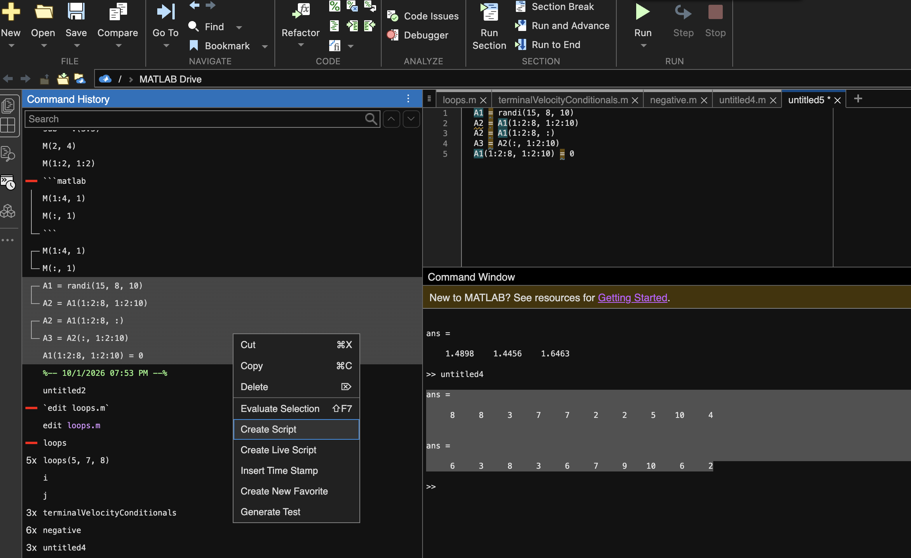
New unnamed, unsaved Editor tab with those commands. Add to the end:

```matlab
disp('in Newton-meters')
```

Save to the current folder as **`Torque`**.

> **Book typo:** text shows curly quotes `‘in Newton-meters’`. MATLAB needs straight quotes `'...'`.

- Name is **case-sensitive** $\rightarrow$ `torque` $
eq$ `Torque`.
- Runs each command in order using `f`, `ft`, `rads` from the Workspace. Not set $\rightarrow$ error.

```matlab
f = 12.5;
ft = 4.0056;
rads = 0.5236;
Torque

tau =

    7.6307

in Newton-meters
```

**Torque.m** (as created):

```matlab
d = ft * 0.3048;
theta = rad2deg(rads);
tau = f * d * sind(theta)
disp('in Newton-meters')
```
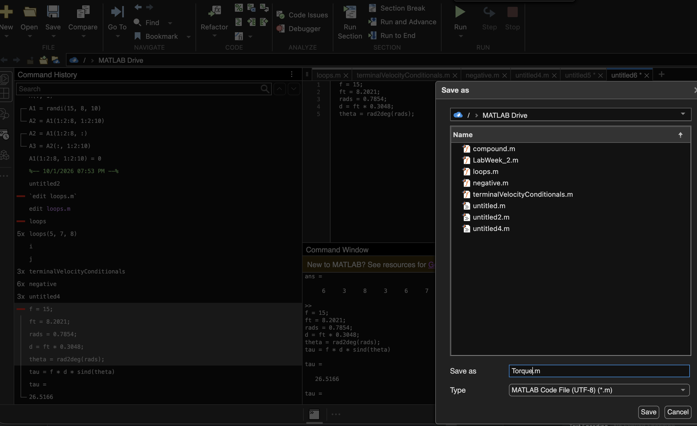

**3 more ways to make a script:**

- **New $\rightarrow$ Script** on the ribbon (save manually to name it)
- **Ctrl+N** (save manually to name it)
- `edit scriptName` (creates a named file)

> Script uses the name of an existing Workspace variable $\rightarrow$ that variable gets **overwritten**.

**Comments in scripts** $\rightarrow$ explain what and why. Not echoed when the script runs; only seen in the Editor.

### 6.4 Making a Script Interactive

`input` $\rightarrow$ prompt the caller for values. Add to the top of `Torque`:

```matlab
f = input('Enter force in Newtons: ');
ft = input('Enter distance from the axis in feet: ');
rads = input('Enter angle of force in radians: ');
```

**Torque.m — Figure 6.2:**

```matlab
f = input('Enter force in Newtons: ');
ft = input('Enter distance from the axis in feet: ');
rads = input('Enter angle of force in radians: ');
d = ft * 0.3048;
theta = rad2deg(rads);
tau = f * d * sind(theta)
disp('in Newton-meters')
```

Run, enter f = 15, ft = 8.2021, rads = 0.7854 (**Enter** after each) — Figure 6.3:

```matlab
Torque

Enter force in Newtons: 15
Enter distance from the axis in feet: 8.2021
Enter angle of force in radians: 0.7854

tau =

   26.5166

in Newton-meters
```

Many approaches to torque; this one saves typing.

### 6.5 Functions: Built-in & Custom

**Function** = block of code that answers a question ("square root of this?") or does a task ("plot this"). Full program = many functions, each a focused subtask. Benefits:

- simpler to test small pieces
- each piece works $\rightarrow$ build big programs with confidence
- safer updates: replace only what changes
- **reuse** in any program

| | Script | Function |
|---|---|---|
| Series of commands in `.m` | yes | yes |
| Call from Command Window | yes | yes |
| Input parameters / return values | no | yes |
| Workspace | base (Command Window) | its own |

"Program" = anything from Excel or iOS to a phone app or a car's fuel controller. "Programming" = "coding", "programmers" = "developers".

**Built-in functions** $\rightarrow$ already used dozens: `sum`, `length`, `logical`, `int32`, `ceil`, `mod`, `class`, `strcmp`, `ismatrix`, `islogical`, `magic`, `randi`, `struct2cell`, `rng`, ...

- Most take an input (`ismatrix(M)`) and return something (logical, matrix, value).
- Some do a task and return nothing (`rng` sets the seed).
- Written with the same code elements as yours. Source visible for some: `which blkdiag` $\rightarrow$ path to its `.m` file $\rightarrow$ open and read.

```matlab
which blkdiag
```

Prints the full path to `blkdiag.m` inside your MATLAB install folder.

Most languages have a big built-in function library.

**Custom functions** = heart of **procedural programming**. Big problems (engineering, huge data sets) $\rightarrow$ not solved by typing commands. Real apps = 100,000s of lines in 100s of functions.

Review **4.1 Using the MATLAB Editor** (Chapter 4).

### 6.6 Function File Format

```text
function [retVar1, retVar2, ...] = functionName (param1, param2, ...)
```

- **`function`** keyword $\rightarrow$ function file, not a script.
- **Output variable(s)** $\rightarrow$ one (brackets optional) or bracketed comma list. Optional; none $\rightarrow$ drop the `=` too. Can be specified as `varargout`.
- **Function name** $\rightarrow$ first function in the file **must match the file name**. Same rules as variable names: a–z, A–Z, 0–9, `_`, start with a letter.
- **Input parameters** $\rightarrow$ comma list in `( )`. Must be supplied when called. None $\rightarrow$ parentheses optional. Can be specified as `varargin`.
  

**Examples:**

```matlab
function toast()
function toast
function toe = tic_tac(first_square)
function [x, y, z] = angry_cat(meow, hiss)
```

**Fundamental facts:**

- `.m` file name = name of its **first** function.
- Only the first function is callable from the Command Window or other files.
- A file can hold as many functions as needed.
- Other functions in the file (**local functions**) $\rightarrow$ callable only by the first function or each other.
- Inputs `( )` and outputs `[ ]` both optional.

Close with `end` on its own line (like loops/branches). Optional if only one function in the file, but good practice.

```text
function [retVar1, retVar2, ...] = functionName (param1, param2, ...)
    % Your code goes here
end
```

Function syntax is language-specific; MATLAB's is a bit unusual.

### 6.7 From Algorithm to Code

**Algorithm** = steps to solve a problem in plain text or **pseudo-code** (code-ish, no syntax worries). Think about the problem, not the rules.

**Task:** find the largest number in a matrix (pretend `max` doesn't exist).

**First pass:**

1. Start with the first column in the first row
2. Automatically regard that value as the largest number so far
3. Move to the second column of the first row. Is that number larger than the first column? If so, that's the new largest number. If not, move on.
4. Keep looking at each column and comparing numbers until you reach the end of the row.
5. Go to the next row. Do it all again until you reach end of the last row.

**More detail:**

1. Create a variable *biggie* to hold the maximum value
2. *biggie* = the value at (1,1)
3. Look at the next column and compare its value to *biggie*
4. If the value is larger, set *biggie* to that value
5. If the value is equal or smaller, do nothing
6. Have we read the last column?
7. No: repeat steps 3–6
8. Yes: go to the next row
9. Repeat steps 3–6 for the next row, starting at column 1
10. Have we read the last row?
11. No: repeat steps 9–10
12. Yes: we're done
13. Report *biggie* to the caller

No single "right" algorithm — it's a craft. Time on the algorithm saves time coding.

Alternative $\rightarrow$ **flowchart** (like the if-elseif-else one in Chapter 4). Good for visual thinkers.

**Build it:**

```matlab
edit matrixMax
```

Tip: paste the algorithm as comments, write code under each step.

```text
function biggie = matrixMax(A)
         ^         ^        ^
  single return  function  input
  value (no [])    name    parameter
```

- Input = matrix `A`; output = scalar `biggie`.
- Editor flags `A` (unused) and `biggie` (never assigned) until the body exists $\rightarrow$ ignore for now, but watch those warnings later.

Parameter = alias for a value. `A` is the name *inside* the function; caller's variable name doesn't matter, just that it's a matrix.

**Step 1 — initialize:**

```matlab
function biggie = matrixMax(A)
    % Variables
    biggie = A(1,1);
```

- `=` highlighted until you add the `;`. Most function lines end in `;` $\rightarrow$ suppress output. Leave a few off to see the noise.

**Step 2 — rows/cols** (`size` with dim parameter: 1 = rows, 2 = cols):

```matlab
    rows = size(A,1);
    columns = size(A,2);
```

- `*` next to the file name on the tab / title bar $\rightarrow$ unsaved changes. MATLAB won't run an unsaved file.
- Click back in the Command Window $\rightarrow$ MATLAB auto-saves. Or **Save** on the ribbon.

**Step 3 — nested `for` loops:**

```matlab
    % Walk the matrix
    for r = 1:rows
        for c = 1:columns
        end
    end
```

Type the `end`s before the loop bodies $\rightarrow$ no missing `end`s in big files.

**Step 4 — compare (in-line comment):**

**matrixMax.m (complete):**

```matlab
function biggie = matrixMax(A)
    % Variables
    biggie = A(1,1);
    rows = size(A,1);
    columns = size(A,2);

    % Walk the matrix
    for r = 1:rows
        for c = 1:columns
            if A(r,c) > biggie   % Is A(r,c) the largest yet?
                biggie = A(r,c);
            end
        end
    end
end
```

**Test** — 5 × 7 matrix of random integers 1–15:

```matlab
rng('default')
T = randi(15,5,7);
matrixMax(T)

ans =

    15
```

- Answer 15. May appear more than once — we only wanted the max.
- Test with other matrices on your own.

```text
matrixMax(T)
    ^      ^
function  input parameter (any variable,
  call    value, or expression)
```

Inputs/outputs tracked by **position** in `( )` / `[ ]`. Same as built-ins: `sin(x)`.

**Watch the loops** $\rightarrow$ add `fprintf` inside the inner loop:

```matlab
    % Walk the matrix
    for r = 1:rows
        for c = 1:columns
            fprintf('r = %d, c = %d \n', r, c);
            if A(r,c) > biggie   % Is A(r,c) the largest yet?
                biggie = A(r,c);
            end
        end
    end
```

```matlab
matrixMax(T)

r = 1, c = 1 
r = 1, c = 2 
r = 1, c = 3 
r = 1, c = 4 
r = 1, c = 5 
r = 1, c = 6 
r = 1, c = 7 
r = 2, c = 1 
...
r = 5, c = 7 

ans =

    15
```

(35 lines total, one per element; middle trimmed here.)

Higher-dimensional array $\rightarrow$ one more nested loop per extra dimension.

### 6.8 Return Values

Multiple returns $\rightarrow$ comma-separated, bracketed list. **Not an array**; values can be different types.

```text
function [retVar1, retVar2, ...] = functionName(...)
```

Returns a double x, string y, matrix Z:

```matlab
function [x, y, Z] = manyRetVals()
```

Caller uses the same format (commas optional):

```matlab
[a, b, C] = manyRetVals();
```

Fewer outputs requested $\rightarrow$ received **in order**, rest lost:

```matlab
[a, b] = manyRetVals();    % gets x, y — Z lost
[a] = manyRetVals();       % gets x only
```

**Concrete example — `matrix_facts`, created from the ribbon:**

1. **New $\rightarrow$ Function**  $\rightarrow$ framework to fill in :


```matlab
function [ output_args ] = untitled3( input_args )
%UNTITLED3 Summary of this function goes here
%   Detailed explanation goes here

end
```

2. Replace `output_args` $\rightarrow$ `dimensions, rows, columns, maxval` 
3. Replace `untitled3` $\rightarrow$ `matrix_facts`.
4. **Save**  $\rightarrow$ name `matrix_facts` (file name = first function name).

5. Replace `input_args` $\rightarrow$ `A` 
6. Replace template comments with a real description.
7. Add the body , then call `matrixMax`.

**matrix_facts.m:**

```matlab
function [dimensions, rows, columns, maxval] = matrix_facts(A)
% Accepts a matrix and returns
%   - number of dimensions
%   - number of rows
%   - number of columns
%   - highest value in the matrix

    dimensions = ndims(A);
    rows = size(A,1);
    columns = size(A,2);
    maxval = matrixMax(A);
end
```

Calling our own function from another one $\rightarrow$ `matrixMax` needs to be in the same folder (or on the path). Remove the `fprintf` debug line from `matrixMax` first, or it prints 35 lines.

```matlab
clear
rng('default')
A = randi(15, 5, 7);
[dim, r, c, mx] = matrix_facts(A)

dim =

     2


r =

     5


c =

     7


mx =

    15
```

Workspace now holds `dim`, `r`, `c`, `mx`.

### 6.9 Local Functions

**Local function** $\rightarrow$ callable only within its file (by another function there, or inside a script). Not from other files or the Command Window. Any number per file. Must come **after** the main function (first function = file name).

In `matrix_facts.m`, change

```matlab
maxval = matrixMax(A);
```

to

```matlab
maxval = myMax(A);
```

and add `myMax` after the main function's `end`.

**matrix_facts.m — Figure 6.14:**

```matlab
function [dimensions, rows, columns, maxval] = matrix_facts(A)
% Accepts a matrix and returns
%   - number of dimensions
%   - number of rows
%   - number of columns
%   - highest value in the matrix

    dimensions = ndims(A);
    rows = size(A,1);
    columns = size(A,2);
    maxval = myMax(A);
end

function max_value = myMax(M)
% Finds the largest value in a matrix

    v = max(M);
    max_value = max(v);
end
```

- `max(M)` on m × n $\rightarrow$ row vector of length n = max of each column.
- `max` on that vector $\rightarrow$ overall max.
- Fancier, one call: `max_value = max(M(:));` $\rightarrow$ `(:)` turns M into one column, `max` works on it directly.

```matlab
[dim, r, c, mx] = matrix_facts(A)

dim =

     2


r =

     5


c =

     7


mx =

    15
```

Same results as before.

### 6.10 Variable Scope

**Scope** = which statements can see/use a variable. Three kinds: **local**, **persistent**, **global**.

- Variable = alias for a memory address.
- Passing to/returning from a function $\rightarrow$ the **value** is passed (not the address), copied into memory that function can reach.
- Address space a set of commands can reach = its scope.

**Rules:**

- A function can't see the Command Window's address space.
- The Command Window can't see a function's.
- Functions can't see each other's.
- Scripts use the Command Window's space, but a local function in a script sees only its own.

Some languages pass memory addresses (**pointers**, C/C++). Not widely supported in MATLAB.
In many languages a variable made inside a loop (incl. the counter) dies when the loop exits. **Not in MATLAB** — it stays.

**Local scope demo** — two variables with the same name.

```matlab
clc
clear
local_var = 1000;
a = logical(1);
b = 57;
c = 'autumn leaves';
X = magic(4);
```

**Base Workspace — Figure 6.17:**

| Name | Value | Size |
|---|---|---|
| a | 1 | 1x1 |
| b | 57 | 1x1 |
| c | 'autumn leaves' | 1x13 |
| local_var | 1000 | 1x1 |
| X | 4x4 double | 4x4 |

New function `scope` — no inputs, no outputs:

```matlab
function scope()
    local_var = 20;
    local_var = local_var + 10;
end
```

**Breakpoint** $\rightarrow$ stops the function at that line; you control the rest by hand. Click the dash next to line **2** $\rightarrow$ circle appears (gray = unsaved, red = saved). Execution stops **right before** that line.


```matlab
scope

2       local_var = 20;
K>> 
```


- Green arrow = current line. Prompt changes to `K>>` $\rightarrow$ you're in the **function's** workspace.
- Workspace pane is **empty** $\rightarrow$ base variables not visible here.

**Debug section** of the ribbon:

1. **Step** $\rightarrow$ runs `local_var = 20` $\rightarrow$ appears in the function's Workspace.
2. **Step** again $\rightarrow$ `local_var = local_var + 10` $\rightarrow$ Workspace shows 30.
3. **Continue** $\rightarrow$ finishes, back to the Command Window.

```matlab
local_var

local_var =

        1000
```

Base variables back; `local_var` still **1000**. Function's `local_var` $
eq$ base `local_var`, despite the same name. That's scope.

**Global scope** $\rightarrow$ shared across all functions, scripts, and the base workspace. Generally discouraged — often a sign of poor design, confusing errors.

```matlab
global b;
```

Declare and assign on **separate lines**:

```matlab
global b;
b = randi(2000, 13, 22);
```

To use it somewhere else $\rightarrow$ declare again first:

```matlab
global b;    % Bring the variable into the function
var1 = b;    % Use the variable
b = var2;    % Set the variable
```

Change global `b` $\rightarrow$ changes everywhere it's used (any function, Command Window).

 `b` already exists as a local in the base workspace from the scope demo $\rightarrow$ `global b` there gives a warning. Run `clear b` first.

### 6.11 Recursion

**Recursive function** = calls itself. Needs a **stop condition** or it spirals forever. Once hit $\rightarrow$ calls unwind, each returning its value to its caller, until the original caller gets the final result.

**Factorial**: $n! = 1 \cdot 2 \cdot 3 \cdots n$ (and $1! = 1$). Example 4!:

```text
1 * 2 * 3 * 4
(1 * 2 * 3) * 4
((1 * 2) * 3) * 4
(((1) * 2) * 3) * 4
```

So:

```text
4! = 3! * 4
3! = 2! * 3
2! = 1! * 2
```

Pattern: $x! = (x-1)! \cdot x$.

**Algorithm:**

1. Begin with a number n
2. If n = 1, then n! = 1 and we're done
3. If n ~= 1, then get (n − 1)!
4. Multiply (n − 1)! times n

Stop condition: **n = 1**.

**recurse.m:**

```matlab
function fact = recurse(n)
    if n == 1
        fact = 1;
    else
        fact = n * recurse(n-1);
    end
end
```

```matlab
recurse(4)

ans =

    24
```

Trace: `recurse(4)` needs 4 * `recurse(3)`, which needs 3 * `recurse(2)`, which needs 2 * `recurse(1)` = 1. Then it unwinds: 2, then 6, then **24**.

`recurse(0)` or a negative n never reaches 1 $\rightarrow$ recursion until MATLAB's recursion limit error.

### 6.12 Persistent Variables

Normally a function's locals vanish when it exits. **`persistent`** $\rightarrow$ value kept in memory for the next call (until MATLAB restarts, or `clear fthw`).

**fthw.m** ("factorials the hard way"):

```matlab
function f = fthw(x)
    persistent y;
    if x == 1
        y = 1;
    else
        y = y * x;
    end
    f = y;
end
```

Call with x = 1, then add 1 each time $\rightarrow$ manual factorial, no recursion (Figure 6.22):

```matlab
fthw(1)
fthw(2)
fthw(3)
fthw(4)

ans =

     1


ans =

     2


ans =

     6


ans =

    24
```

Why do it this way? You wouldn't — demo only. Like globals, persistent variables have their place but are rarely needed.

#### Key Terms

algorithm, function definition, functions, global scope, initialize, input value, local functions, local scope, persistent variable, pseudo-code, return value, scope, scripts

#### Key Commands

`%`, `disp`, `edit`, `end`, `function`, `input`, `size`, `which`

---

## SDC Chapter 6 — Exercises

**Exercise 6.1** — Rewrite the terminal velocity script, first seen in the Introduction and last modified in the loops and conditionals tutorial, as a function which accepts a planet name (as a character array string) as its input parameter and returns the terminal velocity for that planet. Hint: To avoid case-sensitivity issues, you can use the lower or upper function to convert the input string into a standard form that your function expects.

<details><summary>Solution</summary>

Uses the values from `terminalVelocityCond2` (Chapter 4.8). Formula assumed: $V_t = \sqrt{2mg / (\rho A C)}$ — matches the book's Neptune result.

```matlab
function Vt = terminalVelocity(planet)
% Terminal velocity (cm/s) of a 2.5 cm, 65.4710 g sphere on a given planet
    switch lower(planet)
        case 'mars'
            gravity = 371;
            atmosphericDensity = 0.000020;
        case 'saturn'
            gravity = 1044;
            atmosphericDensity = 0.00019;
        case 'neptune'
            gravity = 1115;
            atmosphericDensity = 0.00045;
        otherwise
            gravity = 981;
            atmosphericDensity = 0.001217;
    end
    dia = 2.5;
    area = pi*((dia/2)^2);
    mass = 65.4710;
    C = 0.47;
    Vt = sqrt((2*mass*gravity)/(atmosphericDensity*area*C));
end
```

```matlab
terminalVelocity('NEPTUNE')
terminalVelocity('mars')

ans =

   1.1859e+04


ans =

   3.2447e+04
```

Neptune matches the book's `1.185869183622224e+04` (shown there in `format long`).

</details>

**Exercise 6.2** — Modify the matrixMax function defined in the From Algorithm to Code section so that it also returns the row and column of the *last* occurrence of the maximum value, as a 1 × 2 row vector.

<details><summary>Solution</summary>

`>=` instead of `>` $\rightarrow$ a later equal value also updates the location $\rightarrow$ **last** occurrence.

```matlab
function [biggie, loc] = matrixMax(A)
    % Variables
    biggie = A(1,1);
    loc = [1 1];
    rows = size(A,1);
    columns = size(A,2);

    % Walk the matrix
    for r = 1:rows
        for c = 1:columns
            if A(r,c) >= biggie   % >= keeps the LAST max
                biggie = A(r,c);
                loc = [r c];
            end
        end
    end
end
```

```matlab
T = [3 9 1; 9 2 9; 4 5 6];
[mx, where] = matrixMax(T)

mx =

     9


where =

     2     3
```

9 appears at (1,2), (2,1), (2,3) $\rightarrow$ walking row by row, (2,3) is last.

</details>

**Exercise 6.3** — Write a function called torque1 to calculate torque, which was discussed in the Scripts section. The function will accept five parameters:

- a force *f*, in Newtons
- a distance *d* from the pivot point
- a unit indicator for the distance value: 'f' for feet or 'm' for meters
- an angle at which the force is being applied
- a unit indicator for the angle value: 'r' for radians or 'd' for degrees

The function will return the value calculated by the formula *tau = f \* d \* sin(theta)*. Convert distance if necessary and select the proper sine function based on its unit indicator.

<details><summary>Solution</summary>

```matlab
function tau = torque1(f, d, dUnit, theta, aUnit)
% Torque in N-m. dUnit: 'f' feet / 'm' meters. aUnit: 'r' radians / 'd' degrees
    if dUnit == 'f'
        d = d * 0.3048;      % feet -> meters
    end
    if aUnit == 'd'
        tau = f * d * sind(theta);
    else
        tau = f * d * sin(theta);
    end
end
```

```matlab
torque1(15, 8.2021, 'f', 0.7854, 'r')
torque1(15, 2.5, 'm', 45, 'd')

ans =

   26.5166


ans =

   26.5165
```

First matches the script result. Second = same setup given in meters + degrees (tiny difference: the book's 8.2021 ft and 0.7854 rad are rounded).

</details>

**Exercise 6.4** — Write a function called torque2 to calculate torque, based on the code in Exercise 6.3. This version accepts three parameters:

- a three-column matrix, where column 1 contains the force value, column 2 contains the distance value, and column 3 contains the force angle value
- a unit indicator for the distance value: 'f' for feet or 'm' for meters
- a unit indicator for the angle value: 'r' for radians or 'd' for degrees

The function will return a column vector with each row being the torque value for the corresponding row of the input matrix. As in Exercise 6.3, the torque value is calculated by the formula *tau = f \* d \* sin(theta)*, and the unit indicators are used to determine whether a distance conversion is necessary and to select the proper sine function.

<details><summary>Solution</summary>

Element-wise $\rightarrow$ no loop needed.

```matlab
function tau = torque2(M, dUnit, aUnit)
% M = [force, distance, angle] per row. Returns a column of torques (N-m)
    f = M(:,1);
    d = M(:,2);
    theta = M(:,3);
    if dUnit == 'f'
        d = d * 0.3048;
    end
    if aUnit == 'd'
        tau = f .* d .* sind(theta);
    else
        tau = f .* d .* sin(theta);
    end
end
```

```matlab
M = [15 8.2021 0.7854; 12.5 4.0056 0.5236];
torque2(M, 'f', 'r')

ans =

   26.5166
    7.6307
```

Both rows match the script runs.

</details>

**Exercise 6.5** — Write a recursive function called reversed that accepts a character array string and reverses its order. Do not use the built-in reverse function. Hint: Your solution can use the built-in extractBetween function. Pay close attention to the data types that you're passing and receiving.

<details><summary>Solution</summary>

Stop condition: 0 or 1 characters $\rightarrow$ already reversed. Otherwise $\rightarrow$ last char + reversed(rest).

`extractBetween` on a char array returns a **cell** (`{'...'}`) $\rightarrow$ unwrap with `{1}` (or `char(...)`) before recursing.

```matlab
function out = reversed(s)
% Recursively reverses a character array
    n = length(s);
    if n <= 1
        out = s;
    else
        rest = extractBetween(s, 1, n-1);   % 1x1 cell
        out = [s(n), reversed(rest{1})];
    end
end
```

```matlab
reversed('autumn leaves')

ans =

    'sevael nmutua'
```

(Without `extractBetween`: `[s(end), reversed(s(1:end-1))]` does the same.)

</details>

---

## Object-Oriented Programming in Matlab 

---
## Midterm Example
An ambitious boss wants to be a Nobel Laureate for all of the prizes (chemistry, physics, peace, literature, economics and physiology or medicine). His start-up company, Kudos, is hosting job interviews and testing YOU for data-handling skills. It's time to qualify your half-semester skills of MATLAB.

The first data has arrived from Sarah Spongejello, a Google and NASA JPL engineer. The data, a function file, came back from SpaceBee One, one of the Indian Polar Satellite Launch Vehicle (PSLV) rocket's under-sized cube satellites.

### Part 1 — Keep a log
### Part 2 — Run the function, save the data as `spacebee1`
**ctof.m**

```matlab
function temptable = ctof(tinitial,tfinal)
% CTOF : function to convert temperature from C to F
% call syntax:
%   temptable = ctof(tinitial,tfinal);
%----------------
    C = [tinitial:tfinal]';     % Create a column vector C
    F = (9/5)*C + 32;           % compute corresponding F
    temptable = [C F];          % make a 2 column matrix of C & F
end
```
```matlab
spacebee1 = ctof(0, 100);
```
**Find these values for column 2 (°F):**

| Statistic | MATLAB command | Answer |
|---|---|---|
| MAX | max(spacebee1(:, 2)| 212|
| MIN | min(spacebee1(:, 2) |32 |
| RANGE | range(spacebee1(:, 2) |180 |
| MEAN | mean(spacebee1(:, 2) | 122 |
| MEDIAN | median(spacebee1(:, 2) | 122|
| MODE | mode(spacebee1(:, 2) | 32 |
### Part 3 — Forecast 4 more points (linear fit)

You'll provide **4 more data points** beyond spacebee1 by forecasting. If column 1 = **x** and column 2 = **y**, linear data follows:

$$y = mx + b$$
### 3ab. Slope and intercept
$$m = \frac{y_2 - y_1}{x_2 - x_1}$$

```matlab
p = polyfit((spacebee1(:, 1), (spacebee1(:, 2), 1);
slope = p(1) = 1.8
intercept = p(2) = 32
```
### 3c. Anonymous function for the next 4 points
```matlab
f = @(x) p(1)*x + p(2)
values = [f(101) f(102) f(103) f(104)]

values = 1×4
213.8000	215.6000	217.4000	219.2000
```
### Part 4 — Add a Kelvin column

The boss offers to call his connection, Paige-Page Thompson, who works with large Capital One data. You tell him it isn't necessary, because you know how to manipulate arrays to add a column of **Kelvin** temperatures (K = °C + 273.15).

### 4a. Build the Kelvin column (273.15 to 373.15)

```matlab
spacebee2 = (273.15:373.15)'
size(spacebee2)

ans = 1×2
     101     1
```
### 4b. Combine with spacebee1

```matlab
B = [spacebee1, spacebee2]
size(B)

ans = 1×2
     101     3
```
### 4c. Plot

```matlab
plot(B)
title('Comparison of Celsius - Fahrenheit - Kelvin')
xlabel('Degrees from 0 to 104 Celsius')
ylabel('Comparison of Degrees')
legend({'Celcius', 'Farenheight', 'Kevin'})
axis equal
```
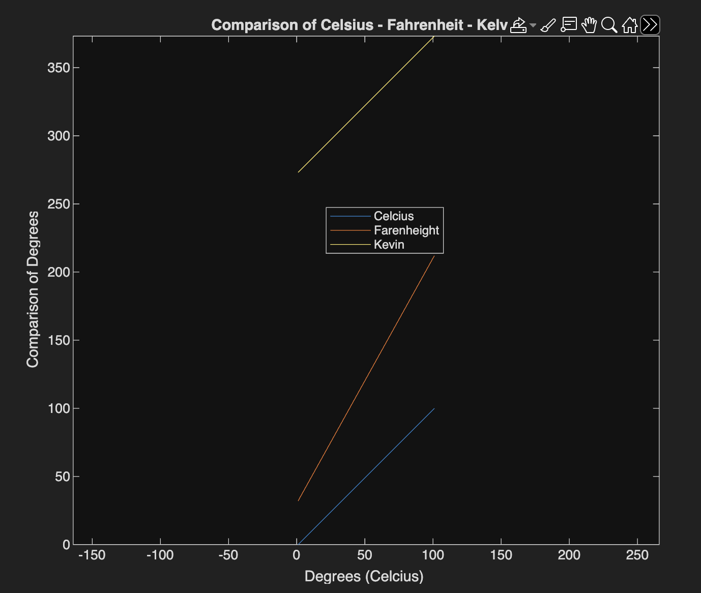

---
## Numerical Integration

**Assignment: "Distance planet travels in an orbit"** (last 3 pages of the PDF)
Fill in a template that computes the **perimeter of an ellipse** — the distance a planet travels in one orbit — two ways, and return both.
$$P = 4a\int_0^{\pi/2}\sqrt{1-k^2\sin^2\theta}\;d\theta,\qquad k=\frac{\sqrt{a^2-b^2}}{a}$$
- `a` = major axis, `b` = minor axis

**Template (given):**

```matlab
function [trapzApprox, numIntegrate] = PlanetDistance(a,b,nPoints)
    trapzApprox=TrapzPlanet(a,b,nPoints);
    numIntegrate=IntegratePlanet(a,b);
    fprintf("Trapezoid integration %f", numIntegrate);
    fprintf("Numeric integration %f", numIntegrate);
end

function trapzApprox=TrapzPlanet(a,b,nPoints)

    k = sqrt(a^2 - b^2)/a;
    x = linspace(0, pi/2, nPoints);
    y = sqrt(1 - (k^2)*sin(x).^2);
    trapzApprox = 4*a*trapz(x, y);
end

function numIntegrate=IntegratePlanet(a,b)

    k = sqrt(a^2 - b^2)/a;
    fun1 = @(x) sqrt(1 - (k^2)*sin(x).^2);
    xmin =0;
    xmax = pi/2;
    numIntegrate = integral(fun1,xmin,xmax)*4*a;
end
```

**Your job $\rightarrow$ write the bodies of two local functions:**

| Local function | Must use | Inputs | Does |
|---|---|---|---|
| `TrapzPlanet` | `trapz` | `a, b, points` | trapezoidal integration over `points` discrete θ values |
| `IntegratePlanet` | `integral` | `a, b` | adaptive integration of an anonymous function |

**Expected result:**

```matlab
a = 3.01*10^9; b = 2.74*10^9;
[trapzApprox, numIntegrate] = PlanetDistance(a,b,1000)

trapzApprox =

   1.8074e+10


numIntegrate =

   1.8074e+10
```

**Auto-grader checks:**

1. `PlanetDistance(a,b,10)` $\rightarrow$ `trapzApprox = 1.8074e+10` (even with only 10 points)
2. `PlanetDistance(a,b,10)` $\rightarrow$ `numIntegrate = 1.8074e+10`
3. `PlanetDistance.m` actually calls both `trapz` and `integral`

**Things to get right:**

- θ goes from **0 to π/2** (radians $\rightarrow$ use `sin`, not `sind`).
- Don't forget the **4a** in front of the integral.
- Element-wise ops (`.^`, `.*`) inside the integrand — `integral` passes in an array.
- `trapz` needs **x and y arrays**; `integral` needs a **function handle** `@(theta) ...` + limits.
---

## OOP — Object-Oriented Programming

### Objectives

1. Group related data and operations into objects.
2. Create objects from a class and call their methods.
3. Write a `classdef` file with `properties` and `methods` blocks.
4. Use property attributes (`Access`, `Constant`, `Dependent`) and get-access methods.
5. Write constructors, ordinary methods and static methods.
6. Overload built-in operators like `+`.
7. Write mutators, accessors, set/get-access methods and private helpers.
8. Explain the difference between a value class and a handle class.

### Summary of functions used in this chapter

| Function / keyword | What it does | Example |
|---|---|---|
| `classdef Name ... end` | begins / ends a class definition (file `Name.m`) | `classdef photoFrame` |
| `classdef Name < handle` | makes it a handle class | `classdef BallDrop < handle` |
| `properties ... end` | block of data fields | `properties (Access = private)` |
| `methods ... end` | block of functions | `methods (Static)` |
| `obj = Name(args)` | constructor call, creates an object | `frame1 = photoFrame(3, 10)` |
| `obj.Method()` | call a method (dot form) | `frame1.CalcArea()` |
| `Method(obj)` | call a method (function form) | `CalcArea(frame1)` |
| `Name.StaticMethod()` | call a static method, no object needed | `photoFrame.convertInToCm(10)` |
| `get.prop(obj)` | get-access method, runs when `prop` is read | `get.frameArea(obj)` |
| `set.prop(obj, v)` | set-access method, runs when `prop` is assigned | `set.game1Score(obj, s)` |
| `nargin` | number of inputs the caller passed | `if nargin == 2` |
| `plus`, `minus`, `lt`, `gt`, `eq` | methods to define to overload `+ - < > ==` | `function obj = plus(obj1, obj2)` |
| `floor`, `mod` | used to normalize minutes to hours + minutes | `mod(totalMinutes, 60)` |
| `rectangle('Position', p, 'Curvature', c)` | draws a box; curvature `[1 1]` makes a circle | `rectangle('Position', [x y d d], 'Curvature', [1 1])` |
| `clf`, `pause(t)` | clear figure, wait `t` seconds (animation) | `pause(.03)` |


#### Key Terms (all)

accessor, class, class definition, constructor, dependent property, encapsulation, get-access method, getter, handle class, instance, interface, members, method, method attribute, mutator, object, object-oriented programming, operator overloading, ordinary method, private helper method, property, property attribute, set-access method, setter, static method, stored property, value class

#### Key Commands (all)

`classdef`, `properties`, `methods`, `end`, `nargin`, `Access`, `Constant`, `Dependent`, `Hidden`, `Static`, `get.propertyName`, `set.propertyName`, `plus`, `minus`, `lt`, `gt`, `eq`, `< handle`, `rectangle`, `clf`, `pause`

### 1.1 Objects: Introduction

- Big program = hundreds of variables + functions, which gets confusing. Need a higher-level way to organize.
- Real world: an oven is made of wood, metal, plastic... but we think of it as one **object** with a few operations (open door, set temperature, set timer).

- Same idea in code. Runner program: an object `runnerInfo` that supports setting distance, setting time, computing speed.

Flat list of names is confusing:

```text
distRun
timeRun
GetSpeed()
PrintRunnerStats()
numSpectators
ticketPriceNormal
numStudents
ticketPriceStudent
CalculateRevenue()
```
Grouped into two objects, much clearer:
| `runnerInfo` | `crowdInfo` |
|---|---|
| `distRun` | `numSpectators` |
| `timeRun` | `ticketPriceNormal` |
| `GetSpeed()` | `numStudents` |
| `PrintRunnerStats()` | `ticketPriceStudent` |
| | `CalculateRevenue()` |

- **Object-oriented programming (OOP)**: program = collection of objects. More understandable, manageable, and more likely to run correctly.
- **Object** = data + the operations performed on that data.
- Naming convention in the reading: lowercase first letter = variable (`carStickerPrice`), uppercase + `()` = function (`DecreaseStickerPrice()`).

#### Key Terms

object, object-oriented programming

### 1.2 Classes: Using a Class
| Term | Meaning |
|---|---|
| **encapsulation** | data + operations in one object, with limits on outside access to the internals |
| **class** | template with the properties and methods common to many objects |
| **property** | named field that stores data |
| **method** | function that operates on the properties |
| **interface** | how a user interacts with the object (call methods, don't touch properties directly) |
| **constructor** | special method that creates an object; **same name as the class** |
| **instance** | one specific object of a class |

```matlab
% Call constructor to create frame1 object
frame1 = photoFrame(3, 10);
% Call method to calculate frame1's area
areaFrame1 = frame1.CalcArea()
```
**Two ways to call a method** :

```matlab
areaFrame1 = frame1.CalcArea();     % dot notation
areaFrame1 = CalcArea(frame1);      % function syntax: object is the first argument
```
- Objects of one class share the **same** properties and methods, but each **instance** is different.
#### Key Terms

class, constructor, encapsulation, instance, interface, method, property

### 1.3 Defining a Class
- One class per file; file name = class name (`photoFrame.m`).
- Built from blocks, each closed by `end`:

| Keyword | Holds |
|---|---|
| `classdef` | starts the class definition, followed by the class name |
| `properties` | data; can set defaults, access, visibility, storage |
| `methods` | functions; can set signatures, definitions, access |

- Class **members** = the properties and methods.
#### Example : implementation of datatype photoFrame
**photoFrame.m:**

```matlab
classdef photoFrame

    properties
        frameWidth;      % Width of a frame
        frameHeight;     % Height of a frame
    end

    methods
        % Constructor
        function obj = photoFrame(width, height)
            if nargin == 2
                obj.frameWidth = width;
                obj.frameHeight = height;
            else
                obj.frameWidth = [];
                obj.frameHeight = [];
            end
        end

        % Calculate frame area
        function area = CalcArea(obj)
            area = obj.frameWidth * obj.frameHeight;
        end

        % Display property values
        function ShowFields(obj)
            fprintf('Width = %d, Height = %d\n', ...
                    obj.frameWidth, obj.frameHeight);
        end
    end
end
```
1. **Define class:** `photoFrame.m` holds the code; `classdef` and the final `end` are the boundaries.
2. **Define properties:** from `properties` to its `end`. Property names; types, defaults, access optional.
3. **Define methods:** from `methods` to its `end`. Each method = `function ... end`.

#### Key Terms

class definition, members

#### Key Commands

`classdef`, `properties`, `methods`, `end`
### 1.4 Class Properties
#### Property attributes
**Property attributes** = characteristics of a property: access permission, visibility, storage. Set per `properties` block, so use several blocks for different attributes.
**Access levels** (default `public`):

| Level | Accessible from |
|---|---|
| `public` | anywhere the object is visible |
| `protected` | the class and its subclasses |
| `private` | class members only (not subclasses) |
| `immutable` | value can be set only in the constructor |

#### Subset of property attributes:

| Attribute | Values | Description |
|---|---|---|
| `Access` | `public`, `protected`, `private` | get and set access |
| `Constant` | `false`, `true` | `true` $\rightarrow$ value can't be changed |
| `Dependent` | `false`, `true` | `true` $\rightarrow$ value not stored in the object |
| `GetAccess` | `public`, `protected`, `private` | read access |
| `Hidden` | `false`, `true` | `true` $\rightarrow$ not shown in property lists |
| `SetAccess` | `public`, `protected`, `private`, `immutable` | write access |

> **Note:** attributes default to `false` and `public`. A property with no default value starts as `[]` (empty double).

#### Stored vs dependent properties:**

| Type | Stored in memory? | Value comes from |
|---|---|---|
| **stored** | yes | assignment / default |
| **dependent** | no | calculated each time it's read, by a **get-access method** |

- Get-access method: in a `methods` block, named `get.propertyName(obj)`. MATLAB calls it automatically when the property is read.
- Users read a public dependent property as `obj.propertyName` or `obj.propertyName()`, **without** `get`.

**photoFrameModified.m:**

```matlab
classdef photoFrameModified
    properties (Access = private)        % Stored properties
        frameWidth = 3;
        frameHeight = 10;
        quantityOrdered = 1;
    end
    properties (Constant, Access = private)
        inchToCmFactor = 2.54;
    end
    properties (Dependent)               % Dependent property
        frameArea;
    end

    methods
        % Get method for frameArea property
        function area = get.frameArea(obj)
            area = obj.frameWidth * obj.frameHeight;
        end

        % Change frame dimensions
        function obj = SetFrameDimensions(obj, width, height)
            obj.frameWidth = width;
            obj.frameHeight = height;
        end

        % Display property values
        function ShowFields(obj)
            fprintf('Width = %d, Height = %d, Area = %d\n', ...
                    obj.frameWidth, obj.frameHeight, obj.frameArea);
        end
    end
end
```
```matlab
frame1 = photoFrameModified;
frame1.ShowFields()
frame1 = frame1.SetFrameDimensions(5, 20);
frame1.ShowFields()

Width = 3, Height = 10, Area = 30
Width = 5, Height = 20, Area = 100
```

```matlab
frame1.get.frameArea()      % incorrect syntax to get the frameArea
```

```text
Unrecognized method, property, or field 'get' for class 'photoFrameModified'.
```

```matlab
frame1.frameArea()
frame1.frameArea

ans =

   100


ans =

   100
```
- Dependent benefits: saves memory (not stored) and always consistent with the properties it's calculated from.
- Get-access methods are only needed for `Dependent` properties.
#### Key Terms

dependent property, get-access method, property attribute, stored property

#### Key Commands

`Access`, `Constant`, `Dependent`, `Hidden`, `GetAccess`, `SetAccess`
### 1.5 Class Methods

#### Constructor
- Same name as the class. Creates an instance with property values from the inputs, then returns it.
- **NO OVERLOADING**: One constructor per class. None defined $\rightarrow$ default constructor (no inputs) sets properties to `[]` or their block defaults.
- Called as `e1 = employeeInfo()`, **not** `e1.employeeInfo()` (e1 doesn't exist yet).

#### Ordinary methods & method attributes

- **Ordinary method** = works on one specific instance. The object must be passed explicitly (`obj` first).
- A value-class method can't change its input, so it returns a new object/value.
- **Method attributes** = access, visibility, implementation. Several `methods` blocks $\rightarrow$ different attributes.

**Example**


```matlab
classdef photoFrame
    properties (Access = private)
        frameWidth;
        frameHeight;
    end
```
1. Constructor = same name as the class, creates an object.

```matlab
    methods
        % Constructor
        function obj = photoFrame(width, height)
            % Create, return photoFrame object (code not shown)
        end
```
2. `obj` = first argument of an ordinary method, e.g. `SetFrameDimensions(obj, width, height)`.
3. Methods can access private members.
4. Multiple `methods` blocks $\rightarrow$ customize access, visibility, implementation.

```matlab
        % Change frame dimensions
        function obj = SetFrameDimensions(obj, width, height)
            % Assign user values to frameWidth and frameHeight
            % (code not shown)
        end

        % Display property values
        function ShowFields(obj)
            fprintf('Width = %d, Height = %d\n', ...
                    obj.frameWidth, obj.frameHeight);    % methods can access private members
        end
    end
    methods (Access = private, Hidden = true)
        function CalculateFrameCost(obj)
            % Calculate cost based on dimensions (code not shown)
        end
    end
end
```
- Method `Access` defaults to `public` $\rightarrow$ callable anywhere the object is visible; that's the interface.
**Subset of method attributes:**

| Attribute | Values | Description |
|---|---|---|
| `Access` | `public`, `protected`, `private` | who can call it |
| `Hidden` | `false`, `true` | `true` $\rightarrow$ not shown in method lists |
| `Static` | `false`, `true` | `true` $\rightarrow$ doesn't need an object |

#### Static methods
- Related to the class, but don't work on a specific instance. Ex: `convertInToCm()` converts units but doesn't touch the properties.

```matlab
classdef photoFrame
    properties (Access = private)
        frameWidth;
        frameHeight;
    end
...
    methods (Static)        % Static method
        % Converts input argument from inches to cm
        function sizeCm = convertInToCm(sizeInches)
            sizeCm = sizeInches * 2.54;
        end
    end

```
- Call with `ClassName.MethodName()`, no object needed:

```matlab
x = photoFrame.convertInToCm(10)
```

#### Key Terms

constructor, method attribute, ordinary method, static method

#### Key Commands

`nargin`, `methods (Static)`, `methods (Access = private)`

### 1.6 Class Example: Seat Reservation System

**Implement two classes:**

- `seat` class = one seat: first name, last name, amount paid. Methods: check empty, reserve, print.
- `eventInfo` class = venue, date, and an **array of `seat` objects**. Methods: reserve a seat, print venue info.
- Main script stays clean: menu + calls to `eventInfo` methods.
**seat.m:**

```matlab
classdef seat
    properties (Access = private)
        firstName;
        lastName;
        amountPaid;
    end

    methods
        % Constructor
        function obj = seat()
            obj.firstName = 'empty';
            obj.lastName = 'empty';
            obj.amountPaid = 0;
        end

        % Checks if a seat is empty
        function isEmpty = CheckSeatEmpty(obj)
            isEmpty = strcmp(obj.firstName, 'empty');
        end

        % Reserve seat
        function obj = ReserveSeat(obj, userFirstName, userLastName, ticketPrice)
            obj.firstName = userFirstName;
            obj.lastName = userLastName;
            obj.amountPaid = ticketPrice;
        end

        % Prints seat information
        function PrintSeat(seat)
            if strcmp(seat.firstName, 'empty')
                fprintf('empty\n')
            else
                fprintf('%s %s, Paid: %d\n', seat.firstName, seat.lastName, seat.amountPaid)
            end
        end
    end
end
```
**eventInfo.m:**

```matlab
classdef eventInfo
    properties (Access = private)
        venueName;
        showDate;
        allSeats = seat;
    end

    methods
        % Constructor
        function obj = eventInfo(location, date, numberSeats)
            if nargin == 3
                obj.venueName = location;
                obj.showDate = date;
                obj.allSeats(1:numberSeats) = seat();    % Array of seats
            else
                obj.venueName = [];
                obj.showDate = [];
                obj.allSeats(1) = [];
            end
        end

        % Reserve seat in venue
        function obj = ReserveSeat(obj)
            seatNumber = input('Enter seat number: ');   % Get seat number

            % If empty, reserve seat
            if obj.allSeats(seatNumber).CheckSeatEmpty()
                name1 = input('Enter first name:  ', 's');
                name2 = input('Enter last name:  ', 's');
                cost = input('Enter amount paid:  ');

                obj.allSeats(seatNumber) = obj.allSeats(seatNumber).ReserveSeat(name1, name2, cost);

            % If not empty, display error
            else
                fprintf('Error: Seat %d is not empty.\n', seatNumber)
            end
        end

        % Print all venue information
        function PrintVenueInfo(obj)
            fprintf('Venue location: %s\n', obj.venueName);
            fprintf('Event date: %s\n', obj.showDate);

            for i = 1:length(obj.allSeats)
                fprintf('%d: ', i);
                obj.allSeats(i).PrintSeat();
            end
        end
    end
end
```
**Main script:**

```matlab
% Assign default menu value
userKey = 'go';

% Create an instance of class eventInfo
ticketSystem = eventInfo('Symphony Hall', '05-May-2003', 5);

% Continue to prompt user for menu selection while not quit
while ~strcmp(userKey, 'q')
    userKey = input('Enter command (p/r/q): ', 's');

    if strcmp(userKey, 'p')                  % Print venue info
        ticketSystem.PrintVenueInfo();

    elseif strcmp(userKey, 'r')              % Reserve a seat
        ticketSystem = ticketSystem.ReserveSeat();

    elseif strcmp(userKey, 'q')              % Quit
        disp('Quitting.');

    else
        disp('Invalid command.');            % User did not type p, r, or q
    end

end
```
Session (user input after each prompt):

```text
Enter command (p/r/q): p
Venue location: Symphony Hall
Event date: 05-May-2003
1: empty
2: empty
3: empty
4: empty
5: empty
Enter command (p/r/q): r
Enter seat number: 1
Enter first name:  John
Enter last name:  Doe
Enter amount paid:  1000
Enter command (p/r/q): r
Enter seat number: 2
Enter first name:  Susie
Enter last name:  Doe
Enter amount paid:  1250
Enter command (p/r/q): r
Enter seat number: 2
Error: Seat 2 is not empty.
Enter command (p/r/q): r
Enter seat number: 5
Enter first name:  Peter
Enter last name:  Principle
Enter amount paid:  500
Enter command (p/r/q): p
Venue location: Symphony Hall
Event date: 05-May-2003
1: John Doe, Paid: 1000
2: Susie Doe, Paid: 1250
3: empty
4: empty
5: Peter Principle, Paid: 500
Enter command (p/r/q): q
Quitting.
```

- `ticketSystem = ticketSystem.ReserveSeat();` $\rightarrow$ must reassign: `eventInfo` is a value class, so the method returns the changed copy.
- Methods aren't copied per object; only properties are. Each object calls its class's methods.

### 1.7 Operator Overloading
- **Operator overloading** = define built-in operators (`+`, `-`, ...) for your own objects.
- Each operator has a matching MATLAB function. Define a method with that name in the class.

**Subset of operator methods:**

| Operator | Method to define | Example use |
|---|---|---|
| `+` | `plus(a, b)` | `a + b` |
| `-` | `minus(a, b)` | `a - b` |
| `<` | `lt(a, b)` | `a < b` |
| `>` | `gt(a, b)` | `a > b` |
| `==` | `eq(a, b)` | `a == b` |


**Example tripDetails.m:**
```matlab
classdef tripDetails
    properties (Access = private)
        tripHours;
        tripMinutes;
    end

    methods
        % Constructor
        function obj = tripDetails(travelHrs, travelMins)
            if nargin == 2
                obj.tripHours = travelHrs;
                obj.tripMinutes = travelMins;
            else
                obj.tripHours = [];
                obj.tripMinutes = [];
            end
        end

        % Print trip hours and minutes
        function printTripDetails(obj)
            fprintf('Trip duration: %d hours, %d min\n', ...
                    obj.tripHours, obj.tripMinutes);
        end
```
**Overloading the +opertator**
```matlab
        % Overloads the + operator
        function obj = plus(obj1, obj2)
            totalMinutes = (obj1.tripHours * 60) + obj1.tripMinutes + ...
                           (obj2.tripHours * 60) + obj2.tripMinutes;

            obj = tripDetails(floor(totalMinutes/60), mod(totalMinutes, 60));
        end
    end
end
```
```matlab
t1 = tripDetails(3, 22);
t1.printTripDetails();
t2 = tripDetails(2, 50);
t2.printTripDetails();
t3 = t1 + t2;
t3.printTripDetails();

Trip duration: 3 hours, 22 min
Trip duration: 2 hours, 50 min
Trip duration: 6 hours, 12 min
```
#### Key Terms

operator overloading

#### Key Commands

`plus`, `minus`, `lt`, `gt`, `eq`

### 1.8 Mutators, Accessors & Private Helpers
| Method type | Does |
|---|---|
| **mutator** | may change ("mutate") properties |
| **accessor** | reads properties, doesn't change them |
| **setter** | mutator for one property |
| **getter** | accessor for one property |

**GameInfo.m (version 1):**

```matlab
classdef GameInfo
    properties (Access = private)
        game1Score;
        game2Score;
    end

    methods
        % Mutator methods
        function obj = SetGame1Score(obj, gameScore)
            obj.game1Score = gameScore;
        end

        function obj = SetGame2Score(obj, gameScore)
            obj.game2Score = gameScore;
        end

        % Accessor methods
        function gameScore = GetGame1Score(obj)
            gameScore = obj.game1Score;
        end

        function gameScore = GetGame2Score(obj)
            gameScore = obj.game2Score;
        end

        function returnValue = FindHighScore(obj)
            returnValue = max(obj.game1Score, obj.game2Score);
        end
    end
end
```

**Main script:**

```matlab
cardGame = GameInfo;

cardGame = cardGame.SetGame1Score(88);
cardGame = cardGame.SetGame2Score(135);

fprintf('Game 1: %d\n', cardGame.GetGame1Score);
fprintf('Game 2: %d\n', cardGame.GetGame2Score);
fprintf('Highest score: %d\n', cardGame.FindHighScore);

Game 1: 88
Game 2: 135
Highest score: 135
```

**Property access methods: `set` and `get`**

- **get-access method** `get.propertyName(obj)`: runs automatically when the property is **read**. Main use: computing a `Dependent` property. Can also trigger events / update other properties.
- **set-access method** `set.propertyName(obj, value)`: runs automatically when the property is **assigned**. Use for error and type checking.
- Never call them directly. MATLAB calls them.

**GameInfo.m (version 2, scores bounded 0 to 100):**

```matlab
classdef GameInfo
    properties (Access = private)
        game1Score;
        game2Score;
    end

    properties (Dependent, Access = private)
        highScore;
    end

    methods
        % Public mutator and accessor methods
        function obj = SetGame1Score(obj, gameScore)
            obj.game1Score = gameScore;
        end

        function obj = SetGame2Score(obj, gameScore)
            obj.game2Score = gameScore;
        end

        function gameScore = GetGame1Score(obj)
            gameScore = obj.game1Score;
        end

        function gameScore = GetGame2Score(obj)
            gameScore = obj.game2Score;
        end

        function returnValue = FindHighScore(obj)
            returnValue = obj.highScore;
        end
    end

    methods
        % The set and get methods are automatically called
        % when a property is accessed
        function obj = set.game1Score(obj, gameScore)
            if (gameScore < 0)
                obj.game1Score = 0;
            elseif (gameScore > 100)
                obj.game1Score = 100;
            else
                obj.game1Score = gameScore;
            end
        end

        function obj = set.game2Score(obj, gameScore)
            if (gameScore < 0)
                obj.game2Score = 0;
            elseif (gameScore > 100)
                obj.game2Score = 100;
            else
                obj.game2Score = gameScore;
            end
        end

        function highScore = get.highScore(obj)
            highScore = max(obj.game1Score, obj.game2Score);
        end
    end
end
```

Same main script:

```text
Game 1: 88
Game 2: 100
Highest score: 100
```

- `SetGame2Score(135)` assigns `game2Score` $\rightarrow$ MATLAB calls `set.game2Score` $\rightarrow$ 135 is over 100 $\rightarrow$ stored as 100.
- `FindHighScore()` reads `highScore` $\rightarrow$ MATLAB calls `get.highScore` $\rightarrow$ max of the two scores.


**Private helper methods**

- **Private helper** = private method that helps the public methods; avoids repeated code.
- `CheckSetValue()` does the 0 to 100 check once for both setters. `Static` too, since it doesn't need an object.

```matlab
classdef GameInfo
    properties (Access = private)
        game1Score;
        game2Score;
    end

    methods
        % Public mutator and accessor methods
        % ...
    end

    methods
        % The set and get methods are automatically called
        % when a property is accessed
        function obj = set.game1Score(obj, gameScore)
            obj.game1Score = obj.CheckSetValue(gameScore);
        end

        function obj = set.game2Score(obj, gameScore)
            obj.game2Score = obj.CheckSetValue(gameScore);
        end

        % ...
    end

    methods (Static, Access = private)
        % Helper method
        function boundedScore = CheckSetValue(gameScore)
            if (gameScore < 0)
                boundedScore = 0;
            elseif (gameScore > 100)
                boundedScore = 100;
            else
                boundedScore = gameScore;
            end
        end
    end
end
```

#### Key Terms

accessor, getter, mutator, private helper method, set-access method, setter

#### Key Commands

`get.propertyName`, `set.propertyName`, `methods (Static, Access = private)`

### 1.9 Handle Classes

| | Value class | Handle class |
|---|---|---|
| Constructor returns | the object | a **handle** (reference) to the object |
| `b = a` / passing to a method | copies the object | copies the handle; both point to **one** object |
| Change through one variable | the other is unaffected | seen through every variable |
| Default? | yes (most MATLAB classes) | add `< handle` after the class name |

1. Value constructor returns an object; `tripB = tripA` makes an independent copy.
2. Changing `tripA` doesn't change `tripB`.
3. Handle constructor returns a handle; `tripB = tripA` copies the handle.
4. Both variables refer to the same data, so a change through either one changes both.


```matlab
tripA = tripDetails(1, 30);      % value class
tripB = tripA;

tripA.tripHours = 5;

tripA.printTripDetails();
tripB.printTripDetails();

Trip duration: 5 hours, 30 min
Trip duration: 1 hours, 30 min
```
**Handle (similar to pointer in C++)**
```matlab
tripA = tripDetailH(1, 30);      % handle class
tripB = tripA;

tripA.tripHours = 5;

tripA.printTripDetails();
tripB.printTripDetails();

Trip duration: 5 hours, 30 min
Trip duration: 5 hours, 30 min
```

#### Key Terms

handle, handle class, value class

#### Key Commands

`< handle`

### 1.10 Handle Class Example: Ball Drop

- `BallDrop` (handle class) = one ball: random start x, falling speed, radius, color.
- `MoveBall()` moves it down; stops when it hits the floor. `PlotBall()` redraws it.
- Handle classes are common in animation: pass a reference, don't copy the object every frame.

**BallDrop.m:**

```matlab
classdef BallDrop < handle
    properties (Access = private)
        xPos;               % Starting ball position, x-coordinate
        yPos;               % Starting ball position, y-coordinate
        yVelocity;          % Ball falling velocity, y component
        ballRadius;         % Ball radius
        ballColor;          % Ball color
    end

    properties (Constant)
        minyVelocity = -10; % Minimum y velocity
    end

    methods
        % Constructor
        function obj = BallDrop()
            % Assign randomized starting location
            obj.xPos = 18 * rand(1) - 9;              % -9 < random number < 9
            obj.yPos = 9;                             % Starts at the top

            % Assign random falling velocity of ball
            obj.yVelocity = -0.5 * rand(1) - 0.1;     % -0.6 < random number < -0.1

            % Assign random ball radius and color
            obj.ballRadius = rand(1) * .9;            % 0 < random number < 0.9
            obj.ballColor = [randi(2) - 1, ...
                             randi(2) - 1, randi(2) - 1];   % R, G, B is 0 or 1
        end

        % Moves ball instance from top of screen to bottom
        function MoveBall(obj)
            obj.yPos = obj.yPos + obj.yVelocity;

            % If ball hits bottom, then stops falling
            if ((obj.yPos - 1 * obj.ballRadius) <= obj.minyVelocity)
                obj.yVelocity = 0;
                obj.yPos = -10 + obj.ballRadius;
            end
        end

        % Creates a rounded rectangle (i.e. ball) on 2-D line plot
        function PlotBall(obj)
            ballSize = obj.ballRadius * 2;
            pos = [obj.xPos, obj.yPos, ballSize, ballSize];   % Specifies location and size
            curv = [1, 1];                                     % Adds curvature to the sides of the rectangle
            rectangle('Position', pos, 'Curvature', curv, 'FaceColor', obj.ballColor);
        end
    end
end
```
**Main script:**

```matlab
% The main script creates a 100 balls and
% an animation that drops the balls onto a surface.
rng('default')                  % added so your balls match the figures

numberBalls = 100;              % Defines number of balls
figure(1);                      % Creates a figure window

for b = 1:numberBalls           % Create 100 instances of BallDrop
    balls(b) = BallDrop;
end

for j = 1:200
    hold on;                    % Clear balls in the
    clf;                        % current graph
    finish = false;

    for b = 1:numberBalls       % Re-position each ball to a lower
        balls(b).MoveBall;      % y position (i.e. make ball fall)
        balls(b).PlotBall;
    end

    axis([-12, 12, -12, 12]);   % Sets graphics
    rectangle('Position', [-11, -11, 22, 22]);
    set(gca, 'visible', 'off', 'DataAspectRatio', [1, 1, 1]);
    pause(.03)                  % Pause before next iteration of loop
end
```


---
## Object-Oriented Programming in Matlab — Exercises

**Exercise 1.1** — carOnLot is an object in a used-car inventory program. Which of the following variables and functions should be included in carOnLot? A lowercase first letter indicates a variable name, while uppercase and an ending () indicate a function.

1) carStickerPrice
2) todaysTemperature
3) daysOnLot
4) origPurchasePrice
5) numSalespeople
6) IncrementCarDaysOnLot()
7) DecreaseStickerPrice()
8) DetermineTopSalesperson()

<details><summary>Solution</summary>

| Item | In `carOnLot`? | Why |
|---|---|---|
| `carStickerPrice` | yes | a car has a sticker price |
| `todaysTemperature` | no | the weather isn't part of a car |
| `daysOnLot` | yes | days on the lot is a feature of the car |
| `origPurchasePrice` | yes | each car was bought for some price |
| `numSalespeople` | no | not a feature of a car |
| `IncrementCarDaysOnLot()` | yes | operates on a car |
| `DecreaseStickerPrice()` | yes | operates on a car |
| `DetermineTopSalesperson()` | no | belongs on a salesperson object |

</details>

**Exercise 1.2** — 1) frame1 is a(n) _____. 2) frameWidth is a(n) ___. 3) CalcArea is a(n) _____. 4) Objects defined by the same class can have different properties and methods. 5) Objects defined by the same class can hold different values in the object's properties.

<details><summary>Solution</summary>

1. **object**: `frame1` is an instance of class `photoFrame`.
2. **property**: `frameWidth` stores data.
3. **method**: `CalcArea` doesn't store data; it operates on `frameWidth` and `frameHeight`.
4. **False**: every `photoFrame` object has the same two properties and three methods.
5. **True**: the values differ (`frame1` is 3 × 10, `frame2` is 20 × 7).

</details>
**Exercise 1.3** — What does each statement do? `officeFrame = photoFrame(24, 36)`, `officeFrame = officeFrame.SetHeight(40)`, and what value does `officeFrame.CalcArea()` return?

<details><summary>Solution</summary>

- `photoFrame(24, 36)` calls the constructor $\rightarrow$ object `officeFrame` of class `photoFrame`.
- `SetHeight(40)` uses dot notation $\rightarrow$ sets `frameHeight` to 40.
- `CalcArea()` returns `frameHeight * frameWidth`.


```matlab
officeFrame.CalcArea()

ans =

   960
```

</details>

**Exercise 1.4** — Fill in the placeholders in the `employeeData` class definition. 1) Placeholder_A. 2) Placeholder_B, to define the property currentSalary. 3) Placeholder_C terminates the property block? 4) Placeholder_D defines the constructor method with the arguments name and currentSalary. 5) Placeholder_E, to assign currentSalary the value of newSalary. (Hint: Use dot notation)

<details><summary>Solution</summary>

The reading's code for this question isn't in the PDF, so the skeleton below is rebuilt from the answers.

```matlab
classdef employeeData                                  % A: classdef
    properties
        name;
        currentSalary;                                 % B: currentSalary;
    end                                                % C: end

    methods
        function obj = employeeData(name, currentSalary)   % D: constructor
            obj.name = name;
            obj.currentSalary = currentSalary;
        end

        function obj = SetSalary(obj, newSalary)
            obj.currentSalary = newSalary;             % E: obj.currentSalary
        end
    end
end
```

- A: the definition begins with `classdef` + class name.
- B: each property on its own line.
- C: a property block ends with `end`.
- D: constructor = same name as the class; returns the new object.
- E: the method gets `obj` explicitly; dot notation reaches its property.

</details>
**Exercise 1.5** — The following properties' access attribute value is _____. Is it public, protected, or private?

```matlab
properties
    model = 'GT40';
    year = 1966;
end
```

<details><summary>Solution</summary>

**public**: `Access` isn't specified, so it defaults to public.

</details>

**Exercise 1.6** — The following properties can be accessed _____. Is it anywhere class is visible, only by class members or no one?

```matlab
properties (Access = private)
    model = 'GT40';
    year = 1966;
end
```

<details><summary>Solution</summary>

**Only by class members.** Users have to go through the class methods.

</details>

**Exercise 1.7** — milesToKilometers can be accessed _____. Is it anywhere the class is visible or only by members?

```matlab
properties (Constant)
    milesToKilometers = 1.60934;
end
```

<details><summary>Solution</summary>

**Anywhere the class is visible.** `Access` defaults to public.

</details>
**Exercise 1.8** — milesToKilometers can be assigned a new value by _____. Is it anywhere the class is visible, class methods only, or no code?

<details><summary>Solution</summary>

**No code.** `Constant` means it can't be changed after initialization; every instance has `milesToKilometers = 1.60934`.

</details>

**Exercise 1.9** — tankCapacity has default value _____. Is it [], 0, or 16.5?

```matlab
properties (Access = protected)
    mpg = 16.5;
    tankCapacity;
end
```

<details><summary>Solution</summary>

**`[]`**: no default given, so it's an empty double.

</details>

**Exercise 1.10** — For the photoFrameModified class of the example above... 1) quantityOrdered is a _____ property. 2) frameArea is a _____ property. 3) The new property framePerimeter, calculated as (2 * frameWidth + 2 * frameHeight) should be defined as a _____ property. 4) A get-access method must be defined for the property quantityOrdered. True or False?

<details><summary>Solution</summary>

1. **Stored**: it has a default of 1, not calculated from anything.
2. **Dependent**: calculated from `frameWidth` and `frameHeight`.
3. **Dependent**: it depends on other properties; saves memory and stays consistent.
4. **False**: get-access methods are only needed for `Dependent` properties.

</details>

**Exercise 1.11** — True or False? 1) A constructor has the same name as the class. 2) A class definition must define a constructor method. 3) A constructor is called using dot notation. Ex: e1.employeeInfo() creates an object named e1, which is an instance of class employeeInfo. 4) Good practice is to explicitly define a default constructor for a class. 5) Good practice is a constructor that explicitly tests the number of arguments provided in the call.

<details><summary>Solution</summary>

1. **True.**
2. **False**: there's a default constructor (no inputs) that sets properties to `[]` or their defaults. Writing one overrides it.
3. **False**: `e1` doesn't exist yet, so `e1.employeeInfo()` gives an "Unable to resolve the name" error. Use `e1 = employeeInfo()`.
4. **True**: it should initialize each property.
5. **True**: wrong input count $\rightarrow$ set properties to empty and/or show an error.

</details>


**Exercise 1.12** — Which code snippet best fills the blank _____, per the description? 1) The ResetSalary method is accessible only by the object's members. Is it: methods, methods (Access = public), or methods (Access = private)?

```matlab
_____
    function obj = ResetSalary(obj)
        % Re-assign an object's relevant salary
        % properties to default values
    end
end
```

<details><summary>Solution</summary>

**`methods (Access = private)`**: a private method is accessible only by members of the object.

</details>

**Exercise 1.13** — The OvertimePay method calculates a paycheck based on the object's hoursWorked property and an argument hourlyRate. Is it: obj, or obj, hourlyRate or hourlyRate?

```matlab
function otPay = OvertimePay(______)
    otPay = (obj.hoursWorked - 40) * 1.5 * hourlyRate;
end
```

<details><summary>Solution</summary>

**`obj, hourlyRate`**: the method reads `obj.hoursWorked`, so the object is passed explicitly; `hourlyRate` comes from the caller.

</details>
**Exercise 1.14** — employeeData class constructor. Is it: employeeData( ), or obj = employeeData( ), or employeeData( obj) ?

```matlab
function ______
    % Creates and returns an employeeData object
end
```

<details><summary>Solution</summary>

**`obj = employeeData()`**: the constructor creates, then returns, an instance.

</details>
---
**Exercise 1.15** — CheckBounds() is a method that returns true if all property values are within a predefined range. CheckBounds() should be defined as a(n) ____ method. Is it: ordinary or static?

<details><summary>Solution</summary>

**ordinary**: it works on the property values of one instance.

</details>
**Exercise 1.16** — RoundValue() rounds any numeric input to the nearest ten. Ordinary or static?

<details><summary>Solution</summary>

**static**: it doesn't operate on an instance; any number passed in gets rounded.

> **Book typo:** this question repeats the `CheckBounds()` text from 22.15, but its answer is about `RoundValue()`. The question here is rewritten to match the answer.

</details>
**Exercise 1.17** — RemoveSpaces() is a method that returns an input character vector with all whitespace removed from the character vector. RemoveSpaces() should be defined as a(n) ____ method.

<details><summary>Solution</summary>

**static**: it works on any character vector passed in, not on an instance.
</details>

**Exercise 1.18** — True or False? 4) ConvertToEuros(ticketAmount) is a Static method of class parkingTicket and can be called by `fine = parkingTicket.ConvertToEuros(125);` 5) ticket2250 is an instance of class parkingTicket. TimeNow() is a Static method of class parkingTicket and can be called by `fine = ticket2250.TimeNow();` 6) GetTicketDate() is an ordinary method of class parkingTicket and can be called by `fine = parkingTicket.GetTicketDate();`

<details><summary>Solution</summary>

4. **True**: a static method is called with class name + method name.
5. **True**: a static method can also be called from an instance.
6. **False**: an ordinary method needs an instance. Create e.g. `cityTicket` first, then `fine = cityTicket.GetTicketDate();`.

> **Book typo:** the reading's answer to 6 says "then the Static method can be called by `cityTicket.GetTicketDate()`". `GetTicketDate` is the ordinary method.

</details>

**Exercise 1.19** — Refer to the above seat reservation example. True or False? 1) ticketSystem contains one object of type seat. 2) The seat class defines 7 methods. 3) The statement obj.allSeats(1:numberSeats) = seat(); allocates numberOfSeats × 4 member methods. 4) Before a seat can be reserved, the main script first checks if the seat object is empty.

<details><summary>Solution</summary>

1. **False**: `eventInfo('Symphony Hall', '05-May-2003', 5)` creates an array of 5 seat objects.
2. **False**: 4 methods: the constructor `seat`, `CheckSeatEmpty`, `ReserveSeat`, `PrintSeat`.
3. **False**: methods aren't allocated per object; only properties are. Objects call their class's methods.
4. **False**: `ticketSystem.ReserveSeat` checks the seat; the main script only handles commands.

</details>

**Exercise 1.20** — flightA and flightB are objects of the class tripDetails. Write a statement that uses the overloaded + operator to assign totalFlightTime with flightA and flightB's combined trip duration.

<details><summary>Solution</summary>

```matlab
totalFlightTime = flightA + flightB;
```

MATLAB sees two `tripDetails` objects and calls the class's `plus`.

</details>
**Exercise 1.21** — Given the following code snippet, what is the value of weeklyDrive.tripHours?

```matlab
mondayDrive = tripDetails(4, 15);
weddayDrive = tripDetails(6, 34);
weeklyDrive = mondayDrive + weddayDrive;
```

<details><summary>Solution</summary>

**10**: 4 h 15 min + 6 h 34 min = 10 h 49 min.

> **Note:** `tripHours` is private in the 22.7 class, so `weeklyDrive.tripHours` can't actually be read from outside. Use `weeklyDrive.printTripDetails()` to see it.

</details>
**Exercise 1.22** — Given the following code snippet, what is the value of weekendDrive.tripMinutes?

```matlab
saturdayDrive = tripDetails(1, 45);
sundayDrive = tripDetails(1, 30);
weekendDrive = saturdayDrive + sundayDrive;
```

<details><summary>Solution</summary>

**15**: 1 h 45 min + 1 h 30 min = 3 h 15 min. `mod(totalMinutes, 60)` keeps minutes under 60.

</details>
**Exercise 1.23** — Complete the method definition to overload the == operator.

```matlab
function obj = ____(obj1, obj2)
```

<details><summary>Solution</summary>

**`eq`**: define a method named after the operator's MATLAB function.

</details>

**Exercise 1.24** — 1) A mutator should not change the private properties. True or False. 2) An accessor should not change the private properties. True or False. 3) The SetGame1Score method is a(n) _____. 4) The FindHighScore method is a(n) _____.

<details><summary>Solution</summary>

1. **False**: a mutator changes ("mutates") properties.
2. **True**: an accessor reads a property and returns a value or does an action.
3. **mutator**: it assigns `game1Score`.
4. **accessor**: it reads `game1Score` and `game2Score` and returns the higher one.

</details>

**Exercise 1.25** — True or False? 1) The set.game2Score() method is automatically called when game2Score's value is accessed. 2) The get.highScore() method is automatically called when highScore's value is accessed. 3) The get-access and set-access methods are built-in methods defined by MATLAB for error checking and formatting property values. 4) userName is a new property added to gameInfo's class definition. userName's get-access method is defined by `function obj = set.userName()`. 5) Good practice is for a user to explicitly call a property's get-access method before assigning a value to the property.

<details><summary>Solution</summary>

1. **False**: set runs when the value is **assigned**, not read.
2. **True**: get runs when the value is read.
3. **False**: you write them; MATLAB just calls them automatically when they exist.
4. **False**: a get-access method is `get.userName(obj)`; `set.userName` is the set-access method.
5. **False**: calling them directly is an error; MATLAB calls them for you.

</details>
**Exercise 1.26** — True or False? 1) A private helper method can be called from the main script. 2) A private helper method typically helps a class's other methods carry out their tasks. 3) A private helper method may not call another private helper method. 4) In MATLAB, a helper method will by default be private.

<details><summary>Solution</summary>

1. **False**: only the class's own methods can call it.
2. **True**: leads to cleaner code.
3. **False**: other methods in the class can call it, including other private helpers.
4. **False**: methods default to public; write `Access = private`.
**Exercise 1.27** — Given the class type for tripDetails, what is each property's numeric value after executing:

```matlab
tripA = tripDetails(3, 27);
tripB = tripA;

tripA.tripHours = 1;
tripB.tripMinutes = 48;
```

1) Value class: tripB.tripHours. 2) Handle class: tripB.tripHours. 3) Value class: tripA.tripMinutes. 4) Handle class: tripA.tripMinutes. 5) Handle class: tripB.tripMinutes.

<details><summary>Solution</summary>

| Question | Answer | Why |
|---|---|---|
| value, `tripB.tripHours` | **3** | `tripB` is a separate copy |
| handle, `tripB.tripHours` | **1** | same object as `tripA` |
| value, `tripA.tripMinutes` | **27** | `tripA` is a separate copy |
| handle, `tripA.tripMinutes` | **48** | same object as `tripB` |
| handle, `tripB.tripMinutes` | **48** | assigned directly |

</details>
**Exercise 1.28** — Handle class definition. True or False? 1) The addTravelDelay() method definition includes (obj) as an input parameter because the method accesses an object's property values. 2) The addTravelDelay() method returns an object because the tripHours and tripMinutes properties are modified. 3) The statement tripA.addTravelDelay(2, 5) has no impact on tripA's properties because the addTravelDelay() method doesn't return the modified object.

<details><summary>Solution</summary>

1. **True**: `hrsDelay` and `minDelay` are added to the object's properties.
2. **False**: it's `function addTravelDelay(...)`, not `function obj = addTravelDelay(...)`; nothing is returned.
3. **False**: 1 h 30 min before, 3 h 35 min after. The method and caller share the same object.

</details>
**Exercise 1.29** — Is each class a handle or value class? 4) `classdef employeeData` (define properties, define methods, end). 5) `classdef photoFrame < handle` (define properties, define methods, end).

<details><summary>Solution</summary>

4. **value**: user-defined classes are value classes by default.
5. **handle**: `< handle` after the class name.

</details>
**Exercise 1.30** — Ball drop simulation. True or False? 1) The main script creates 100 instances of class BallDrop. 2) Each instance of the class BallDrop is assigned with the same yVelocity value. 3) BallColor is specified by an RGB vector consisting of three entries, where each entry is a random real number in the interval between 0 and 1.

<details><summary>Solution</summary>

1. **True**: the first `for` loop runs 100 times, one `BallDrop` each.
2. **False**: each constructor call picks a random `yVelocity` between -0.6 and -0.1, so balls fall at different rates.
3. **False**: `randi(2) - 1` is an integer, either 0 or 1.

```matlab
rng('default')
c = [randi(2) - 1, randi(2) - 1, randi(2) - 1]

c =

     1     1     0
```

(First three draws of the default stream. Computed in Python with MATLAB's generator, not run in MATLAB.)

</details>

---
## SDC Chapter 7 — Debugging & Error Handling

### Objectives

1. Know the difference between syntactic and semantic errors.
2. Recognize and fix syntactic errors based on MATLAB's visual feedback and suggestions.
3. Set a breakpoint to enter the debugger.
4. Manually execute a function using the Step and other buttons on the Debug toolbar, or their keyboard equivalents.
5. Find problems in your code using both the MATLAB debugging functionality and common manual practices.
6. Demonstrate good programming practices for input verification and standardization.
7. Use the try-catch construction to avoid program crashes.

### Summary of functions used in this chapter

| Function / keyword | What it does | Example |
|---|---|---|
| `dbstep` | run current line (= **Step**) | `dbstep` |
| `dbstep n` | run next n lines (toolbar can't) | `dbstep 5` |
| `dbstep in` / `dbstep out` | = **Step In** / **Step Out** | `dbstep in` |
| `dbquit` | exit debugger (= **Quit Debugging**) | `dbquit` |
| `lower` / `upper` | standardize text case | `planet = lower(planet);` |
| `ischar` / `isstring` | is char array / string? | `ischar('Mars')` $\rightarrow$ `1` |
| `isscalar` | is 1×1? | `isscalar([1 2])` $\rightarrow$ `0` |
| `return` | exit function now | `return;` |
| `switch ... otherwise` | catch-all case | `otherwise disp('Invalid')` |
| `try ... catch ... end` | run code; on error $\rightarrow$ catch block | see 7.8 |
| `%%` | code section (run independently) | `%% Load data` |
| `%{ ... %}` | block comment | see 7.9 |
| **Ctrl+R** / **Ctrl+T** | comment / uncomment selected lines | — |
| **Ctrl+C** | abort running code (= Quit Debugging) | — |

### 7.1 Syntactic Errors

- Debug = find where code went wrong. **Debugger** $\rightarrow$ control execution by hand, watch from inside.
- **Error handling** = code that gracefully handles (or prevents) likely trouble spots.
- **Syntactic error** = broke syntax rules (e.g. `#` in a var name). Easiest $\rightarrow$ MATLAB flags them as you type.


```matlab
clear
a * 5
```

```text
Unrecognized function or variable 'a'.
```


```matlab
cos(sin(0.45)
 cos(sin(0.45)
              ↑
Error: Invalid expression. When calling a function or indexing a variable, use parentheses. Otherwise, check for mismatched delimiters.

Did you mean:
>> cos(sin(0.45))
```


- Arrow $\rightarrow$ where `)` should go. "Did you mean" $\rightarrow$  press **Enter** to accept. Often right.
- **$\uparrow$** $\rightarrow$ Command History. Failed command has a **red dash**
- - Right-click that History line $\rightarrow$ **Create Script**.
- Editor: no inline message $\rightarrow$  **red squiggle** under the error. Hover $\rightarrow$  tooltip : `Invalid syntax at end of line. Possibly, a ')' is missing.`

**Error/warning alley** (right edge of Editor):

| Box at top | Meaning |
|---|---|
| green | no errors |
| yellow | warnings / potential errors |
| red | definite errors |

- Each problem line $\rightarrow$  red/yellow **dash** in the alley. Hover $\rightarrow$  line # + message. Big help in long files.
- Run it anyway $\rightarrow$  same Command Window error.
- Syntax error $\rightarrow$  stops execution **immediately** $\rightarrow$  only first error per run.
#### Key Terms

debug $\cdot$ debugger $\cdot$ error handling $\cdot$ syntax

### 7.2 Semantic Errors

- **Semantic error** = logic error. Syntax fine, wrong result. Sometimes a **runtime error**, sometimes silent.
- Computer only does what the programmer tells it. Can't guess intent.

```matlab
function x = addSeven(num)
    x = num + 7;
    x = 10;
end
```

- `addSeven(3)` $\rightarrow$ 10 (correct, by accident). Any other input $\rightarrow$ wrong. Legit code $\rightarrow$ returns last `x`.

#### Key Terms

semantic error $\cdot$ runtime error

### 7.3 Using the Debugger: Fixing the Obvious Errors

Book file: **`terminalVelocityDebug.m`** (broken terminal velocity function). Open in Editor.

**Error 1 — misspelled variable:**

```matlab
terminalVelocityDebug('Mars')
```

```text
Undefined function or variable 'dia'.

Error in terminalVelocityDebug (line 9)
area = pi*((dia/2)^2)  % Cross-sectional area of the falling object,
```

- Underlined line # = link  $\rightarrow$ jumps to that line.
- Defined as `diam`, used as `dia` (cut-and-paste slip). `diam` had a squiggle  $\rightarrow$ hover: value never used 
$\rightarrow$ alarm bell.

```matlab
dia = 2.5;          % Diameter of the sphere, in cm
```

- Rename a var  $\rightarrow$ MATLAB highlights all instances; rename again $\rightarrow$  offers to change all $\rightarrow$  no missed spots.

Can drag-and-drop var names from Workspace $\rightarrow$ Editor/Command Window. Fast, no typos.
**Error 2 — missing `;`** : `=` highlighted yellow + squiggle. Hover $\rightarrow$ `Terminate statement with semicolon to suppress output (in functions).` $\rightarrow$ **Details** (long explanation) / **Fix** (adds `;`).
- Warnings OK to ignore with good reason. Not here $\rightarrow$ add `;`.

**Error 3 — case-sensitive return var:**

```matlab
v = terminalVelocityDebug('Mars')
```

```text
Output argument "Vt" (and maybe others) not assigned during call to "terminalVelocityDebug".
```

- Unassigned output $\rightarrow$ why? Line never reached: loop never runs, untaken branch, early `return`.
- Here $\rightarrow$ alley shows 1 yellow square + 2 dashes:

```text
⚠ Line 6: The function return value 'Vt' might be unset.
⚠ Line 45: The value assigned to variable 'vt' might be unused.
```

- `Vt` $
eq$ `vt` (case-sensitive). Change `vt` $\rightarrow$ `Vt` in the last assignment.

```matlab
v = terminalVelocityDebug('Mars')

v =

   3.2447e+04
```


- These 3 = flagged by MATLAB $\rightarrow$ in real life fixed while typing.

#### Key Commands

`return`

### 7.4 Breakpoints

New failure:

```matlab
terminalVelocityDebug('Pluto')
```

```text
Undefined function or variable 'gravity'.

Error in terminalVelocityDebug (line 45)
Vt = sqrt((2 * mass * gravity) / (atmosphericDensity * C * area));
```

- Only works for planets, not dwarf planets $\rightarrow$ walk through it.
- **Breakpoint** $\rightarrow$ pauses at a line $\rightarrow$ debug mode. Only on **executable lines**.

```matlab
function Vt = terminalVelocityDebug(planet)      % line 6
    % Constant Values
    dia = 2.5                 % Diameter of the sphere, in cm
    area = pi*((dia/2)^2)     % Cross-sectional area of the falling object,
                              % which for a sphere is pi*radius^2
    mass = 65.4710;           % Mass of the sphere, in grams
    C = 0.47;                 % Drag coefficient of a sphere
```

**On pause at a breakpoint:**

- Command Window shows the paused line (line # = link)
- prompt `>>`  $\rightarrow$ `K>>`
- green arrow at paused line 
- Workspace  $\rightarrow$ function's workspace (not base)
- **Run** toolbar  $\rightarrow$ **Debug** toolbar

### 7.5 Debug Mode & the Debug Toolbar

**Command Window in debug mode** $\rightarrow$ `K>>`, scope = function workspace. Otherwise normal: make vars, run eqs, change values, check types, call other functions.

| Button | Key | Does |
|---|---|---|
| **Continue** | F5 | run until next breakpoint or exit |
| **Step** | F10 | run current line $\rightarrow$ next line |
| **Step In** | F11 | line calls a function $\rightarrow$ step into it. (Step $\rightarrow$ runs it normally) |
| **Step Out** | Shift+F11 | finish called function $\rightarrow$ back to caller, pause on the call line (already executed) |
| **Run to Cursor** | — | run up to clicked line. Non-executable $\rightarrow$ next executable. Breakpoint in between 
$\rightarrow$ stops there |
| **Function Call Stack** | — | view workspace of any running function / base |
| **Quit Debugging** | Shift+F5 | abort 
$\rightarrow$ Command Window + base workspace. **Ctrl+C** same $\rightarrow$ escape infinite loops |

**db commands** (scriptable):

| Command | = |
|---|---|
| `dbquit` | Quit Debugging |
| `dbstep` | Step |
| `dbstep n` | Step n lines (no toolbar equivalent) |
| `dbstep in` | Step In |
| `dbstep out` | Step Out |

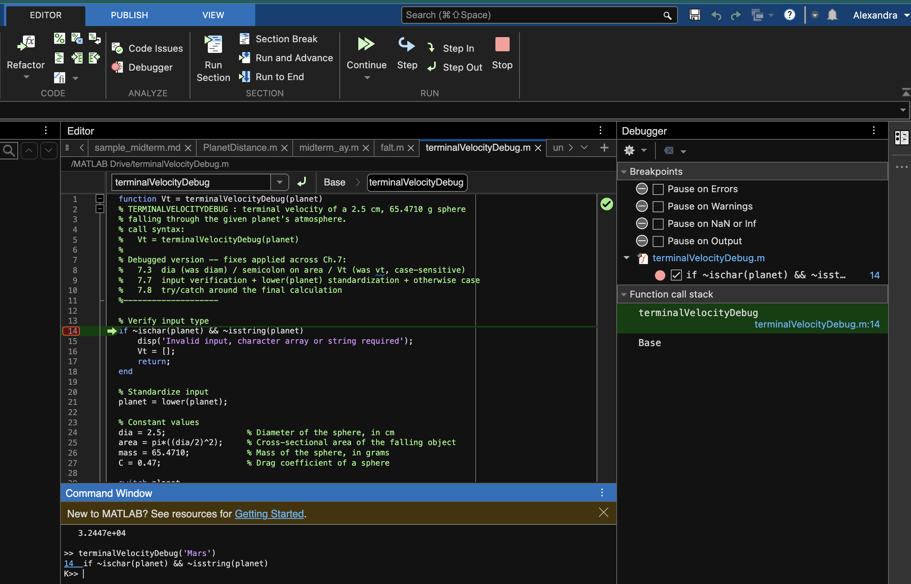
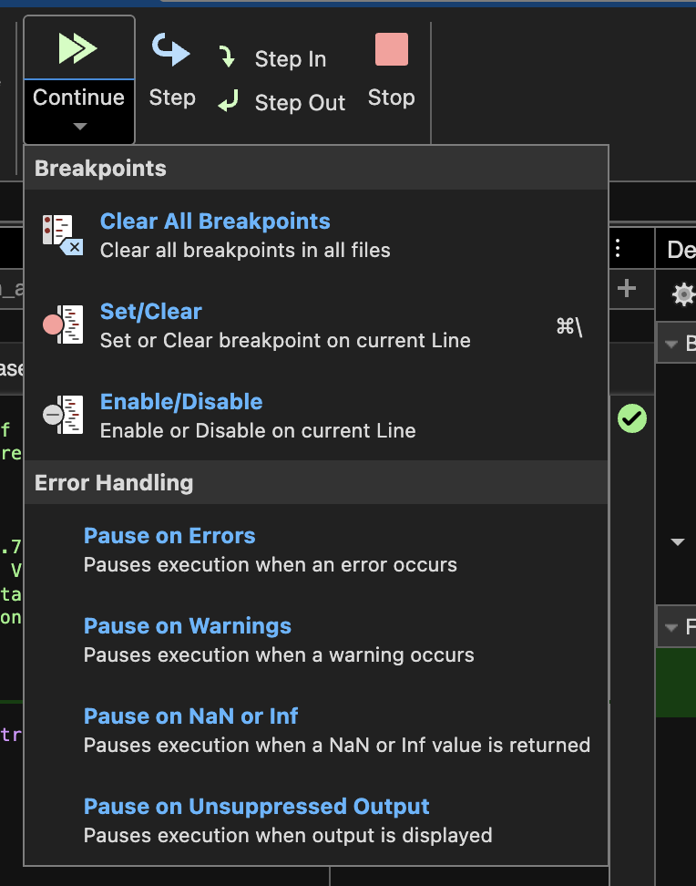

More 
$\rightarrow$ Help topic **Debugging**.

#### Key Terms

debugger $\cdot$ debug mode

#### Key Commands

`dbquit` $\cdot$ `dbstep` $\cdot$ `dbstep in` $\cdot$ `dbstep out`

### 7.6 Walking a Function

**Good input — Jupiter:**

1. Breakpoint at **line 8** (`dia = 2.5`).
2. Call:

```matlab
terminalVelocityDebug('Jupiter')
```
4. **Step** 
$\rightarrow$ `dia` appears.
5. Click in line 12 (`C = 0.47`) 
$\rightarrow$ **Run to Cursor** 
$\rightarrow$ lines 9–11 run (`area`, `mass`).
6. **Step** 
$\rightarrow$ `C` defined. Comments skipped (not executable) 
$\rightarrow$ arrow at `switch`.
7. **Step** 
$\rightarrow$ first case (Mercury). **Step** 
$\rightarrow$ Venus… 
$\rightarrow$ each `case` tested vs `planet` (like an `if-elseif` chain).
8. Step to **line 34** (`case 'Jupiter'`) $
$\rightarrow$ Step into it 
$\rightarrow$ `gravity`, `atmosphericDensity` set 
$\rightarrow$ next Step leaves `switch` (only one case runs).
9. At end 
$\rightarrow$ **Continue** (or Step ×2) 
$\rightarrow$ back to Command Window.

> **Note:** Some languages need an explicit exit (`break`) per case, else **fall-through** into next cases. MATLAB doesn't.

**Bad input — Pluto:**

1. `terminalVelocityDebug('Pluto')` 
$\rightarrow$ pauses at line 8.
2. Click line 8 breakpoint 
$\rightarrow$ removed. Add one at **line 18** (`switch`). Breakpoints can change mid-debug.
3. Step through 
$\rightarrow$ no case matches 
$\rightarrow$ `gravity`, `atmosphericDensity` never in Workspace.
4. Step at `Vt =` line 
$\rightarrow$ error + exit. Already know why 
$\rightarrow$ **Quit Debugging**.

### 7.7 Error Handling: Standardizing & Verifying Input

- Proactive handling = hallmark of good programming.
- Weak spot = **input parameter**. MATLAB is **type-flexible** 
$\rightarrow$ accepts char, number, matrix, struct… Can't control input; can control handling.

> **Note:** Strongly-typed languages (C#) 
$\rightarrow$ param types declared; wrong type = error.

**Verify input** (top of function):

```matlab
if x < 10 || x > 20
    disp('Invalid input, must be between 10 and 20');
    return;   % No point in continuing, so exit the function
end
```

```matlab
if ~isscalar(x)
    disp('Invalid input, scalar value required');
    return;
end
```

```matlab
if ~ischar(planet)
    disp('Invalid input, character array required');
    return;
end
```

**Standardize input** — case problem:

```matlab
terminalVelocityDebug('mars')
```

$\rightarrow$ error; `'mars'` $\neq$ `'Mars'`. Fix 
$\rightarrow$ add right after the `function` line:

```matlab
% Standardize input
planet = lower(planet);
```

…and make all `case` strings lower case.

- `lower` ignores non-text (won't crash on a number matrix). Extra-safe version:

```matlab
if ischar(planet) || isstring(planet)
    % Standardize text input
    planet = lower(planet);
end
```

- Case doesn't affect result $rightarrow$ fixing input > aborting.

**Test:** breakpoint at `switch`, then:

```matlab
terminalVelocityDebug('NepTunE')
```

- Workspace: `planet` = `'neptune'`. **Continue** 
$\rightarrow$

```matlab
ans =

   1.1859e+04
```


**Unassigned vars when no case matches 
$\rightarrow$ 2 fixes:**

1. **Default values before `switch`** 
$\rightarrow$ defined regardless of flow. Good when the default means something (counter = 0) or is an obvious absurd flag (age = 999; here −1).
2. **Better 
$\rightarrow$ `otherwise` block** :

```matlab
    case 'uranus'
        gravity = 887;
        atmosphericDensity = 0.00042;
    otherwise
        disp('Invalid input, not a planet in our solar system')
        return;
end
```

- Any input $\neq$ 8 planets 
$\rightarrow$ message + exit before the calc.

#### Key Terms

input verification $\cdot$ standardization $\cdot$ type-flexible

#### Key Commands

`lower` $\cdot$ `upper` $\cdot$ `return`

### 7.8 Try/Catch Blocks

```matlab
terminalVelocityDebug('mercury')

ans =

   Inf
```

- Mercury $
$\rightarrow$ ρ = 0 
$\rightarrow$ divide by 0 
$\rightarrow$ MATLAB returns `Inf` (many languages crash instead).
- **try/catch** 
$\rightarrow$ fail gracefully:

```matlab
try
    % Code that could generate an error
catch
    % Code to handle the error, if one occurs
end
```

- No error $\rightarrow$ `catch` skipped. Error $\rightarrow$ `catch` runs.
- Catch code = anything: message with var values + exit; `if-elseif` responding per error; assign a new value + continue.
- Invented example (pretend ÷0 crashes) $\rightarrow$ wrap the Vt line:

```matlab
try
    Vt = sqrt((2 * mass * gravity) / (atmosphericDensity * C * area));
catch
    disp("Error - function terminated");
    return;
end
```

> **Note :** ÷0 doesn't throw in MATLAB $\rightarrow$ this `catch` never runs for Mercury. Real check: `if isinf(Vt)`. To see *which* error: `catch ME` $\rightarrow$ `disp(ME.message)` / `ME.identifier`.

- Capturing specific errors $\rightarrow$ MATLAB help.

#### Key Commands

`try/catch`

### 7.9 Manual Debugging Techniques

Debugging = art. General tricks:

**Comment out problem lines** — two extra comment formats:

| Format | Use |
|---|---|
| `%% Title` | starts a **section**; sections run independently |
| `%{` … `%}` | block comment; each marker on its own line |

```matlab
x = x + 77;
%{
    z = cos(88.4);
    A = magic(3);
%}
plot(x);
```

- Select lines $\rightarrow$ **Ctrl+R** comment / **Ctrl+T** uncomment.

> **Tip:** All shortcuts $\rightarrow$ **Home $\rightarrow$ Preferences $\rightarrow$ Keyboard $\rightarrow$ Shortcuts**. Pros use shortcuts.

**Remove semicolons** (temporarily) $\rightarrow$ see each line's output.

**Hover to see a value** $\rightarrow$ paused: hover a var name $\rightarrow$ type + value. Value = at the **paused** line, not the hovered line.

**Enter your own values** $\rightarrow$ `K>>` = function workspace. Breakpoint after a calc $\rightarrow$ assign the correct value in Command Window $\rightarrow$ continue.

**Pause running code** $\rightarrow$ no breakpoints $\rightarrow$ **Run** button becomes **Pause** while running $\rightarrow$ instant breakpoint; Debug toolbar appears.

Try it — add at top of `terminalVelocityDebug`:

```matlab
while 1
    x = 1;
end
```

- Run $\rightarrow$ hangs. **Pause** $\rightarrow$ green arrow at current line $\rightarrow$ **Quit Debugging**. (Or **Ctrl+C**.)

#### Key Commands

`%%` $\cdot$ `%{ %}` $\cdot$ **Ctrl+R** $\cdot$ **Ctrl+T**

### 7.10 Testing Your Code

- Don't test with 2 easy values. Push boundaries, bad input, edge cases — "seedy waterfront bar in a pirate town".
- Make it fail $\rightarrow$ fix $\rightarrow$ fail again.
- Each function must be solid $\rightarrow$ whole program solid.

---

#### Key Terms

debug $\cdot$ debugger $\cdot$ error handling $\cdot$ semantic error $\cdot$ syntax

#### Key Commands 

`%%` $\cdot$ `%{ %}` $\cdot$ `[Ctrl]+[R]` $\cdot$ `[Ctrl]+[T]` $\cdot$ `dbquit` $\cdot$ `dbstep` $\cdot$ `dbstep in` $\cdot$ `dbstep out` $\cdot$ `lower` $\cdot$ `return` $\cdot$ `try/catch` $\cdot$ `upper`

---

## SDC Chapter 7 — Exercises

**Exercise 7.1** — Write a function with a single input parameter that is a 3 x 4 matrix that contains either the twelve signs of the Chinese zodiac, the twelve signs of the western zodiac, or a mix of the two, as strings (double-quotes). Write code in the function that verifies that the matrix doesn't contain any strings outside of the expected set and that it contains no duplicate elements.

<details><summary>Solution</summary>

Checks: string type $\rightarrow$ 3×4 size $\rightarrow$ all members of the allowed set (`ismember`) $\rightarrow$ no duplicates (`unique` count = 12). `lower` $\rightarrow$ case-insensitive.

```matlab
function ok = checkZodiac(Z)
% Verifies a 3x4 string matrix of zodiac signs: valid names, no duplicates
    chinese = ["rat" "ox" "tiger" "rabbit" "dragon" "snake" ...
               "horse" "goat" "monkey" "rooster" "dog" "pig"];
    western = ["aries" "taurus" "gemini" "cancer" "leo" "virgo" ...
               "libra" "scorpio" "sagittarius" "capricorn" "aquarius" "pisces"];
    allowed = [chinese western];
    ok = false;

    if ~isstring(Z)
        disp('Invalid input, string matrix required');
        return;
    end
    if ~isequal(size(Z), [3 4])
        disp('Invalid input, must be 3 x 4');
        return;
    end

    Z = lower(Z);                           % standardize
    bad = Z(~ismember(Z, allowed));
    if ~isempty(bad)
        disp("Unknown sign(s): " + strjoin(bad(:)', ", "));
        return;
    end
    if numel(unique(Z)) < numel(Z)
        disp('Duplicate signs found');
        return;
    end
    ok = true;
end
```

```matlab
Z = ["Rat" "Ox" "Tiger" "Rabbit"; "Leo" "Virgo" "Libra" "Scorpio"; "Dog" "Pig" "Aries" "Pisces"];
checkZodiac(Z)
Z(3,4) = "Rat";
checkZodiac(Z)
Z(3,4) = "Unicorn";
checkZodiac(Z)

ans =

  logical

   1

Duplicate signs found

ans =

  logical

   0

Unknown sign(s): unicorn

ans =

  logical

   0
```

</details>

**Exercise 7.2** — Open the data file, terminalDebugging.m. Use the debugging skills you have learned to debug and run this code.

<details><summary>Solution</summary>

`terminalDebugging.m` is not available. Approach:

1. Alley box red/yellow? $\rightarrow$ fix every squiggle/dash first (missing `)`, `;`, unused vars).
2. Run with a known-good input (`'Mars'` $\rightarrow$ `3.2447e+04`).
3. Runtime error $\rightarrow$ click the line link $\rightarrow$ check spelling/case of every var on that line (`dia`/`diam`, `Vt`/`vt`).
4. Output not assigned $\rightarrow$ breakpoint at the top, **Step** $\rightarrow$ find the branch/loop that skips the assignment.
5. Add `lower(planet)` + `otherwise` + input checks (7.7).
6. Test edge cases: `'mercury'` (`Inf`), `'Pluto'`, `'NepTunE'`, `5`.

</details>

**Exercise 7.3** — Open the file secretMessage.m included in the download. Be sure that the secretMessage.dat file is also in the same directory. Run the function by entering the following command in the Command Window:

```matlab
secretMessage('6')
```

The function should fail to run. Using the techniques learned in this chapter, track down the function's many flaws until running the function reveals the encoded text.

Two hints: the text begins "Four score…" and even the function call given above is suspect.

<details><summary>Solution</summary>

Files not present$\rightarrow$ approach only:

- Call is suspect: `'6'` is a **char** (`double('6')` = 54), not the number 6 $\rightarrow$ try `secretMessage(6)`. Or add input standardization: `if ischar(n), n = str2double(n); end`.
- Breakpoint at the first line $\rightarrow$ **Step** $\rightarrow$ watch Workspace after each step;
- Remove `;` on the suspicious lines temporarily $\rightarrow$ see partial output each pass.

</details>

## SDC Chapter 8 — Importing & Exporting Data

### Objectives

1. Understand the Windows file system hierarchy of files and folders.
2. Navigate the file system through the command prompt.
3. Copy and move files and folders from the command prompt.
4. Understand the difference between absolute and relative paths and construct a relative path to a file.
5. Use wildcards in a path to refer to multiple files or folders.
6. Save variables to and load variables from a .mat file.
7. Use functions to import data from an Excel spreadsheet and a delimited text file.
8. Use the MATLAB import tool to import data from an external file.
9. Use functions to export data to an Excel spreadsheet, a comma-separated value file, and a text file.

### Summary of functions used in this chapter

| Function / keyword | What it does | Example |
|---|---|---|
| `pwd` | current (working) folder | `curr_dir = pwd` |
| `path` | list search path folders | `path` |
| `cd` | change folder | `cd ..` |
| `ls` / `dir` | list folder contents (char array / struct array) | `files = dir` |
| `mkdir` / `rmdir` | make / remove (empty) folder | `mkdir('..\NewFolder')` |
| `delete` | delete file(s) (not folders) | `delete('testfile*')` |
| `movefile` | move / rename | `movefile('a.m','b.m')` |
| `copyfile` | copy | `copyfile('*.txt','..\Matlab2')` |
| `which` | full path of a file on the search path | `which pathdef.m` |
| `uigetdir` / `uigetfile` | folder / file picker dialog $\rightarrow$ path | `p = uigetdir` |
| `type` | show text file contents | `type ImportExample1.txt` |
| `whos` | list vars + size/type | `whos -file vars.mat` |
| `save` / `load` | write / read `.mat` | `save vars.mat a c` |
| `readmatrix` | file $\rightarrow$ numeric matrix | `M = readmatrix('f.txt')` |
| `detectImportOptions` | import-options object to tweak | `opts = detectImportOptions(f)` |
| `readvars` | file $\rightarrow$ one column vector per output | `[x,y] = readvars(f)` |
| `readcell` | file $\rightarrow$ cell array (mixed types) | `C = readcell(f)` |
| `writematrix` | matrix $\rightarrow$ .txt/.csv/.dat/.xlsx | `writematrix(M,'out.xlsx')` |
| `writecell` | cell array $\rightarrow$ file | `writecell(C,'out.csv')` |
| `fopen` / `fclose` | open / close file $\rightarrow$ fileID | `fid = fopen('a.txt','wt+')` |
| `fprintf` | formatted text $\rightarrow$ file or screen | `fprintf(fid,'%d\n',x)` |
| `isnan` | NaN test (skip bad imports) | `M(~isnan(M))` |
| `exist` | name already used? (0 = free) | `exist sine` |
| `fullfile` | Create a system-specific path | fullfile(`Users`, `alexandrayakovleva`, `Documents`, `MATLAB`)|
| `filesep` | Use system-specific separator | '\' or '/'|


### 8.1 Navigating the File System

- Files live in **folders** (= **directories**). Top = **root**. Location = **path**: `'/Users/alexandrayakovleva/Documents/MATLAB/'`.

**Where am I?**

- **Current Folder** = **working directory**. Path shown in bar above the Current Folder panel

```matlab
curr_dir = pwd

curr_dir =

    '/Users/alexandrayakovleva/Documents/MATLAB/'
```

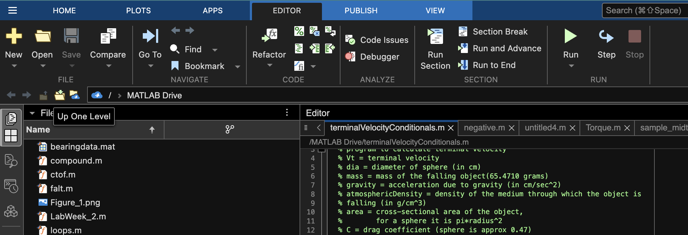

- Calling a function/script $\rightarrow$ MATLAB looks in current folder, then the **search path**. `path` $\rightarrow$ full list.
- Not on path $\rightarrow$ `cd` there, or call with full path.

**Absolute vs relative paths:**

| Type | Example | Note |
|---|---|---|
| absolute | `'/Users/alexandrayakovleva/Documents/MATLAB/'` | from root |
| absolute, same drive | `~/Documents/MATLAB/` | Use ~ to drop User folder|
| relative | `'../../Music'` | from current folder |

- `..` = parent folder (every folder except root has one). `.` = current folder (rarely used).
- From `'/Users/alexandrayakovleva/Documents/MATLAB/`: `ls ../../Music` $\rightarrow$ 1st `..` = Documents
- Relative paths $\rightarrow$ good inside apps (internal folder structure moves with the app).
- Paths **case-sensitive**.

> **Tip:** `\` or `/` both work; can even mix them (don't).

#### Key Terms

file, folder, directory, path, absolute path, relative path, working directory

#### Key Commands

`pwd`, `path`

### 8.2 File System Functions

- Mouse: Current Folder panel $\rightarrow$ **Up One Level** / **Browse for Folder** . In code $\rightarrow$ functions only.
**Two call forms:**

| Form | Syntax |
|---|---|
| command | `someFunction parameters` |
| function | `retVal = someFunction(parameters)` $\rightarrow$ **parens required when assigning** |

**Wildcards** $\rightarrow$ `*` = anything:

```matlab
copyfile('*', '~/Documents/Matlab2')   % everything in current folder (files + folders)
copyfile('*.txt', '../Matlab2')                      % all .txt -> sibling folder Matlab2
```

**`cd`**

- `cd path` $\rightarrow$ absolute or relative; **no wildcards**; spaces $\rightarrow$ single quotes; no file names.

```matlab
cd /Users/alexandrayakovleva
cd ..
```

$\rightarrow$ now in `/Users`. Path in a variable $\rightarrow$ `cd(pathVar)`.

> **Tip:** Unlike Windows `cd..`, MATLAB needs the **space**: `cd ..`

**`ls` / `dir`**

- `ls` (current), `ls folderName`, `ls path`. Assigning $\rightarrow$ parens:

```matlab
contents = ls('~/Matlab/Week7')
files = ls
```

- Result = **char array**, one name per row, padded with spaces to the longest name.

> **Tip:** `ls` = lower-case L + s.

- `dir` = same display; assigned $\rightarrow$ **struct array**:

| Field | Type | Holds |
|---|---|---|
| `name` | char | item name |
| `folder` | char | absolute path of containing folder |
| `date` | char | last modified |
| `bytes` | double | size |
| `isdir` | logical | 1 folder / 0 file |
| `datenum` | double | date as a number |

**`mkdir` / `rmdir` / `delete`**

- `mkdir folderName`, `mkdir path\folderName`, `mkdir path folderName` (separate params $\rightarrow$ flexible in code). Spaces $\rightarrow$ quotes.
- Returns `[status, msg, msgID]` $\rightarrow$ status 1 = OK / 0 = fail; msg = error text; msgID $\rightarrow$ usable in try/catch.

```matlab
status = mkdir('../NewFolder')

status =

  logical

   1
```

```matlab
[status, msg, error] = mkdir('../NewFolder?')
```

- `?` invalid in Windows names $\rightarrow$ fails $\rightarrow$ `status` = 0 + message + ID (exact text OS/version-dependent).

- `rmdir folderName` $\rightarrow$ deletes **empty** folder only. Same 3 outputs.

```matlab
[status, msg, error] = rmdir('../NewFolder')
```

- `delete fileName` $\rightarrow$ file name/path, wildcards OK, **not folders**. Recycle bin vs permanent $\rightarrow$ **Preferences $\rightarrow$ General $\rightarrow$ Deleting files**, or `recycle('on')`.

**`movefile source destination`** (optionally renames). Source $\rightarrow$ wildcards OK (`*.mat`); destination $\rightarrow$ no wildcards; omitted $\rightarrow$ current folder.

| Source $\rightarrow$ destination | Result |
|---|---|
| file $\rightarrow$ folder | moved into folder |
| file $\rightarrow$ path + file name | moved + renamed |
| folder $\rightarrow$ existing folder | moved inside it |
| folder $\rightarrow$ new folder name | moved + renamed |

- Rename = same folder / no folder info. Returns `[status, msg, msgID]`.
- **`copyfile`** = `movefile` (minus renaming) but keeps the original.

**Walkthrough:**

```matlab
home = ' /MATLAB Drive'
cd(home)                 % Start from the default working directory
pwd                      % Assure yourself you're in the right place
ls                       % List the files in this directory
edit testfile1           % Make some files to play with
edit testfile2
edit testfile3.txt
mkdir ..\matlab2         % Create a new sibling directory
cd ..
pwd                      % Where you are now
ls                       % Notice that matlab2 exists here
cd matlab2               % Move into that directory
ls                       % Nothing here yet
copyfile('..\matlab\testfile*.m')          % Copy files to this folder
ls                       % And there they are
movefile('testfile1.m', 'testfile4.m')     % Rename a file
dir                      % Verify the name change
cd(home)
pwd                      % And you're back
%rmdir('..\matlab2')     % Can't do it - the directory isn't empty
delete('..\matlab2\*.*') % Delete the copied files
rmdir('..\matlab2')      % Works now
delete('testfile*')      % Clean up
```

**Other functions:**

| Function | Does |
|---|---|
| `which` | searches path $\rightarrow$ absolute path. `which pathdef.m` (= file holding the search-path list) |
| `uigetdir` / `uigetfile` | standard pick dialog $\rightarrow$ returns path |
| `type` | print file contents; fine for text & `.m`, gibberish for `.mat` |
| `whos` | vars + types/sizes: `whos`, `whos -file matlab.mat`, `whos global` |

> **Tip:** `which` $\rightarrow$ find the source `.m` of built-in functions.

#### Key Terms

wildcard, source, destination

#### Key Commands

`cd`, `ls`, `dir`, `mkdir`, `rmdir`, `delete`, `movefile`, `copyfile`, `which`, `uigetdir`, `uigetfile`, `type`, `whos`

### 8.3 Working with .mat Files

- Exit MATLAB $\rightarrow$ Workspace gone. `save` $\rightarrow$ keep it.
- `save` (no name) $\rightarrow$ `matlab.mat` in current folder, **overwrites** silently. `load` (no name) $\rightarrow$ looks for `matlab.mat`.

```matlab
clear      % Start with an empty Workspace
a = 1
b = 2
save

a =

     1


b =

     2

Saving to:  /MATLAB Drive/matlab.mat
```

```matlab
clear
load

Loading from: matlab.mat
```

```matlab
delete matlab.mat
load
```

```text
Error using load
Unable to find file or directory 'matlab.mat'.
```

(Error wording version-dependent.)

```matlab
a = 1; b = 2; save
c = 3
save

c =

     3

Saving to: /MATLAB Drive/matlab.mat
```

- 2nd `save` $\rightarrow$ overwrote `matlab.mat`, no warning $\rightarrow$ catastrophic if it was last session's work. Use names:

```matlab
d = 4
save vars.mat

d =

     4
```

- Save a **function's** workspace $\rightarrow$ breakpoint $\rightarrow$ `save` at `K>>` $\rightarrow$ later `load` into base.
- `load` **adds** to Workspace; same name $\rightarrow$ **overwritten silently**:

```matlab
d = 1
load vars.mat
d

d =

     1


d =

     4
```

- `.mat` = binary, not human-readable (`type vars.mat` $\rightarrow$ gibberish). Peek: `whos -file vars.mat`.

**Load / save only some vars:**

```matlab
clear
load vars.mat a c
```

$\rightarrow$ Workspace = `a` (1), `c` (3) only.

```matlab
b = 2
d = 6
save vars2.mat c d
clear
load vars2

b =

     2


d =

     6
```

$\rightarrow$ Workspace = `c` (3), `d` (6). `b` not saved.

> **Tip:** Double-click a `.mat` in Current Folder $\rightarrow$ loads it. `.mat` extension optional in `save`, `load`, `whos`.

#### Key Commands

`save`, `load`, `whos`

### 8.4 Importing Delimited Text: readmatrix

- External data: spreadsheet, database, text, binary; local/network/streaming. Here $\rightarrow$ text + Excel.
- **Text file** = only characters, human-readable (Notepad `.txt` yes; Word doc no).
- Text import hard: delimiter? line lengths? line breaks? layout? MATLAB auto-detects a lot.
- **CSV** = comma-separated values. Extension `.csv` optional; still plain text (so is `.dat`).
- Row in file $\leftrightarrow$ row in matrix; item $\leftrightarrow$ column.

> **Tip:** Everything is 1s and 0s; **binary file** = non-text, no spreadsheet/delimited structure.

**R2019a** $\rightarrow$ `readmatrix`, `readvars`, `readcell`.

> **Warning:** `xlsread`, `csvread`, `dlmread` $\rightarrow$ not recommended (still work). Use the new ones.

**`readmatrix`** $\rightarrow$ replaces `csvread` / `dlmread` (and `xlsread` for single-type sheets).

| Form | Use |
|---|---|
| `readmatrix(file)` | type from extension |
| `readmatrix(file, opts)` | custom import options |
| `readmatrix(___, Name, Value)` | name/value pairs |

- **Numbers only.** File in cwd, or relative/absolute/network/cloud path. Text extensions: `.txt`, `.csv`, `.dat`.
- Makes its own decisions $\rightarrow$ sometimes surprising.

Go to `/MATLAB Drive/`. Double-click `midterm_ay_log.txt` $\rightarrow$ comma-delimited integers.

```matlab
readmatrix  midterm_ay_log.txt
```

$\rightarrow$ `ans` = matrix, one row per text line. (Data files not in photos $\rightarrow$ no output shown.)

Both work for my data:

```matlab
M = readmatrix midterm_ay_log.txt
M = readmatrix('midterm_ay_log.txt')
```

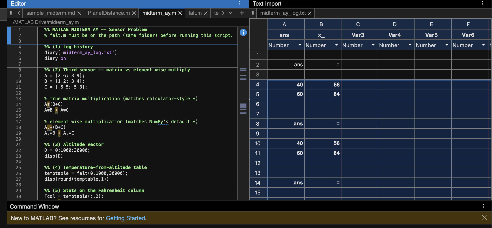


**Example files — what readmatrix does:**

| File | Content | Result |
|---|---|---|
| `ImportExample2.txt` | one row shorter | short row padded with `NaN` |
| `ImportExample2.csv` | rows 1–2: 4 cols, rows 3–4: 3 cols | **only last 2 rows imported** (!) |
| `ImportExample2` (no ext.) | 2 matches | picked `.txt` $\rightarrow$ unpredictable $\rightarrow$ **always give the extension** |
| `ImportExample3.txt` | one decimal value | all shown at that precision (all `double` anyway) |
| `ImportExample4.dat` | letters + numbers | non-numbers $\rightarrow$ `NaN` $\rightarrow$ skip with `isnan` |
| `ImportExample5.dat` | letters incl. `i`, `j` | `i`/`j` read as √−1 $\rightarrow$ whole matrix **complex** |
| `ImportExample6.txt` | rows of characters | nothing useful — numbers only |
| `ImportExample7.txt` | tab-separated | yes (also if renamed `.csv`) |
| `ImportExample8.txt` / `9.csv` | other delimiters | try them |
| `ImportExample10.txt` | `2^5` in a cell | `NaN` — calculation, not a number |

- Default delimiters (any of `.txt`/`.csv`/`.dat`): **comma, tab, space, semicolon**.
- Double-click `.csv`/`.dat` $\rightarrow$ opens Import Data Tool (8.9); `.txt` $\rightarrow$ Editor.

> **Tip:** Examples are small $\rightarrow$ no `;`. Real data $\rightarrow$ add `;`.

> **Tip:** Don't use `i` or `j` as variables/loop counters $\rightarrow$ overwrite √−1 in that scope. Old habit; skip it.

> **Tip:** `exist name` $\rightarrow$ `0` = name free.

```matlab
2^5

ans =

    32
```

#### Key Terms

comma-separated text, csv file, delimited text

#### Key Commands

`readmatrix`

### 8.5 Import Options: detectImportOptions

- `opts = detectImportOptions(file)` $\rightarrow$ object with editable properties. Also used by `readtable`, `readcell`.
- No changes $\rightarrow$ `readmatrix(f, opts)` = `readmatrix(f)`.
- Text $\rightarrow$ `DelimitedTextImportOptions` or `FixedWidthImportOptions`.

```matlab
>> opts = detectImportOptions('midterm_ay_log.txt')
```

```text
opts = 

  DelimitedTextImportOptions with properties:

   Format Properties:
                    Delimiter: {'\t'  ' '}
                   Whitespace: '\b'
                   LineEnding: {'\n'  '\r'  '\r\n'}
                 CommentStyle: {}
    ConsecutiveDelimitersRule: 'join'
        LeadingDelimitersRule: 'ignore'
       TrailingDelimitersRule: 'ignore'
                EmptyLineRule: 'skip'
                     Encoding: 'UTF-8'

   Replacement Properties:
                  MissingRule: 'fill'
              ImportErrorRule: 'fill'
             ExtraColumnsRule: 'addvars'

   Variable Import Properties: Set types by name using setvartype
                VariableNames: {'ans', 'x_', 'Var3' ... and 10 more}
                VariableTypes: {'double', 'double', 'double' ... and 10 more}
        SelectedVariableNames: {'ans', 'x_', 'Var3' ... and 10 more}
              VariableOptions: Show all 13 VariableOptions 
	Access VariableOptions sub-properties using setvaropts/getvaropts
           VariableNamingRule: 'modify'

   Location Properties:
                    DataLines: [4 Inf]
            VariableNamesLine: 2
               RowNamesColumn: 0
            VariableUnitsLine: 0
     VariableDescriptionsLine: 0 
	To display a preview of the table, use preview
```

(Property list/encoding vary by version.)

**Key properties:**

| Property | Meaning |
|---|---|
| `Delimiter` | delimiter char(s); cell array for several |
| `Whitespace` | chars treated as whitespace |
| `LineEnding` | chars ending a line $\rightarrow$ new row |
| `ConsecutiveDelimitersRule` | `'split'` (empty value between) / `'join'` (treat as one) / `'error'` |
| `EmptyLineRule` | `'skip'` / `'read'` / `'error'` |
| `MissingRule` | short row: `'fill'` (default, `FillValue` = NaN) / `'omitrow'` / `'error'` ... |
| `VariableOptions` | per-column (= per-variable) name, type, fill value $\rightarrow$ `getvaropts` / `setvaropts` |
| `VariableNames` | column names (linked to VariableOptions) |
| `SelectedVariableNames` | columns to import (subset of VariableNames) |
| `DataLines` | lines to import: start, range, or several ranges |

**Messy file — `ImportExample11.txt`:** line 1 = column titles, one line with consecutive commas, one empty line, one short row, one line using colons.

```matlab
readmatrix midterm_ay_log.txt

ans = 1338×13
1.0e+04
         NaN        NaN     NaN     NaN     NaN     NaN     NaN     NaN     NaN     NaN     NaN     NaN     NaN
      0.0040     0.0056     NaN     NaN     NaN     NaN     NaN     NaN     NaN     NaN     NaN     NaN     NaN
      0.0060     0.0084     NaN     NaN     NaN     NaN     NaN     NaN     NaN     NaN     NaN     NaN     NaN
         NaN        NaN     NaN     NaN     NaN     NaN     NaN     NaN     NaN     NaN     NaN     NaN     NaN
      0.0040     0.0056     NaN     NaN     NaN     NaN     NaN     NaN     NaN     NaN     NaN     NaN     NaN
      0.0060     0.0084     NaN     NaN     NaN     NaN     NaN     NaN     NaN     NaN     NaN     NaN     NaN
         NaN        NaN     NaN     NaN     NaN     NaN     NaN     NaN     NaN     NaN     NaN     NaN     NaN
     -0.0008     0.0042     NaN     NaN     NaN     NaN     NaN     NaN     NaN     NaN     NaN     NaN     NaN
      0.0024     0.0063     NaN     NaN     NaN     NaN     NaN     NaN     NaN     NaN     NaN     NaN     NaN
         NaN        NaN     NaN     NaN     NaN     NaN     NaN     NaN     NaN     NaN     NaN     NaN     NaN
     -0.0008     0.0042     NaN     NaN     NaN     NaN     NaN     NaN     NaN     NaN     NaN     NaN     NaN
      0.0024     0.0063     NaN     NaN     NaN     NaN     NaN     NaN     NaN     NaN     NaN     NaN     NaN
      1.0000        NaN     NaN     NaN     NaN     NaN     NaN     NaN     NaN     NaN     NaN     NaN     NaN
           0     0.0000     NaN     NaN     NaN     NaN     NaN     NaN     NaN     NaN     NaN     NaN     NaN
      0.0000     0.0000     NaN     NaN     NaN     NaN     NaN     NaN     NaN     NaN     NaN     NaN     NaN
      0.0000     0.0000     NaN     NaN     NaN     NaN     NaN     NaN     NaN     NaN     NaN     NaN     NaN
      0.0000     0.0000     NaN     NaN     NaN     NaN     NaN     NaN     NaN     NaN     NaN     NaN     NaN
      0.0000     0.0000     NaN     NaN     NaN     NaN     NaN     NaN     NaN     NaN     NaN     NaN     NaN
      0.0001     0.0000     NaN     NaN     NaN     NaN     NaN     NaN     NaN     NaN     NaN     NaN     NaN
      0.0001     0.0000     NaN     NaN     NaN     NaN     NaN     NaN     NaN     NaN     NaN     NaN     NaN
      0.0001     0.0000     NaN     NaN     NaN     NaN     NaN     NaN     NaN     NaN     NaN     NaN     NaN
      0.0001     0.0000     NaN     NaN     NaN     NaN     NaN     NaN     NaN     NaN     NaN     NaN     NaN
      0.0001     0.0000     NaN     NaN     NaN     NaN     NaN     NaN     NaN     NaN     NaN     NaN     NaN
      0.0001     0.0000     NaN     NaN     NaN     NaN     NaN     NaN     NaN     NaN     NaN     NaN     NaN
      0.0001     0.0000     NaN     NaN     NaN     NaN     NaN     NaN     NaN     NaN     NaN     NaN     NaN
      0.0001     0.0000     NaN     NaN     NaN     NaN     NaN     NaN     NaN     NaN     NaN     NaN     NaN
      0.0001     0.0000     NaN     NaN     NaN     NaN     NaN     NaN     NaN     NaN     NaN     NaN     NaN
      0.0001     0.0000     NaN     NaN     NaN     NaN     NaN     NaN     NaN     NaN     NaN     NaN     NaN
      0.0001     0.0000     NaN     NaN     NaN     NaN     NaN     NaN     NaN     NaN     NaN     NaN     NaN
      0.0002     0.0000     NaN     NaN     NaN     NaN     NaN     NaN     NaN     NaN     NaN     NaN     NaN
      0.0002     0.0000     NaN     NaN     NaN     NaN     NaN     NaN     NaN     NaN     NaN     NaN     NaN
     ⋮
     Display all 1338 rows and 13 columns

```


- Title line skipped, `,,` $\rightarrow$ NaN, empty line skipped, short row padded, colon line $\rightarrow$ all NaN.

```matlab
opts = detectImportOptions('midterm_ay_log.txt')
```

Relevant lines:

```text
   Format Properties:
                    Delimiter: {'\t'  ' '}
                   Whitespace: '\b'
                   LineEnding: {'\n'  '\r'  '\r\n'}
                 CommentStyle: {}
    ConsecutiveDelimitersRule: 'join'
        LeadingDelimitersRule: 'ignore'
       TrailingDelimitersRule: 'ignore'
                EmptyLineRule: 'skip'
                     Encoding: 'UTF-8'
```

**BOOK EXAMPLES (no file available) Add colon delimiter:**

```matlab
opts.Delimiter = {',' ':'}
readmatrix('ImportExample11.txt', opts)

ans =

     1     2   NaN     4     5
     6     7     8     9    10
    11    12    13   NaN   NaN
    14    15    16    17    18
    19    20    21    22    23
    24    25    26    27    28
```


```matlab
opts.ConsecutiveDelimitersRule = 'join'
readmatrix('importexample11.txt', opts)

ans =

     1     2     4     5   NaN
     6     7     8     9    10
    11    12    13   NaN   NaN
    14    15    16    17    18
    19    20    21    22    23
    24    25    26    27    28
```

$\rightarrow$ 4, 5 in the right columns; row 1 now one short $\rightarrow$ NaN at end.

**Only complete rows:**

- Logical way $\rightarrow$ `opts.MissingRule = 'omitrow'`.

> **Book error:** book calls it property `MissingData`, value `'omitrows'`. Actual: **`MissingRule`** = **`'omitrow'`**.

- Manual way $\rightarrow$ `DataLines` (line #s = **original file**, not the matrix; title = line 1):

```matlab
opts.DataLines = [3 3; 5 7]
readmatrix('importexample11.txt', opts)

ans =

     6     7     8     9    10
    14    15    16    17    18
    19    20    21    22    23
    24    25    26    27    28
```

**Only columns 2–3** (headers `Duck`, `Cat`; DataLines still set):

```matlab
opts.SelectedVariableNames = {'Duck', 'Cat'}
readmatrix('ImportExample11.txt', opts)

ans =

     7     8
    15    16
    20    21
    25    26
```

#### Key Commands

`detectImportOptions`

### 8.6 readmatrix with Excel Spreadsheets

- Sheet = grid = matrix; multiple sheets $\rightarrow$ 3-D. Strong Excel support.
- `readmatrix` $\rightarrow$ when sheet (or the part imported) is **one data type**. Mixed $\rightarrow$ `readcell`.
- `detectImportOptions` on Excel $\rightarrow$ **`SpreadsheetImportOptions`**.

**`IOExample.xlsx`** — groceries × 4 stores:

- row 1 = column names (A1 blank), col A = row names (A1 blank), `x` = store doesn't sell it.

Double-click $\rightarrow$ Import Data Tool $\rightarrow$ close.

```matlab
readmatrix('IOExample.xlsx')
```

$\rightarrow$ row 1 omitted (var names); column A **not** omitted $\rightarrow$ all NaN; `x` $\rightarrow$ NaN.

```matlab
opts = detectImportOptions('IOExample.xlsx')
```

Figure 8.4 (Command Window text):

```text
opts =

  SpreadsheetImportOptions with properties:

   Sheet Properties:
                       Sheet: ''

   Replacement Properties:
                 MissingRule: 'fill'
             ImportErrorRule: 'fill'

   Variable Import Properties: Set types by name using setvartype
               VariableNames: {'Var1', 'Store_1', 'Store_2' ... and 2 more}
               VariableTypes: {'char', 'double', 'double' ... and 2 more}
       SelectedVariableNames: {'Var1', 'Store_1', 'Store_2' ... and 2 more}
             VariableOptions: Show all 5 VariableOptions
	Access VariableOptions sub-properties using setvaropts/getvaropts

   Range Properties:
                   DataRange: 'A2' (Start Cell)
          VariableNamesRange: 'A1'
               RowNamesRange: ''
          VariableUnitsRange: ''
   VariableDescriptionsRange: ''
	To display a preview of the table, use preview
```


| Property | Meaning |
|---|---|
| `Sheet` | sheet number (1-based) or name; `''` = first |
| `DataRange` | `'A2'` (start $\rightarrow$ end), `'A2:Y344'` block, ranges array, `'2:344'` rows |
| `VariableNamesRange` / `RowNamesRange` | cells holding column / row titles |

```matlab
readmatrix('IOExample.xlsx', opts)
```

```text
Error using readmatrix
Selected variables in the import options must have the same data type.
```

```matlab
opts.VariableTypes
```

$\rightarrow$ col 1 `'char'` (row names), col 5 `'char'` (mostly `x`). Force all double:

```matlab
opts.VariableTypes(1) = {'double'}
opts.VariableTypes(5) = {'double'}
opts.VariableTypes
readmatrix('IOExample.xlsx', opts)
```

$\rightarrow$ same as no-opts call $\rightarrow$ `readmatrix` default ≠ `detectImportOptions` defaults.

**Rows 4–7 only:**

```matlab
opts.DataRange = '4:7'
readmatrix('IOExample.xlsx', opts)
```

- `DataRange` width must = number of variables $\rightarrow$ whole rows only here. Block $\rightarrow$ name/value `Range` (8.7).

> **Tip:** Full import format list $\rightarrow$ Help: "Supported File Formats for Import and Export".

### 8.7 Name/Value Pairs

`readmatrix(file, Name, Value, Name, Value, ...)`, help template `readmatrix(___, Name, Value)` $\rightarrow$ `___` = file or file + opts. Overlap with opts $\rightarrow$ some pairs ignored.

| Name | Used with |
|---|---|
| `OutputType`, `FileType`, `Range`, `NumHeaderLines`, `TreatAsMissing`, `ExpectedNumVariables` | text & spreadsheet |
| `Delimiter`, `CommentStyle`, `LineEnding`, `DateLocale`, `Encoding`, `Whitespace`, `DecimalSeparator`, `ThousandsSeparator`, `TrimNonNumeric`, `ConsecutiveDelimitersRule`, `LeadingDelimitersRule` | text only |
| `Sheet`, `UseExcel` | spreadsheet only |

Block from Sheet2:

```matlab
M = readmatrix('IOExample.xlsx', 'Sheet', 'Sheet2', 'Range', 'B2:E8')
```

$\rightarrow$ 7×4 numeric (data file not in photos).

#### Key Terms

name/value pair

#### Key Commands

`range`

### 8.8 readvars & readcell

**`readvars`** $\rightarrow$ same 3 forms; output = separate **n×1 column vectors**, one per column, each one type. List as many outputs as needed $\rightarrow$ filled in column order.

```matlab
[items, store1prices] = readvars('IOExample.xlsx');
```

$\rightarrow$ `items` (names), `store1prices`. Double-click in Workspace to inspect.

Rows 2–10 of columns 1, 3, 5:

```matlab
opts = detectImportOptions('IOExample.xlsx')
opts.SelectedVariableNames = [1 3 5];
opts.DataRange = '2:10';
[items, Store2, Store4] = readvars('IOExample.xlsx', opts);
```

**`readcell`** $\rightarrow$ like `readmatrix` but output = **cell array** $\rightarrow$ each cell any type. Same 3 parameter forms.

> **Book typo:** "As with readmatrix and *readcell*..." $\rightarrow$ should be readmatrix and **readvars**.

```matlab
c = readcell('MixedDataExample.csv')
```

- Unquoted text $\rightarrow$ still text (`i` stays the char `'i'`, not √−1).
- `,,` $\rightarrow$ `<missing>` cell.

> **Tip:** *data* = plural, *datum* = singular.

#### Key Commands

`readvars`, `readcell`

### 8.9 The Import Data Tool

- Interactive: pick data visually $\rightarrow$ **writes the code for you** $\rightarrow$ learning tool; paste into your functions.
- Open: **Home $\rightarrow$ Import Data** (Figure 8.2), or right-click file in Current Folder $\rightarrow$ **Import Data...** (Figure 8.6).


**Import tab options** 


| Option | Meaning |
|---|---|
| **Range** | type a range / pick previous; grid selection updates it |
| **Variable Names Row** | row with column headers (Table / Column vectors only) |
| **Output Type** | Table (default), Column vectors, Numeric Matrix, String Array, Cell Array |
| **Text Options** | text $\rightarrow$ string (`"..."`) or char array (`'...'`) |
| **Unimportable Cells** | blue = OK, yellow = unimportable $\rightarrow$ replace with NaN (default) / exclude rows / exclude columns. N/A for String/Cell Array |

**Import Selection** dropdown:

- **Import Data** $\rightarrow$ vars in Workspace.
- **Generate Script / Generate Function** $\rightarrow$ heavily commented import code $\rightarrow$ save + run; compare with yours.

#### Key Commands

(Import Data Tool — ribbon only)

### 8.10 Exporting: writematrix & writecell

R2019a. **`writematrix`** replaces `csvwrite`, `dlmwrite` (+ `xlswrite` for single-type). Homogeneous data. No return value.

> **Tip:** `xlswrite`, `csvwrite`, `dlmwrite` $\rightarrow$ not recommended. Data not in a matrix $\rightarrow$ convert first (e.g. `cell2mat`).

| Form | Writes |
|---|---|
| `writematrix(M)` | `M.txt`, comma-delimited, current folder (can't $\rightarrow$ `matrix.txt`) |
| `writematrix(M, file)` | named file; format from extension |
| `writematrix(___, Name, Value)` | options |

- Exists $\rightarrow$ **overwritten, no confirmation**. Missing $\rightarrow$ created. Folder in path missing $\rightarrow$ **fails** (can't make folders).
- Extensions: `.txt` `.csv` `.dat` (all comma-delimited), `.xls` `.xlsm` `.xlsx` `.xlsb`. None $\rightarrow$ comma-delimited `.txt`.
- Spreadsheet $\rightarrow$ `NaN` written as empty cells.

```matlab
Goals = readmatrix('ImportExample7.txt')
writematrix(Goals)
```

$\rightarrow$ `Goals.txt`: tab-delimited in $\rightarrow$ comma-delimited out, same data.

```matlab
Goals = readmatrix('ImportExample7.txt')
writematrix(Goals, '../goals.xlsx')
writematrix(Goals, '../goals.dat')
```

**Name/value for writematrix:**

| Name | Value |
|---|---|
| `FileType` | `'text'` / `'spreadsheet'` (spreadsheet $\rightarrow$ `.xls`, not `.xlsx`) |
| `DateLocale` | `xx_YY`, e.g. `en_US` |
| `Delimiter` | `'comma'` `'space'` `'tab'` `'semi'` `'bar'` or single chars |
| `QuoteStrings` | `true`/`false` (delimited text) |
| `Encoding` | see `detectImportOptions` help |
| `Sheet` | number or name (spreadsheet) |
| `Range` | upper-left cell, or corner:corner (spreadsheet) |
| `UseExcel` | `true`/`false` (spreadsheet) |

Insert into an existing sheet:

```matlab
M = readmatrix('ImportExample1.txt')
writematrix(M, 'IOExample.xlsx', 'Sheet', 'New Sheet', 'Range', 'D4')
```

- Warning: sheet didn't exist $\rightarrow$ added. Sheet **number** riskier: sheet 5 in a 2-sheet file $\rightarrow$ blank sheets 3, 4.
- Existing file $\rightarrow$ data added at that spot; can overwrite cells **silently**. File open in Excel $\rightarrow$ can't write.
- `'D4'` $\rightarrow$ whole matrix written. `'D4:G8'` + bigger matrix $\rightarrow$ **truncated, no error**.

**`writecell`** $\rightarrow$ same, source = cell array: `writecell(C)` $\rightarrow$ `C.txt`, `writecell(C, file)`, `writecell(___, Name, Value)` (same pairs).

#### Key Commands

`writematrix`, `writecell`

### 8.11 Exporting Formatted Text: fopen, fprintf, fclose

Lower-level text export.

**Open:**

```text
fileID = fopen('filename', 'permission')
```

- `fileID` ≥ 3 (0 = stdin, 1 = stdout/screen, 2 = stderr). **−1 = failed** $\rightarrow$ always check `fileID > 0`.

| Permission | Meaning |
|---|---|
| `'rt'` | read only (default) |
| `'wt'` | write; erases existing content |
| `'at'` | write; append to end |
| `'rt+'` | read & write; no new file if missing |
| `'wt+'` | read & write; erases content; creates if missing |
| `'at+'` | read & write; append; creates if missing |

```matlab
fileID = fopen('MyNewFile.txt', 'wt+')

fileID =

     3
```

> **Book note:** book shows `4`. Number = next free ID $\rightarrow$ `3` in a fresh session with nothing else open.

**Write:**

```text
fprintf(fileID, 'format specifier', var1, var2, ...)
```

- Format specifier = literal text + placeholders.

```matlab
name = 'Ada';
fprintf('My name is %s.\n', name);

My name is Ada.
```

(`name` not defined in book $\rightarrow$ set here.)

| Specifier | Type |
|---|---|
| `%s` | string |
| `%d` / `%i` | signed integer |
| `%u` | unsigned integer |
| `%f` | floating-point |

- `%.2f` $\rightarrow$ 2 digits **right** of the decimal point.

> **Book error:** says "two digits to the left of the decimal point".

```matlab
fprintf('%.2f\n', pi)

3.14
```

- `\n` = newline (one char) $\rightarrow$ almost every format string ends with it.

**Escapes:**

```matlab
fprintf('This isn't a good place for a quote');
```

$\rightarrow$ **error**: MATLAB sees `'This isn'`, then stray text + an unmatched `'`. (Book doesn't show the message; exact text varies by version.)

```matlab
fprintf('This isn''t a good place for a quote\n');

This isn't a good place for a quote
```

(`\n` added here; book's version has none $\rightarrow$ prompt lands on the same line.)

| Write | Get |
|---|---|
| `''` (two single quotes) | `'` |
| `%%` | `%` |
| `\n` | newline |
| `\t` | tab |
| `\\` | `\` |

- `''` and `%%` = unusual (doubling); normally escape with `\`.


> **Tip:** Test output first $\rightarrow$ `fileID = 1` = Command Window.

- Output format must be known to you + recipient (standard or agreed layout, column headers).

**Close** — vital: open files $\rightarrow$ locked, **memory leaks**, crashes. Open $\rightarrow$ read/write $\rightarrow$ close immediately.

> **Tip:** Memory leak = resources not released after use $\rightarrow$ piles up $\rightarrow$ out of memory/storage $\rightarrow$ crash.

- `fclose(fileID)` $\rightarrow$ returns 0 OK, −1 fail.

```matlab
ids = fopen('all')

ids =

     3
```

(Empty `[]` if none open. Loop over it calling `fclose`.)

```matlab
fclose(fileID)

ans =

     0
```

```matlab
fclose('all')

ans =

     0
```

#### Key Terms

permission

#### Key Commands

`fopen`, `fprintf`, `fclose`

---

#### Key Terms (book list)

path, absolute path, relative path, file, folder, directory, working directory, wildcard, source, destination, comma-separated text, delimited text, csv file, name/value pair, permission

#### Key Commands (book list)

`cd`, `copyfile`, `delete`, `detectImportOptions`, `dir`, `fclose`, `fopen`, `fprintf`, `load`, `ls`, `mkdir`, `movefile`, `path`, `pwd`, `range`, `readcell`, `readmatrix`, `readvars`, `rmdir`, `type`, `uigetdir`, `uigetfile`, `which`, `whos`, `writecell`, `writematrix`

---

## SDC Chapter 8 — Exercises

**Exercise 8.1** — Use any function that retrieves a path, then split that path into separate individual folder names using MATLAB string functions.

<details><summary>Solution</summary>

```matlab
p = pwd
folders = strsplit(p, filesep)

p =

    '\Users\alexandrayakovleva\Documents\MATLAB'


folders =

  1×4 cell array

    {'Users'}    {'alexandrayakovleva'}    {'Documents'}    {'MATLAB'}
```

`filesep` = `\` on Windows, `/` on Mac/Linux $\rightarrow$ portable. 

</details>

**Exercise 8.2** — Assign the results of the path function to a matrix variable. Export that matrix to a plain text file using fprintf. Import the matrix back into MATLAB using the backslash as a delimiter.

<details><summary>Solution</summary>

`path` = one long char row, folders joined by `pathsep` (`;` on Windows) $\rightarrow$ one folder per line in the file $\rightarrow$ re-import splitting each line on `\`.

```matlab
p = path;                              % char row vector
fid = fopen('mypath.txt', 'wt');
if fid > 0
    fprintf(fid, '%s\n', strrep(p, pathsep, newline));   % one folder per line
    fclose(fid);
end
C = readcell('mypath.txt', 'Delimiter', '\');
size(C)
```

- `C` = cell array, row = one path entry, columns = folder names; shorter paths padded with `<missing>`.

</details>

**Exercise 8.3** — Create a script to list the files in your work folder. Assign the list to a variable, and sort the list alphabetically

<details><summary>Solution</summary>

**listFiles.m:**

```matlab
% List files (not folders) in the current folder, sorted A-Z
d = dir;
d = d(~[d.isdir]);          % drop folders, '.' and '..'
names = sort({d.name})'     % column cell array, alphabetical
```

- `sort` on a cell array of char $\rightarrow$ alphabetical; **case-sensitive** (capitals first). Case-insensitive: `[~, i] = sort(lower({d.name})); names = {d(i).name}'`.

</details>

**Exercise 8.4** — Import the data in HeatTreatData.xlsx in two ways, first as a single matrix M, then as column vectors V1 and V2. Save those variables for use in the next exercise.

<details><summary>Solution</summary>

```matlab
M = readmatrix('HeatTreatData.xlsx');
[V1, V2] = readvars('HeatTreatData.xlsx');
save heattreat.mat M V1 V2
whos M V1 V2
```

- Assumed 2 numeric columns. More columns $\rightarrow$ `readvars` fills V1, V2 from the first two; rest ignored.
- Header row $\rightarrow$ skipped automatically if detected as variable names.

</details>

**Exercise 8.5** — Export the numeric content of matrix M created in the previous exercise to a new spreadsheet. Exclude the export of rows that contain NaN, either through a customized opts object or name/value pairs. You will also use this spreadsheet in the next exercise.

<details><summary>Solution</summary>

`writematrix` has no omit option $\rightarrow$ drop NaN rows via opts on the import, then write.

```matlab
opts = detectImportOptions('HeatTreatData.xlsx');
opts.MissingRule = 'omitrow';        % empty cells -> drop row
opts.ImportErrorRule = 'omitrow';    % text in a numeric cell -> drop row
M = readmatrix('HeatTreatData.xlsx', opts);
M = M(~any(isnan(M), 2), :);
writematrix(M, 'HeatTreatClean.xlsx', 'Sheet', 1)
```

</details>

**Exercise 8.6** — Export the numeric content of vectors V1 and V2 to the same spreadsheet created in the previous exercise. Export the two vectors to the 2nd sheet in the spreadsheet, placing them side-by-side. Use a customized opts object or name/value pairs as necessary. When this exercise is complete, sheets 1 and 2 in the spreadsheet should have identical content.

<details><summary>Solution</summary>

Same NaN rule as 8.5, or the sheets won't match.

```matlab
V = [V1 V2];
V = V(~any(isnan(V), 2), :);         % same rows as sheet 1
writematrix(V(:,1), 'HeatTreatClean.xlsx', 'Sheet', 2, 'Range', 'A1')
writematrix(V(:,2), 'HeatTreatClean.xlsx', 'Sheet', 2, 'Range', 'B1')

isequal(readmatrix('HeatTreatClean.xlsx', 'Sheet', 1), ...
        readmatrix('HeatTreatClean.xlsx', 'Sheet', 2))

ans =

  logical

   1
```

(`writematrix(V, ..., 'Sheet', 2)` in one call also works; two calls = "side-by-side" via `Range`.) `1` assumes M had only those 2 columns.

</details>

**Exercise 8.7** — Import the Mortality-1.xlsx file using the readcell function. Delete everything except the columns that contain the country names and the numeric data. Retain the associated column headers. Export the resulting cell array to a new spreadsheet.

<details><summary>Solution</summary>


```matlab
C = readcell('Mortality-1.xlsx');
hdr  = C(1,:);
body = C(2:end,:);

isNum  = all(cellfun(@(x) isnumeric(x) || ismissing(x), body), 1);   % numeric columns
isCtry = contains(string(hdr), "country", 'IgnoreCase', true);        % country-name column

keep = isNum | isCtry;
out  = C(:, keep);                  % keeps header row too
writecell(out, 'MortalityClean.xlsx')
```

</details>

<a name="sdc-actual-midterm"></a>
## Midterm

> **Status:** completed, `midterm_ay.m` -- all 7 parts run and verified below.

### Scenario

MAX 8 Bearing 373 $\rightarrow$ 2 crashes. Only 2 AoA (Angle of Attack) sensors (L/R) drove MCAS. Discrepancy btwn the two $\rightarrow$ confusion which one governs.

Task: write a 3rd sensor in MATLAB, compare vs the other two devices' equations, flag sensor failure.

*(Handout credits: programming created by William Slagle)*

---

### (1) Log History

```matlab
diary('midterm_ay_log.txt')
diary on
```

$\boxtimes$ Check (1)

---

### (2) Third Sensor $\rightarrow$ MATLAB

**LEFT SIDE SENSOR** -- TI-84 Plus CE:

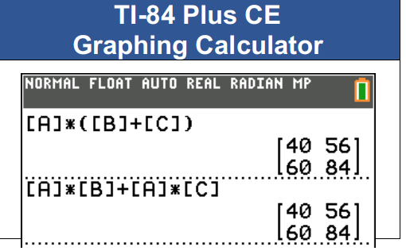

```
[A]*([B]+[C])
[40 56]
[60 84]

[A]*[B]+[A]*[C]
[40 56]
[60 84]
```

**RIGHT SIDE SENSOR** -- Python / NumPy:

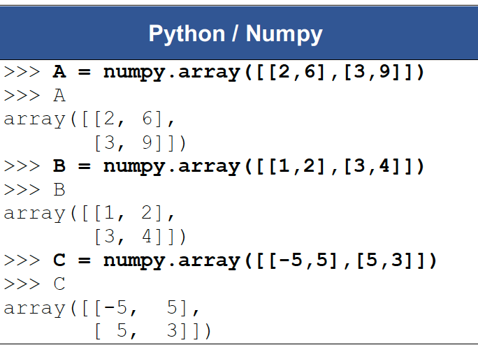

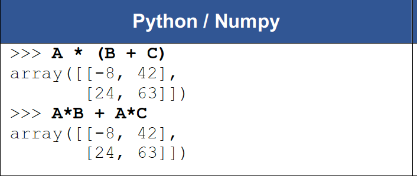

```
A = numpy.array([[2,6],[3,9]])
B = numpy.array([[1,2],[3,4]])
C = numpy.array([[-5,5],[5,3]])

A * (B + C)
array([[-8, 42],
       [24, 63]])

A*B + A*C
array([[-8, 42],
       [24, 63]])
```

**THIRD SENSOR** -- MATLAB code:

```matlab
A = [2 6; 3 9];
B = [1 2; 3 4];
C = [-5 5; 5 3];

% true matrix multiplication -- MATLAB's default *
A*(B+C)
A*B + A*C

% elementwise multiplication -- MATLAB's .*
A.*(B+C)
A.*B + A.*C
```

**My run:**

```
ans =

    40    56
    60    84


ans =

    40    56
    60    84


ans =

    -8    42
    24    63


ans =

    -8    42
    24    63
```

$\boxtimes$ Check (2) -- MATLAB sensor matches: LEFT (`*`, matrix mult) and RIGHT (`.*`, elementwise), one eq each.

> Plugging *same* A, B, C into MATLAB: `*` (true matrix mult) $\rightarrow$ `[40 56; 60 84]`, exactly the TI-84's number. `.*` (elementwise) $\rightarrow$ `[-8 42; 24 63]`, exactly NumPy's number (NumPy's `*` on arrays is elementwise by default, not `@`/matmul). So the "discrepancy" between LEFT and RIGHT isn't a sensor fault -- it's two different definitions of "multiply," same underlying data.

---

### (3) Altitude Vector D

```matlab
D = 0:1000:30000;
disp(D)
```

**My run** (31 elements, 0 to 30000 ft):

```
  Columns 1 through 13

      0    1000    2000    3000    4000    5000    6000    7000    8000    9000   10000   11000   12000

  Columns 14 through 26

  13000   14000   15000   16000   17000   18000   19000   20000   21000   22000   23000   24000   25000

  Columns 27 through 31

  26000   27000   28000   29000   30000
```

$\boxtimes$ Check (3)

---

### (4) falt Function File

Book code has an Octave-ism -- `endfunction` isn't valid MATLAB, swapped for `end`:

```matlab
function temptable = falt(tinitial,inc,tfinal)
	% FALT : function to convert temperature from altitude
	% call syntax:
	% temptable = falt(tinitial,inc,tfinal);
	%--------------------

	A = (tinitial:inc:tfinal)';   % column vector A
	F = 105 - (3.5*(A/1000));     % corresponding F
	temptable = [A F];            % 2-column matrix of A & F
end
```

```matlab
temptable = falt(0,1000,30000);
disp(round(temptable,1))
```

**My run** -- values were right but `disp()` printed this instead:

```
1.0e+04 *

    0    0.0105
    0.1000    0.0101
    0.2000    0.0098
    ...
    3.0000    0
```

> **`disp` uses one shared scale factor** `temptable` contains a large integer column (altitude, up to 30000) and a decimal column (F, e.g. 101.5). `disp()`/`format short` converts second column to match the first column (`101.5` down to `0.0101*1e4 = 101`) on screen
> **Fix:** print with `fprintf` so each column gets its own fixed format instead of a shared exponent:
> ```matlab
> temptable(:,2) = round(temptable(:,2),1);
> fprintf('%8.0f %8.1f\n', temptable.')
> ```

**Correctly formatted output** (first 5 and last 3 of 31 rows):

```
       0   105.0
    1000   101.5
    2000    98.0
    3000    94.5
    4000    91.0
     ...
   28000     7.0
   29000     3.5
   30000     0.0
```

$\boxtimes$ Check (4)

---

### (5) Stats on Fahrenheit Column

```matlab
Fcol = temptable(:,2);
Fmin = min(Fcol)
Fmax = max(Fcol)
Frange = range(Fcol)
Fmean = mean(Fcol)
Fmedian = median(Fcol)
```

**My run** (matches expected exactly):

```
Fmin =

     0


Fmax =

   105


Frange =

   105


Fmean =

   52.5000


Fmedian =

   52.5000
```

$\boxtimes$ Check (5)

---

### (6) Add Celsius Column

$^\circ C = (F-32) \cdot 5/9$

```matlab
Ccol = round((Fcol - 32) * 5/9, 2);
temptable = [temptable Ccol];
fprintf('%8.0f %8.1f %8.2f\n', temptable.')
```

> **Same `disp` behaviour** Switched to `fprintf` for the same reason.

**Corrected output** (first 6 rows):

```
       0   105.0   40.56
    1000   101.5   38.61
    2000    98.0   36.67
    3000    94.5   34.72
    4000    91.0   32.78
    5000    87.5   30.83
```

$\boxtimes$ Check (6)

---

### (7) Plot

```matlab
plot(D, Fcol, D, Ccol, 'LineWidth', 1.5)
title('Altitude vs Temperature', 'FontSize', 25)
xlabel('Altitude (feet)', 'FontAngle', 'italic', 'FontSize', 20)
ylabel('Temperature (degrees)', 'FontAngle', 'italic', 'FontSize', 20)
legend({'Fahrenheit','Celsius'}, 'FontAngle', 'italic', 'FontSize', 10, 'Box', 'off')
grid on;
```

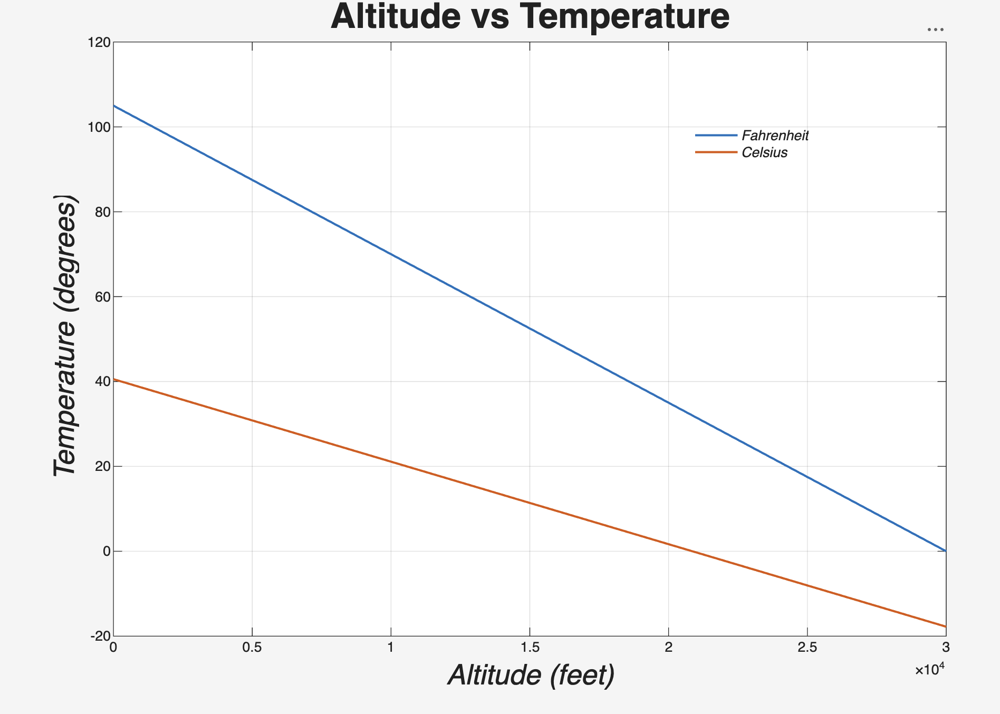

Both lines slope down left $\rightarrow$ right as expected: Fahrenheit 105 at 0 ft $\rightarrow$ 0 at 30,000 ft; Celsius ~40.6 at 0 ft $\rightarrow$ ~-17.8 at 30,000 ft.

$\boxtimes$ Check (7)

---

```matlab
diary off
```

